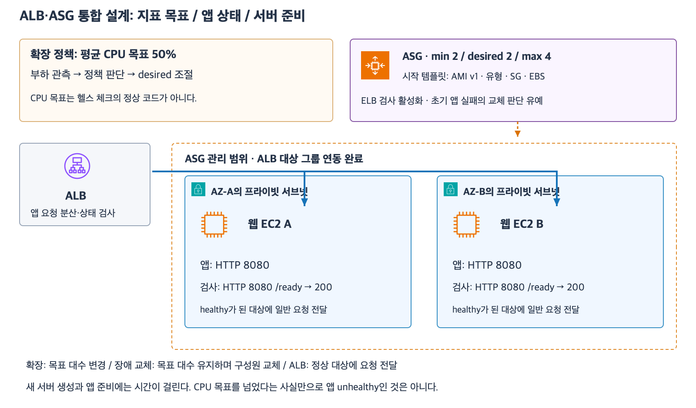

# 9주차 마지막 회상 복습

그림은 ALB와 ASG의 관계를 보여 주는 이전 수업의 참고 구성이다.
계산에는 아래 조건을 사용한다.

## 시나리오

예약 서비스는 두 AZ에 웹 EC2를 4대씩 운영한다.
EC2 한 대의 안정 처리 한도는 분당 700건이고 ASG 목표 추적 정책의 목표는 대당 분당 550건이다.
ALB는 정상 대상에 요청을 고르게 보낸다.
평소 요청은 분당 2,900건이다.
새 EC2는 시작 후 5분이 지나야 ALB 헬스 체크를 통과해 사용자 요청을 받는다.
장애 직후 용량은 ALB가 비정상 대상을 판정한 시점으로 계산한다.

## 회상 문제

**1-1.** AZ 하나가 멈췄다. 남은 웹 계층의 안정 처리량과 부족량은 각각 분당 몇 건인가?

**1-2.** 어느 AZ가 멈추더라도 분당 2,900건을 즉시 처리하려면 각 AZ에 정상 대상이 최소 몇 대씩 있어야 하고 균등 배치 기준 ASG 전체 최소 용량은 몇 대인가? 장애 직후 새 EC2를 시작하는 방식만으로 이 요구를 충족할 수 있는가?

**2-1.** 두 AZ가 정상이고 행사 중 분당 4,800건이 정상 대상 8대에 고르게 들어온다. 대당 실제 요청 수는 몇 건이고 정책 목표와 안정 처리 한도를 각각 충족하는가?

**2-2.** 이 웹 앱은 요청마다 처리 비용이 비슷하다. 대당 요청 수를 기준으로 목표 추적을 하려면 어떤 지표를 사용할 수 있는가?

**3-1.** 예약 가능 시간은 로그인 없이 볼 수 있다. 내 예약을 보려면 공유 저장소에서 기존 세션을 조회해야 한다. 앱은 모두 정상인데 공유 세션 저장소만 멈췄다. ALB의 검사와 별도 로그인 점검은 각각 무엇을 확인해야 예약 가능 시간을 계속 보여 주면서 세션 장애를 감지할 수 있는가?

**3-2.** ALB 헬스 체크에도 세션 조회를 넣어 등록 대상 전체가 비정상으로 판정됐다. 기본 설정의 ALB는 요청 전달을 어떻게 할 수 있는가? 요청이 대상에 전달됐다면 내 예약 조회도 성공한다고 볼 수 있는가?

## 회상 평가 · 2026-11-09

하위 문항 정답 5개, 부분 정답 1개.

- **1-1 부분 정답.** 부족량 분당 100건은 맞다. 남은 AZ의 정상 대상 4대가 대당 분당 700건을 처리하므로 전체 안정 처리량은 분당 2,800건이다.
- **1-2 정답.** AZ당 5대와 ASG 전체 최소 10대가 필요하다. 새 EC2가 요청을 받기까지 5분이 걸리므로 장애 직후 요구를 충족할 수 없다.
- **2-1·2-2 정답.** 대당 분당 600건은 목표 550건을 초과하고 안정 처리 한도 700건 이내다. 요청 수 기반 지표는 `ALBRequestCountPerTarget`이다.
- **3-1 정답.** ALB는 웹 앱의 준비 상태를 검사한다. 별도 로그인 점검은 테스트 세션을 조회하고 실패나 시간 초과를 알린다.
- **3-2 정답.** 모든 대상이 비정상으로 남은 상태에서 ALB는 fail-open으로 요청을 전달할 수 있다. 공유 세션 조회가 실패하므로 내 예약은 열 수 없다.

**1-1 보완.** 남은 웹 계층 전체의 안정 처리량을 계산식으로 다시 확인한다.

**1-1 보완 정답.** 남은 웹 EC2 4대의 전체 안정 처리량은 분당 2,800건이다. 9주차 종합 확인과 마지막 회상 복습을 모두 마쳤다.
