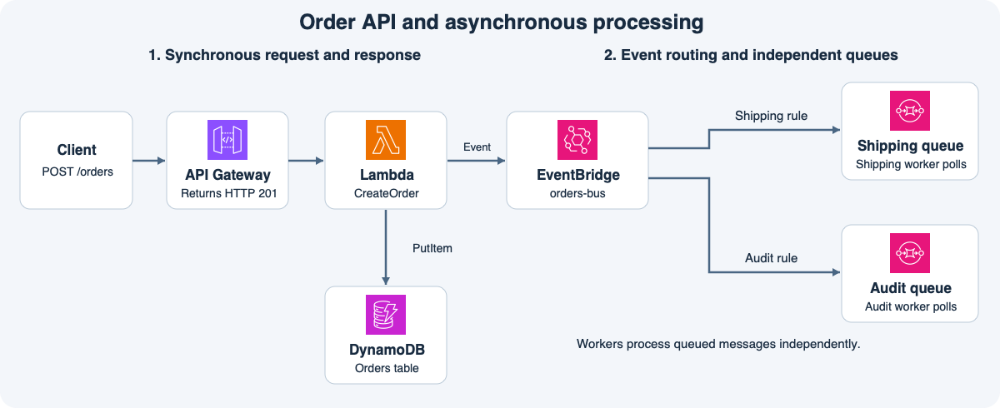

# 10주차 종합 확인 · 서버리스와 메시징

## 1. 주문 생성과 배송 준비가 끝나는 시점

고객이 `POST /orders`를 보내면 API Gateway가 `CreateOrder` Lambda를 동기로 호출한다.
  Lambda는 주문을 DynamoDB에 기록하고 `OrderCreated` 이벤트를 EventBridge의 `orders-bus`에 발행한다.
이 예제에서 Lambda는 주문 저장과 이벤트 발행이 모두 성공한 것을 확인한 후 HTTP 201에 해당하는 결과를 반환한다.
API Gateway는 그 결과를 기다려 고객에게 응답한다.
배송 워커는 나중에 큐에서 메시지를 꺼내 처리하므로 이 응답의 성공 조건에 배송 준비 완료는 포함되지 않는다.

API Gateway가 Lambda를 호출할 때와 Lambda가 DynamoDB에 저장할 때는 서로 다른 권한이 필요하다.
이 구성에서 앞쪽은 Lambda 함수의 리소스 기반 정책에서 해당 API의 호출을 허용한다.
뒤쪽은 Lambda 실행 역할에서 주문 테이블의 `dynamodb:PutItem`을 허용한다.
예를 들어 함수가 실행됐지만 `PutItem`에서 거부됐다면 함수 실행 역할부터 확인한다.

## 2. 한 이벤트에서 두 작업이 시작되는 이유

Classic 이벤트 버스는 이벤트를 수신하면 버스에 연결된 규칙을 각각 평가한다.
배송 규칙이 `OrderCreated`만 받고 감사 규칙이 `OrderCreated`와 `OrderCancelled`를 받는다면, 주문 생성 이벤트는 두 규칙에 모두 일치한다.
배송 큐와 감사 큐에는 각각 메시지가 들어가고, 각 워커는 자기 큐를 읽는다.
예를 들어 배송 워커가 배송 큐 메시지를 삭제해도 감사 큐의 메시지는 그대로 남는다.

모든 구독 팀에 같은 이벤트를 전달하는 예에서는 SNS 토픽에 발행하고 팀별 큐를 구독시키는 팬아웃도 배웠다.
같은 큐의 워커는 큐의 작업을 나눠 처리한다.
팀마다 같은 이벤트를 받아 독립적으로 처리하려면 각 팀에 별도 큐가 필요하다.

## 3. 작업은 완료됐지만 메시지를 삭제하지 못했다면

배송 워커가 메시지를 받으면 SQS는 가시성 제한 시간 동안 메시지를 숨긴다.
워커가 그 안에 메시지를 삭제하지 못하면 다른 워커가 다시 받을 수 있다.
다른 워커는 주문 번호로 공유 저장소에서 배송 준비 완료 상태를 확인한다.
이미 끝난 작업이면 다시 수행하지 않고 메시지만 삭제한다.
계속 수신되지만 삭제되지 않는 메시지는 원본 큐의 수신 한도를 넘기게 될 때 DLQ로 이동한다.
워커 코드가 원인이었다면 수정한 뒤 DLQ redrive를 시작해 원본 큐에서 다시 처리할 수 있다.

## 공식 문서 핵심 요약

- API Gateway는 설정된 Lambda를 호출하고 함수 실행 역할은 함수가 DynamoDB 같은 서비스에 접근할 때 사용하는 권한을 제공한다. [AWS API Gateway와 Lambda 실습](https://docs.aws.amazon.com/lambda/latest/dg/services-apigateway-tutorial.html)
- Classic 이벤트 버스는 이벤트를 규칙마다 비교한다. 일치하는 규칙이 여러 개면 각각의 대상으로 전달한다. [AWS 이벤트 버스](https://docs.aws.amazon.com/eventbridge/latest/userguide/eb-event-bus.html)
- SNS 토픽에 SQS 큐 여러 개를 구독시키면 메시지 하나가 구독 큐 각각에 전달된다. [AWS SNS와 SQS 팬아웃](https://docs.aws.amazon.com/sns/latest/dg/sns-sqs-as-subscriber.html)
- SQS는 원본 큐의 수신 한도에 따라 메시지를 DLQ로 옮길 수 있다. 원인을 해결한 뒤 redrive로 재처리할 수 있다. [AWS SQS DLQ](https://docs.aws.amazon.com/AWSSimpleQueueService/latest/SQSDeveloperGuide/sqs-dead-letter-queues.html)

## 확인 문제

그림의 배송 규칙은 `shop.orders`의 `OrderCreated`만 받고 감사 규칙은 같은 출처의 `OrderCreated`와 `OrderCancelled`를 받는다.
큐와 대상 권한은 정상이라고 가정한다.

**1-1.** 고객이 HTTP 201을 받았다. API Gateway가 기다린 결과는 무엇인가? 이 응답으로 배송 준비가 끝났다고 볼 수 있는가?

**1-2.** API Gateway 호출로 Lambda가 실행됐지만 `Orders` 테이블의 `PutItem`이 거부됐다. 어느 정책에 어떤 권한을 추가할까?

**2-1.** 주문 취소 이벤트와 주문 생성 이벤트가 하나씩 들어왔다. 각각 어느 큐로 전달되는가?

**2-2.** 배송 워커가 주문 생성 메시지를 삭제하는 동안 감사 워커가 멈췄다. 감사 워커가 메시지 보존 기간 안에 복구하면 같은 주문을 처리할 수 있는가? 이유는 무엇인가?

**3-1.** 배송 워커 A가 배송 준비를 마치고 완료 상태를 저장했지만 메시지 삭제 직전에 멈췄다. 가시성 제한 시간이 지난 뒤 워커 B가 같은 메시지를 받았다. 무엇을 확인하고 어떻게 처리할까?

**3-2.** 배송 메시지가 워커 버그로 반복 실패했고 수신 한도를 넘기게 됐다. 메시지는 어디로 이동하는가? 버그 수정 후 원본 큐에서 재처리하려면 무엇을 해야 하는가?

**4-1.** 별도 시스템에서 SNS로 모든 주문 이벤트를 배송팀과 감사팀에 각각 보내고 싶다. 토픽과 큐를 어떻게 연결할까? 두 팀이 큐 하나를 공유하면 어떤 차이가 생기는가?

## 종합 확인 평가 · 2026-11-10

하위 정답 5개, 부분 정답 2개.

- **1-1 정답.** API Gateway는 Lambda의 결과를 기다린다. 201 시점에 주문 저장과 이벤트 발행은 성공했지만 배송 준비가 완료됐는지는 알 수 없다.
- **1-2 부분 정답.** Orders 테이블의 `dynamodb:PutItem`을 Lambda 함수의 IAM 실행 역할에 연결된 권한 정책에서 허용한다.
- **2-1 정답.** 주문 생성은 배송 큐와 감사 큐에, 주문 취소는 감사 큐에만 전달된다.
- **2-2 정답.** 감사 큐 메시지는 배송 큐의 삭제와 독립적이다. 보존 기간 안에 복구한 감사 워커가 처리할 수 있다.
- **3-1 정답.** 주문 번호로 배송 준비 완료 상태를 확인하고, 완료됐다면 배송 준비를 건너뛰고 메시지만 삭제한다.
- **3-2 정답.** 수신 한도를 넘기게 되면 DLQ로 이동한다. 원인 수정 뒤 DLQ redrive를 시작해 원본 큐로 돌려보낸다.
- **4-1 부분 정답.** 배송 큐와 감사 큐를 같은 SNS 토픽에 각각 구독시키고 필터를 두지 않는다. 각 큐 정책에서 해당 토픽의 `sqs:SendMessage`를 허용한다. 한 Standard 큐를 공유하면 두 팀의 워커가 경쟁해서 메시지를 가져간다. 팀별 사본이나 도착 순서, 교대 처리를 보장하지 않는다.

**보완.** 1-2는 권한을 부여하는 IAM 역할을, 4-1은 두 팀이 모든 이벤트를 각각 받는 큐 구성을 설명한다.

**보완 2/2 정답.** 1-2는 Lambda 함수의 IAM 실행 역할에 Orders 테이블의 `dynamodb:PutItem` 권한을 부여한다. 4-1은 배송 큐와 감사 큐를 같은 SNS 토픽에 필터 없이 구독시킨다. 큐 하나를 공유하면 해당 메시지를 받은 워커가 작업을 맡는다.
