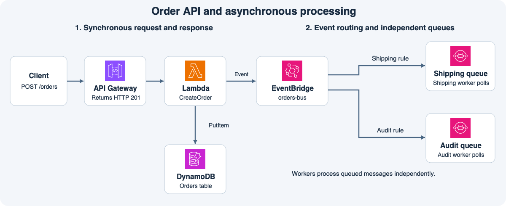

# 10주차 마지막 회상 복습 · 환불 요청과 후속 처리

그림은 지난 수업에서 직접 그린 주문 처리 구성이다.
왼쪽은 API가 요청을 받아 응답하는 구간이고 오른쪽은 이벤트를 큐에 전달해 워커가 나중에 처리하는 구간이다.
이번에는 같은 구조에 환불 업무를 넣어 본다.
그림의 배송 큐 자리에 환불 실행 큐를 두고 감사 큐 자리에는 고객 알림 큐를 둔다.

## 시나리오

고객이 `POST /refunds`를 보내면 API Gateway가 `RequestRefund` Lambda를 동기 호출한다.
함수는 DynamoDB의 `RefundRequests` 테이블에 접수 상태를 기록하고 Classic 이벤트 버스에 `RefundRequested`를 발행한다.
이 예에서는 저장과 발행이 성공하면 API Gateway가 HTTP 202로 응답한다.
이벤트 버스에서 환불 실행 큐와 고객 알림 큐로 전달된 메시지는 각 워커가 별도로 처리한다.

| 규칙 | source | detail-type | 대상 |
|---|---|---|---|
| 환불 실행 | `shop.refunds` | `RefundRequested` | 환불 실행 큐 |
| 고객 알림 | `shop.refunds` | `RefundRequested` 또는 `RefundCompleted` | 고객 알림 큐 |

## 회상 문제

**1-1.** 고객이 HTTP 202를 받았다. API Gateway는 무엇을 기다렸고 이 응답으로 무엇까지 완료됐다고 볼 수 있는가? 실제 환불도 완료됐는가?

**1-2.** API Gateway가 Lambda를 호출했고 함수도 실행됐지만 `RefundRequests` 테이블에 `PutItem`을 할 때 권한이 거부됐다. 어느 역할에 어떤 권한을 부여해야 하는가?

**2-1.** `shop.refunds`에서 `RefundRequested`와 `RefundCompleted`를 하나씩 발행했다. 각 이벤트는 어떤 큐로 가는가?

**2-2.** 별도 시스템에서 SNS로 같은 이벤트를 환불팀과 알림팀에 각각 보내려면 큐를 어떻게 구독시켜야 하는가? 환불 워커가 자기 큐에서 메시지를 삭제하면 알림 큐의 메시지도 삭제되는가?

**3-1.** 워커 A가 실제 환불을 마치고 환불 요청 ID별 완료 상태를 공유 저장소에 저장했다. 메시지 삭제 직전에 멈췄고 가시성 제한 시간이 지나 워커 B가 같은 메시지를 받았다. B는 어떤 값으로 무엇을 확인하고 어떻게 처리해야 하는가?

**3-2.** 다른 메시지는 워커 버그로 계속 실패해 원본 큐의 수신 한도를 넘기게 됐다. 어디로 이동하는가? 코드를 고친 후 원본 큐에서 다시 처리하려면 어떤 작업을 해야 하는가?

## 회상 평가 · 2026-11-10

하위 정답 5개, 부분 정답 1개.

- **1-1 정답.** API Gateway는 동기 호출한 Lambda의 결과를 기다린다. 이 예에서 202는 접수 상태 저장과 이벤트 발행 성공을 의미한다. 실제 환불 완료 여부는 202만으로 알 수 없다.
- **1-2 정답.** Lambda의 IAM 실행 역할에 RefundRequests 테이블의 `dynamodb:PutItem`을 허용한다.
- **2-1 정답.** RefundRequested는 환불 실행 큐와 고객 알림 큐에, RefundCompleted는 고객 알림 큐에만 전달된다.
- **2-2 정답.** 두 팀의 큐를 같은 SNS 토픽에 필터 없이 각각 구독시킨다. 한 큐의 삭제는 다른 큐에 영향을 주지 않는다.
- **3-1 부분 정답.** 환불 요청 ID로 공유 저장소의 완료 상태를 조회하고 이미 끝났다면 환불을 생략한다. 마지막으로 이번에 받은 SQS 메시지를 삭제한다.
- **3-2 정답.** 메시지는 DLQ로 이동한다. 원인을 고친 뒤 DLQ redrive로 원본 큐에 돌려보낸다.

**3-1 보완 정답.** 환불이 이미 끝났으면 워커 B는 재처리를 건너뛰고 이번에 받은 SQS 메시지를 삭제한다. 10주차 종합 확인과 마지막 회상 복습을 모두 마쳤다.
