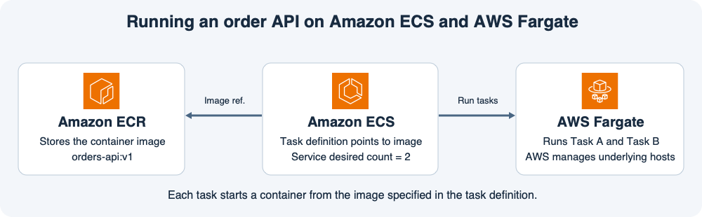

# 11주차 첫 수업 · 컨테이너와 ECS·Fargate 기초

## 1. 이미지와 컨테이너

EC2에서 주문 API를 배포할 때는 서버에 앱과 실행에 필요한 라이브러리를 설치했다.
컨테이너를 사용할 때는 앱 코드와 실행에 필요한 파일을 **컨테이너 이미지**로 묶어 둔다.
**컨테이너**는 그 이미지로 시작한 실행 환경이다.
같은 이미지로 컨테이너를 두 개 시작하면 주문 API가 두 곳에서 각각 실행된다.
**Amazon ECR**은 이미지를 저장하고 실행 환경에서 가져갈 수 있게 하는 레지스트리다.

## 2. ECS가 실행할 내용을 정한다

**태스크 정의(Task definition)**에는 사용할 이미지, CPU와 메모리, 포트 같은 실행 설정을 적는다.
예를 들어 ECR에 저장한 `orders-api:v1` 이미지로 주문 API 컨테이너 하나를 실행하도록 정의한다.
**태스크(Task)**는 그 정의를 실제로 실행한 단위다.
태스크 정의는 컨테이너를 하나 이상 지정할 수 있다. 이 예에서는 태스크마다 컨테이너 하나가 돈다.

**ECS 서비스**는 태스크의 목표 대수를 유지한다.
예를 들어 목표가 2대이면 같은 태스크 정의로 두 태스크가 실행된다.
그중 하나가 종료되면 ECS 서비스가 대체 태스크를 시작해 다시 2대로 맞춘다.
종료된 태스크의 메모리에만 있던 상태는 새 태스크로 복사되지 않는다.

## 3. Fargate는 태스크가 실행될 용량을 제공한다

ECS 태스크를 Fargate에서 실행하면 AWS가 태스크를 구동하는 호스트를 관리한다.
사용자는 앱 이미지와 태스크 설정을 관리한다.
ECS 서비스를 EC2 기반으로 실행할 수도 있다.
직접 운영하는 EC2 클러스터를 사용하는 경우에는 팀이 태스크를 수용할 인스턴스 용량을 관리한다.

ECR에 `orders-api:v2` 이미지를 별도 태그로 올리는 작업은 이미지를 등록하는 단계다.
v1을 가리키는 실행 설정은 그대로다.
서비스에 v2를 가리키는 태스크 정의 리비전을 적용해 배포하면 새 태스크가 v2를 실행한다.

## 공식 문서 핵심 요약

- 태스크 정의에 이미지와 실행 요구사항을 지정한다. 태스크는 정의를 실행한 단위이고 ECS 서비스는 지정한 수의 태스크를 유지한다. [AWS ECS 태스크 정의](https://docs.aws.amazon.com/AmazonECS/latest/developerguide/task_definitions.html)

## 확인 문제

주문 API의 태스크 정의는 ECR의 `orders-api:v1`을 가리킨다.
ECS 서비스는 Fargate에서 정상 태스크 2개를 운영한다.
각 태스크는 컨테이너 하나를 실행한다.

**1-1.** ECR에 있는 이미지와 Fargate 위에서 실행 중인 컨테이너는 각각 무엇인가?

**1-2.** 이미지와 CPU·메모리 요구사항은 어디에 적는가? 그 설정을 실제로 실행한 단위는 무엇인가?

**2-1.** 태스크 하나가 종료됐다. 어느 구성 요소가 대체 태스크를 시작해 2개를 유지하는가? 종료된 태스크의 RAM에만 있던 데이터도 이어받는가?

**2-2.** Fargate를 쓰면 실행 호스트와 앱 이미지·태스크 설정은 각각 누가 관리하는가?

**3-1.** ECR에 별도 태그로 `orders-api:v2`만 올렸고 서비스 설정은 그대로다. 기존 태스크의 버전이 바뀌는가? v2로 배포하려면 서비스에 무엇을 적용해야 하는가?

## 확인 문제 평가 · 2026-11-10

정답 2개, 부분 정답 3개.

- **1-1 부분 정답.** 둘 다 v1과 관련된다는 점은 맞다. ECR에는 `orders-api:v1` 태그로 이미지가 저장되어 있고, Fargate에서는 그 이미지로 시작한 컨테이너 안에서 주문 API가 실행 중이다.
- **1-2 정답.** 태스크 정의에 이미지와 CPU·메모리 요구사항을 적고 실행 단위를 태스크라고 한다.
- **2-1 정답.** ECS 서비스가 대체 태스크를 시작해 목표 수 2개를 유지한다. 기존 태스크의 RAM 데이터는 이어받지 않는다.
- **2-2 부분 정답.** AWS는 Fargate 실행 호스트를 관리한다. 앱 이미지와 태스크 정의의 설정은 사용자 팀이 관리한다.
- **3-1 부분 정답.** 별도 v2 이미지를 올려도 실행 중인 v1 태스크는 그대로다. v2를 가리키는 새 태스크 정의 리비전을 등록하고 ECS 서비스에 적용해 배포한다.

**보완 3/3 정답.** ECR에 이미지가 저장되고 ECS가 관리하는 태스크의 컨테이너에서 앱이 실행된다. AWS는 Fargate 실행 호스트를 관리하고 사용자는 앱 이미지와 태스크 설정을 관리한다. v2를 지정한 태스크 정의 리비전을 ECS 서비스에 적용해 배포한다.
