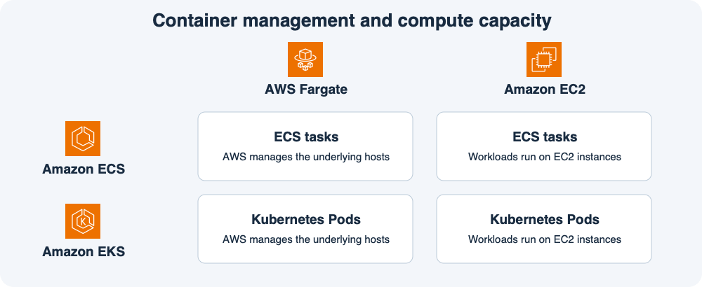

# 11주차 두 번째 수업 · ECS와 EKS 및 실행 용량 선택

## 1. 어떤 방식으로 컨테이너를 관리할까?

**오케스트레이션**은 컨테이너를 어디에 띄울지 정하고 원하는 개수가 유지되도록 관리하는 일이다.
주문 API를 3개 띄워 둔 상태에서 하나가 종료되면 대체 실행 단위를 시작해 목표 개수로 돌아오게 하는 것이 한 예다.

- **ECS**에서는 태스크 정의로 실행할 내용을 정하고 ECS 서비스로 태스크의 목표 개수를 유지한다.
- **EKS**에서는 Kubernetes API를 사용한다. **Pod**는 Kubernetes가 배치하는 실행 단위로 컨테이너를 하나 이상 담을 수 있다. 예를 들어 **Deployment**에 복제본 3개를 지정하면 Kubernetes가 Pod 3개를 유지한다.

이미 팀이 Kubernetes 배포 설정과 운영 도구를 사용한다면 EKS에서 그 방식을 이어갈 수 있다.
Kubernetes 요구사항 없이 AWS의 ECS 태스크와 서비스 모델을 쓰려면 ECS를 선택할 수 있다.

## 2. 컨테이너를 어디서 실행할까?

그림의 행은 관리 방식을, 열은 실행 용량을 나타낸다.
ECS 태스크와 EKS Pod 모두 호환되는 구성이라면 Fargate에서 실행할 수 있고 EC2에서도 실행할 수 있다.

**Fargate**에서는 AWS가 실행 호스트를 관리한다.
팀은 앱 이미지와 태스크 또는 Pod의 설정을 관리한다.
EKS에서는 Fargate 프로필로 어떤 Pod가 Fargate에서 실행될지 정한다.

**EC2 기반 실행**에서는 작업이 EC2 인스턴스에서 돈다.
직접 관리하는 노드를 선택하면 인스턴스 종류와 호스트 구성에 대한 제어권이 늘고 용량과 호스트 운영도 팀이 맡는다.
예를 들어 EKS에서 GPU가 필요한 Pod는 Fargate로 실행할 수 없으므로 적합한 GPU EC2 노드를 사용할 수 있다.

## 공식 문서 핵심 요약

- ECS는 Fargate 실행 용량과 자체 관리 EC2 실행 용량을 지원한다. 이 밖에 AWS가 관리하는 ECS Managed Instances도 있다. [AWS ECS 실행 용량 비교](https://docs.aws.amazon.com/AmazonECS/latest/developerguide/capacity-launch-type-comparison.html)
- EKS는 Fargate 프로필에 일치하는 Pod를 Fargate에 배치할 수 있다. Fargate는 호스트 운영을 줄여 주지만 GPU가 필요한 Pod는 지원하지 않는다. [AWS EKS의 Fargate 실행](https://docs.aws.amazon.com/eks/latest/userguide/fargate.html)

## 확인 문제

**1-1.** 주문 API 팀은 Kubernetes를 쓰지 않고 ECS 서비스로 주문 API 3개를 유지하고 싶다. EC2 호스트를 직접 관리할 필요도 없게 하려면 어떤 조합을 선택할까? 이때 ECS 서비스와 실행 용량은 각각 무엇을 담당할까?

**1-2.** 다른 팀은 기존 Kubernetes Deployment를 그대로 써야 한다. 앱은 Fargate 호환이고 GPU가 필요 없다. Kubernetes 방식을 유지하면서 실행 호스트 관리를 AWS에 맡기려면 어떤 조합을 선택할까?

**2-1.** 위 Kubernetes 팀에 GPU가 필요한 작업이 생겼다. 컨테이너 관리 방식은 유지하면서 어떤 실행 용량을 선택할 수 있을까?

**2-2.** 주문 API를 ECS에서 그대로 관리하면서 Fargate 대신 직접 관리하는 EC2 용량에서 실행하기로 했다. 실행 단위가 Kubernetes Pod로 바뀌는가? 호스트 관리 주체는 어떻게 바뀌는가?

## 확인 문제 평가 · 2026-11-10

하위 4/4 정답.

- **1-1.** ECS 서비스와 Fargate를 조합한다. ECS 서비스는 목표 태스크 수 3개를 유지하고 Fargate는 실행 용량을 제공한다.
- **1-2.** EKS와 Fargate를 조합한다. 기존 Kubernetes Deployment를 사용하고 호환되는 Pod를 Fargate에서 실행한다.
- **2-1.** EKS를 유지하고 GPU가 장착된 EC2 노드에 해당 Pod를 배치한다.
- **2-2.** 실행 단위는 ECS 태스크로 유지된다. 직접 관리하는 EC2 호스트는 고객 팀이 관리한다.
