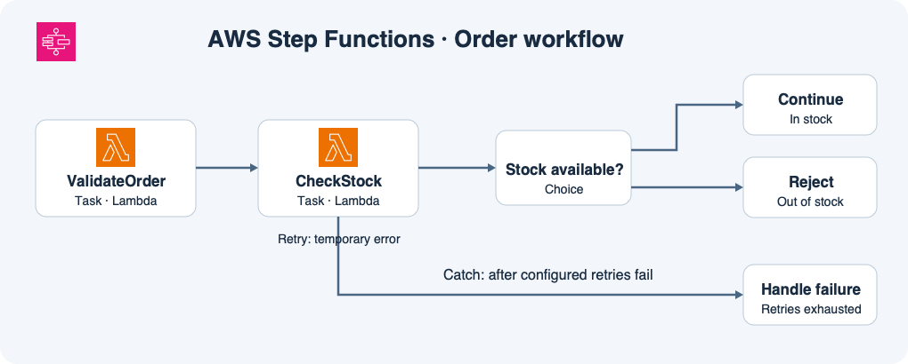

# 11주차 세 번째 수업 · Step Functions와 워크플로 기초

## 1. 실행 순서와 작업 코드

주문을 처리하려면 입력을 검증한 뒤 재고를 확인해야 한다.
**워크플로**는 작업의 순서와 결과별로 다음에 할 일을 정의한 흐름이다.
Step Functions에서는 이 정의를 **상태 머신**이라고 부르고, 주문 한 건을 처리하기 위해 상태 머신을 한 번 시작한 것을 **실행**이라고 부른다.

그림의 `ValidateOrder`와 `CheckStock`은 **Task 상태**다.
Task 상태는 Lambda 호출처럼 실제 작업을 요청한다.
주문 검증과 재고 조회 코드는 각각의 Lambda 함수에 있다.
Step Functions는 어떤 함수를 언제 호출하고 그 결과에 따라 어느 상태로 갈지 관리한다.

## 2. 정상 결과와 오류를 분리하기

재고 조회가 정상적으로 끝나면 `inStock` 값을 반환한다.
**Choice 상태**는 이 값을 읽어 다음 경로를 고른다.
`true`면 주문 처리를 계속하고 `false`면 재고 부족으로 주문을 거절한다.
재고가 없다는 응답도 조회 자체는 성공한 결과다.

재고 시스템이 일시적으로 응답하지 않아 `CheckStock`이 `StockServiceTimeout` 오류를 내면 이 Task의 **Retry**가 같은 작업을 다시 시도한다.
예제에서는 최초 시도 이후 이 오류에 대해 최대 두 번 더 시도한다.
그래도 같은 오류가 계속되면 이 Task의 **Catch**가 실패 처리 상태로 넘긴다.
Catch가 오류를 처리하는 경로로 보내는 것과 전체 실행이 최종적으로 성공 또는 실패로 끝나는 것은 별개의 결정이다.
이 예에서는 실패 처리 상태가 운영 기록을 남기고 워크플로를 실패로 끝내도록 설정했다고 가정한다.

## 공식 문서 핵심 요약

- 실패한 상태에 오류별 Retry를 설정할 수 있다. 일치하는 재시도가 끝나도 오류가 남으면 Catch로 지정한 상태에 넘길 수 있다. [AWS Step Functions 오류 처리](https://docs.aws.amazon.com/step-functions/latest/dg/concepts-error-handling.html)

## 확인 문제

**1-1.** 주문 수량을 검증하는 코드는 어디서 실행하고, 검증 다음에 재고 확인을 실행하도록 순서를 관리하는 서비스는 무엇인가?

**1-2.** 재고 조회는 성공했지만 `inStock=false`를 반환했다. 어느 상태에서 어떤 경로를 고르는가? Timeout Retry가 실행되는가?

**2-1.** `CheckStock`이 첫 시도에서 `StockServiceTimeout`을 내고 첫 재시도에서 `inStock=true`를 반환했다. 어느 작업이 재시도되며 그 뒤 어느 경로로 가는가?

**2-2.** 최초 시도와 두 번의 재시도가 모두 `StockServiceTimeout`으로 끝났다. 총 몇 번 호출했고 무엇이 실패 처리 상태로 넘기는가?

## 확인 문제 평가 · 2026-11-11

정답 2개, 부분 정답 2개.

- **1-1 부분 정답.** 주문 수량 검증 코드는 Lambda에서 실행한다. 작업 순서를 관리하는 서비스는 AWS Step Functions다. 워크플로는 이 서비스가 실행하는 작업 흐름이다.
- **1-2 부분 정답.** Choice에서 경로를 고르고 조회가 성공했으므로 타임아웃 Retry는 실행하지 않는다. `inStock=false`이면 재고 부족으로 주문을 거절하는 Reject 경로를 고른다.
- **2-1 정답.** CheckStock만 재시도한다. 성공한 결과가 `inStock=true`이면 Choice가 Continue로 보낸다.
- **2-2 정답.** 최초 1번과 재시도 2번으로 총 3번 호출한다. Catch가 실패 처리 상태로 넘긴다.

**보완 2/2 정답.** 1-1에서 작업 순서를 관리하는 서비스는 AWS Step Functions다. 1-2에서 CheckStock(Task)이 `inStock=false`를 반환하면 Stock available?(Choice)가 Reject 경로를 고른다.
