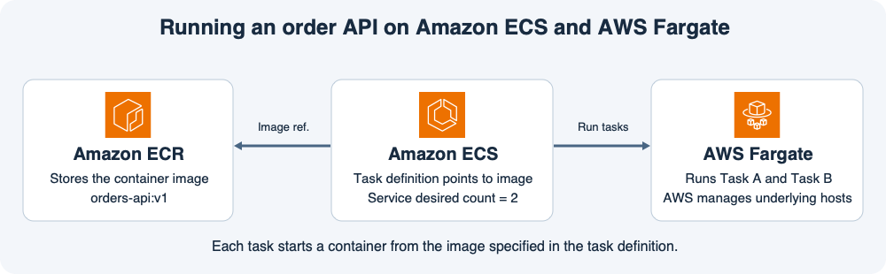
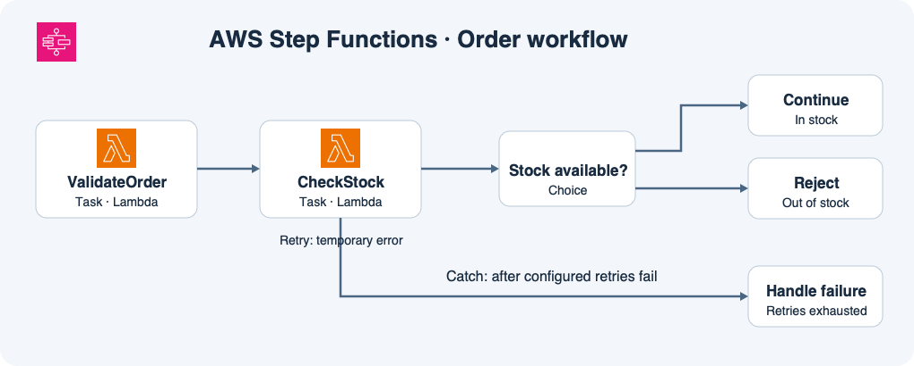

# 11주차 종합 확인 · 컨테이너와 워크플로

## 시나리오

쇼핑몰의 주문 API는 ECR의 `orders-api:v1`을 가리키는 태스크 정의로 실행된다.
ECS 서비스는 Fargate에서 태스크 2개를 유지한다.
한 태스크에는 주문 API 컨테이너 하나가 있다.
배포팀은 ECR에 `orders-api:v2`라는 새 태그를 올렸다.
아직 ECS 서비스 설정은 변경하지 않았다.

한편 주문이 접수되면 별도의 Step Functions 실행이 시작된다.
Step Functions는 검증 Lambda를 호출한 뒤 재고 확인 Lambda를 호출한다.
재고 확인이 정상적으로 끝나면 `inStock` 값에 따라 Continue 또는 Reject로 간다.
재고 시스템에서 `StockServiceTimeout`이 발생하면 `CheckStock` 상태는 최대 2번 더 재시도한다.
재시도 뒤에도 오류가 계속되면 실패 처리 상태로 이동하도록 설정돼 있다.

## 개념 복습

ECR의 이미지는 실행에 필요한 파일을 보관한다.
ECS의 태스크 정의는 어떤 이미지를 어떤 CPU·메모리 설정으로 실행할지 지정한다.
ECS 서비스는 그 정의를 바탕으로 목표 태스크 수를 유지하고, Fargate는 태스크를 실행할 컴퓨팅 용량을 제공한다.

ECS와 EKS는 컨테이너를 관리하는 방식을 정하는 선택이다.
Fargate와 EC2는 실행 용량 선택이다.
예를 들어 Kubernetes의 Deployment를 그대로 써야 하는 팀은 EKS를 사용한다.
그중 Fargate와 호환되는 Pod는 Fargate에서 실행할 수 있고, GPU가 필요한 Pod는 GPU가 장착된 EC2 노드를 사용할 수 있다.

Step Functions는 작업 순서와 분기를 관리한다.
Lambda 코드는 검증이나 재고 조회 같은 실제 작업을 수행한다.
정상 결과는 Choice가 평가하고 예외는 해당 Task의 Retry와 Catch가 처리한다.

## 확인 문제

**1-1.** 주문 API 태스크 하나가 종료됐다. 누가 대체 태스크를 시작하며 대체 태스크는 v1과 v2 중 어느 이미지를 실행하는가? 종료된 태스크의 RAM에만 있던 값도 이어받는가?

**1-2.** 주문 API를 v2로 배포하려면 ECR에 이미지를 올린 뒤 태스크 정의와 ECS 서비스에서 각각 무엇을 해야 하는가?

**2-1.** 다른 팀은 기존 Kubernetes Deployment를 유지해야 하고 실행 호스트를 직접 관리하고 싶지 않다. 이 앱이 Fargate와 호환된다면 어떤 조합이 맞고 실행 단위는 무엇인가?

**2-2.** 그 팀의 일부 작업에 GPU가 필요해졌다. 컨테이너 관리 방식을 유지하면서 어떤 실행 용량을 사용해야 하는가?

**3-1.** 주문 수량을 검증하는 코드가 실행되는 서비스와 검증 후 재고를 확인하도록 순서를 관리하는 서비스는 각각 무엇인가?

**3-2.** 재고 조회는 성공했지만 `inStock=false`가 나왔다. 어느 상태가 어떤 경로를 선택하는가? 이 상황에서 Timeout Retry가 실행되는가?

**4-1.** `CheckStock`의 최초 시도부터 계속 `StockServiceTimeout`이 발생했다. 어떤 작업을 총 몇 번 호출하고 무엇이 실패 처리 상태로 넘기는가?

## 종합 확인 평가 · 2026-11-11

하위 정답 5개, 부분 정답 2개.

- **1-1 부분 정답.** ECS 서비스가 v1으로 대체 태스크를 시작한다. 종료된 태스크의 RAM에만 있던 값은 새 태스크가 이어받지 못한다.
- **1-2 정답.** v2 이미지를 가리키는 새 태스크 정의 리비전을 등록하고 ECS 서비스에 적용해 배포한다.
- **2-1 정답.** EKS와 Fargate를 사용하며 실행 단위는 Pod다.
- **2-2 정답.** EKS를 유지하고 GPU가 장착된 EC2 노드에 해당 Pod를 배치한다.
- **3-1 부분 정답.** Step Functions가 순서를 관리한다. ValidateOrder는 Task 상태의 이름이고 검증 코드는 이 상태가 호출한 Lambda 함수에서 실행된다.
- **3-2 정답.** Stock available?(Choice)가 Reject를 선택한다. 재고 조회는 성공했으므로 타임아웃 Retry가 실행되지 않는다.
- **4-1 정답.** CheckStock을 최초 1번과 재시도 2번으로 총 3번 호출한다. Catch가 실패 처리 상태로 넘긴다.

**보완 2/2 정답.** 1-1에서 종료된 태스크의 RAM에만 있던 데이터는 사라진다. 3-1에서 주문 수량을 검증하는 코드는 Lambda 함수에서 실행된다.
