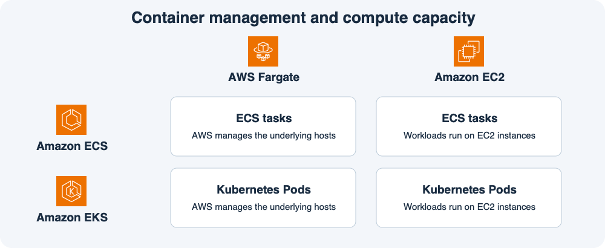
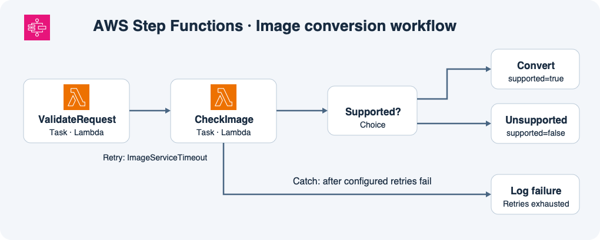

# 11주차 마지막 회상 복습 · 이미지 변환 서비스

그림의 행은 컨테이너 관리 방식이고 열은 실행 용량이다.
이번에는 주문 API 대신 이미지 변환 서비스를 운영한다고 가정한다.

## 시나리오

팀 A는 ECS 서비스로 이미지 변환 API 태스크 2개를 Fargate에서 실행한다.
현재 서비스에 적용된 태스크 정의는 ECR의 `image-api:v1`을 가리킨다.
팀은 `image-api:v2`를 별도 태그로 올렸지만 ECS 서비스에는 아직 변경을 적용하지 않았다.

팀 B는 기존 Kubernetes Deployment로 변환 워커를 운영한다.
대부분의 워커는 Fargate와 호환되지만 일부 고해상도 이미지 변환에는 GPU가 필요하다.

## 변환 요청 처리 흐름

워크플로의 `ValidateRequest`와 `CheckImage`는 각각 Lambda를 호출한다.
`CheckImage`가 정상적으로 `supported=true`를 반환하면 Choice가 변환 경로를 고른다.
`supported=false`를 반환하면 지원하지 않는 형식으로 분류한다.
`CheckImage`가 `ImageServiceTimeout` 오류를 내면 최초 시도 이후 최대 두 번 더 재시도한다.
오류가 계속되면 실패 기록 상태로 이동하도록 설정돼 있다.

## 회상 문제

**1-1.** 태스크 하나가 종료됐다. 무엇이 대체 태스크를 시작하고 새 태스크는 어느 버전으로 실행되는가? 종료된 태스크의 RAM에만 있던 값은 어떻게 되는가?

**1-2.** 팀 A가 v2를 배포하려면 태스크 정의와 ECS 서비스에서 각각 무엇을 해야 하는가?

**2-1.** 팀 B가 기존 Deployment를 유지하면서 호환되는 워커의 실행 호스트 관리를 AWS에 맡기려 한다. 어떤 서비스와 실행 용량을 조합하고 실행 단위는 무엇인가?

**2-2.** 팀 B가 GPU가 필요한 워커를 배치하려면 어떤 실행 용량을 사용해야 하는가?

**3-1.** 요청 검증 코드를 실행하는 서비스와 전체 작업 순서를 관리하는 서비스는 각각 무엇인가? `CheckImage`가 정상적으로 `supported=false`를 반환하면 어느 상태가 어떤 경로를 선택하는가? 타임아웃 Retry도 실행되는가?

**3-2.** `CheckImage`의 최초 시도와 모든 재시도가 `ImageServiceTimeout`으로 끝났다. 어느 작업을 총 몇 번 실행하고, 무엇이 실패 기록 상태로 넘기는가?

## 회상 평가 · 2026-11-11

하위 정답 5개, 부분 정답 1개.

- **1-1 정답.** ECS 서비스가 v1으로 대체 태스크를 시작한다. 종료된 태스크의 RAM에만 있던 값은 사라진다.
- **1-2 정답.** v2를 가리키는 태스크 정의 리비전을 등록하고 ECS 서비스에 적용해 배포한다.
- **2-1·2-2 정답.** EKS에서 호환되는 Pod는 Fargate에서 실행하고 GPU가 필요한 Pod는 GPU가 장착된 EC2 노드에 배치한다.
- **3-1 부분 정답.** Lambda가 검증 코드를 실행하고 Step Functions가 작업 순서를 관리한다. `supported=false`이면 Choice 상태가 지원하지 않는 형식으로 분류하는 경로를 선택한다. 정상 반환이므로 타임아웃 Retry는 실행되지 않는다.
- **3-2 정답.** CheckImage를 최초 1회와 재시도 2회로 총 3회 실행한다. Catch가 실패 기록 상태로 넘긴다.

**회상 복습 완료.** 3-1의 경로 판단과 앞선 종합 확인의 Choice 답변을 함께 반영했다. 이미지 변환 흐름도에서 Choice 분기와 Retry·Catch 경로를 확인할 수 있다.
