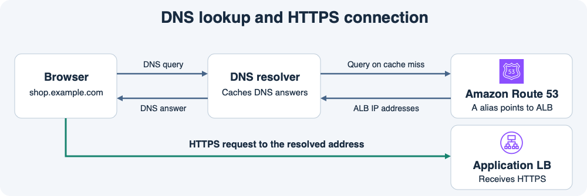

# 12주차 첫 수업 · Route 53과 DNS

## 1. 이름을 찾고 서버에 연결하기

브라우저가 `https://shop.example.com/orders`에 접속하려면 먼저 도메인에 대응하는 주소를 알아야 한다.
DNS 조회는 `shop.example.com`이라는 이름을 대상으로 한다.
`/orders`는 주소를 알아낸 뒤 브라우저가 보내는 HTTP 요청의 경로다.

브라우저가 사용하는 DNS 리졸버에 유효한 답이 있으면 리졸버는 캐시에서 응답한다.
답이 없다면 리졸버는 DNS 위임을 따라 해당 도메인의 권한 있는 DNS 서버에 답을 묻는다.
Route 53을 도메인의 권한 있는 DNS로 설정했다면 **퍼블릭 호스팅 영역**에 들어 있는 레코드를 기준으로 응답한다.
브라우저는 받은 주소로 ALB에 HTTPS 연결을 시작한다.
ALB가 HTTPS 요청을 받고 리스너 규칙에 따라 앱으로 전달한다.

## 2. ALB 주소를 연결하는 Alias

기존 ALB에 `shop.example.com`을 연결하려면 Route 53에서 그 ALB를 대상으로 하는 **A 유형 Alias 레코드**를 만들 수 있다.
Route 53은 ALB의 현재 IPv4 주소를 DNS 답으로 돌려준다.
운영자가 ALB의 IP를 하나 골라 일반 A 레코드에 고정할 필요가 없다.
Alias는 ALB 같은 지원 대상에 도메인 루트인 `example.com`도 연결할 수 있다.
같은 루트에 CNAME을 만드는 것은 DNS에서 허용되지 않는다.

## 3. DNS 변경이 보이는 시점

DNS 응답에는 캐시가 답을 재사용할 수 있는 기간인 **TTL**이 있다.
리졸버에 아직 유효한 이전 답이 있다면 레코드를 바꾼 뒤에도 그 리졸버를 쓰는 사용자는 일정 시간 이전 주소를 받을 수 있다.

## 공식 문서 핵심 요약

- Route 53에서는 ELB를 가리키는 Alias를 루트 도메인이나 하위 도메인에 설정할 수 있다. [AWS Route 53에서 ELB 연결하기](https://docs.aws.amazon.com/Route53/latest/DeveloperGuide/routing-to-elb-load-balancer.html)

## 확인 문제

**1-1.** 사용자가 `https://shop.example.com/orders`를 열었다. DNS 조회에 사용하는 이름은 무엇이고 `/orders` 경로는 어느 단계에 사용되는가?

**1-2.** 이 구성에서 Route 53이 담당하는 단계와 ALB가 담당하는 단계는 각각 무엇인가?

**2-1.** 루트 도메인 `example.com`을 기존 ALB로 연결하려 한다. A 유형 Alias와 CNAME 중 무엇을 선택하고 레코드 대상에는 무엇을 지정하는가?

**2-2.** DNS 레코드를 새 ALB로 변경했다. 사용자의 리졸버에 이전 응답의 TTL이 남아 있다면 사용자가 잠시 이전 ALB 주소를 받을 수 있는가? 이유는 무엇인가?

## 확인 문제 평가 · 2026-11-11

정답 2개, 부분 정답 2개.

- **1-1 정답.** DNS로 `shop.example.com`을 조회하고 ALB에 HTTP 요청을 보낼 때 `/orders` 경로를 사용한다.
- **1-2 부분 정답.** Route 53은 리졸버의 DNS 질의에 ALB 주소로 응답한다. ALB는 브라우저의 HTTPS 요청을 받고 리스너 규칙에 따라 대상 그룹으로 전달한다.
- **2-1 부분 정답.** 루트 도메인에는 A 유형 Alias를 사용하고 기존 ALB를 Alias 대상으로 지정한다.
- **2-2 정답.** 이전 응답의 TTL이 남으면 리졸버가 캐시된 이전 ALB 주소를 반환할 수 있다.

**보완 2/2 정답.** ALB는 브라우저의 HTTPS 요청을 받아 리스너 규칙에 따라 대상 그룹으로 전달한다. A 유형 Alias의 대상은 기존 ALB다.
