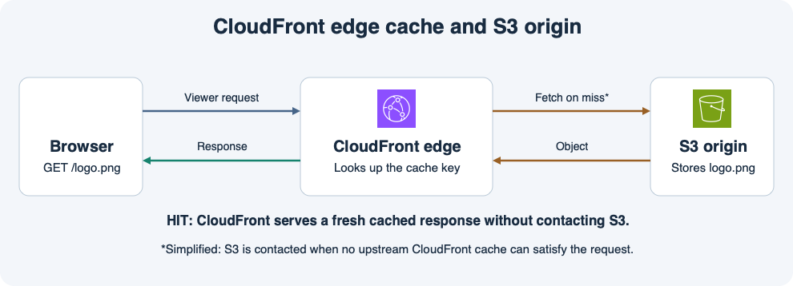

# 12주차 두 번째 수업 · CloudFront와 엣지 캐시

## 1. 콘텐츠가 어디서 오는가

**원본(origin)**은 콘텐츠를 가져오는 곳이다. 이 예에서는 S3가 `/logo.png`를 저장한다.
**엣지 위치**는 CloudFront가 사용자 요청을 받아 처리하는 지점이다.
CloudFront가 캐시에서 바로 응답할 수 있으면 원본까지 요청이 갈 때보다 지연과 원본 부하를 줄일 수 있다.

브라우저가 `/logo.png`를 요청하면 CloudFront는 **캐시 키**에 해당하는 유효한 응답을 찾는다.
유효한 응답이 있으면 **캐시 히트(hit)**이고 그 응답을 사용한다.
없으면 **캐시 미스(miss)**다. 다른 CloudFront 캐시 계층에서도 응답을 찾지 못하면 S3에서 객체를 가져온다.
가져온 응답이 캐시 가능하면 CloudFront가 저장하고 같은 캐시 키의 후속 요청에 재사용한다.

## 2. TTL과 캐시 키

**TTL**은 캐시 응답을 새로 확인하지 않고 재사용할 수 있는 시간을 정한다.
예를 들어 `/logo.png`의 캐시가 아직 유효하면 S3의 같은 키를 새 이미지로 덮어써도 CloudFront가 이전 이미지를 응답할 수 있다.
이전 수업의 DNS TTL은 주소 조회 결과에 적용됐다. 여기서 TTL은 이미지 같은 HTTP 응답에 적용된다.

캐시 키에는 URL 경로가 들어가고, 정책에 따라 일부 쿼리 문자열·헤더·쿠키를 포함할 수 있다.
예를 들어 `lang`을 키에 포함하면 `/banner.png?lang=ko`와 `/banner.png?lang=en`을 서로 다른 응답으로 저장한다.
원본이 언어별로 다른 배너를 주는데 `lang`을 키에서 빼면 두 요청에 같은 캐시 응답이 재사용될 수 있다.

## 공식 문서 핵심 요약

- CloudFront는 캐시 키가 일치하고 유효한 응답이 있을 때 캐시 히트로 처리한다. 정책으로 쿼리 문자열·헤더·쿠키 중 무엇을 캐시 키에 넣을지 정할 수 있다. [AWS CloudFront 캐시 키 문서](https://docs.aws.amazon.com/AmazonCloudFront/latest/DeveloperGuide/understanding-the-cache-key.html)

## 확인 문제

**1-1.** `/logo.png` 요청을 받았는데 어느 CloudFront 캐시에도 객체가 없다. 어디에서 객체를 가져오고 캐시 가능한 응답이면 무엇을 하는가?

**1-2.** 두 번째 요청의 캐시 키가 같고 같은 엣지에 유효한 응답이 남아 있다. 히트와 미스 중 무엇이며 S3에 요청을 보낼까?

**2-1.** S3의 `/logo.png`를 새 이미지로 덮어썼다. CloudFront에 이전 응답이 아직 유효하다면 사용자가 어떤 이미지를 받을 수 있고 이유는 무엇인가?

**2-2.** 원본은 `/banner.png?lang=ko`와 `/banner.png?lang=en`에 서로 다른 이미지를 준다. 각 언어 응답을 구분해 캐시하려면 캐시 키에 무엇을 넣을까?

## 확인 문제 평가 · 2026-11-11

정답 2개, 부분 정답 2개.

- **1-1 부분 정답.** CloudFront는 캐시 미스로 S3에서 객체를 가져온다. 응답이 캐시 가능하면 캐시에 저장하고 브라우저에 응답한다.
- **1-2 정답.** 같은 캐시 키에 유효한 응답이 남아 있으므로 히트다. S3에 요청하지 않는다.
- **2-1 정답.** 같은 캐시 키의 이전 응답이 아직 유효하므로 이전 이미지를 반환할 수 있다.
- **2-2 부분 정답.** URL의 쿼리 파라미터를 이용한다는 방향은 맞다. CloudFront 캐시 정책에서 `lang`을 캐시 키에 포함해야 `ko`와 `en` 응답이 따로 저장된다.

**보완 2/2 정답.** 캐시 미스로 S3에서 받은 응답이 캐시 가능하면 CloudFront에 저장하고 브라우저에 응답한다. 언어별 응답을 구분하려면 캐시 키에 `lang` 쿼리 파라미터를 포함한다.
