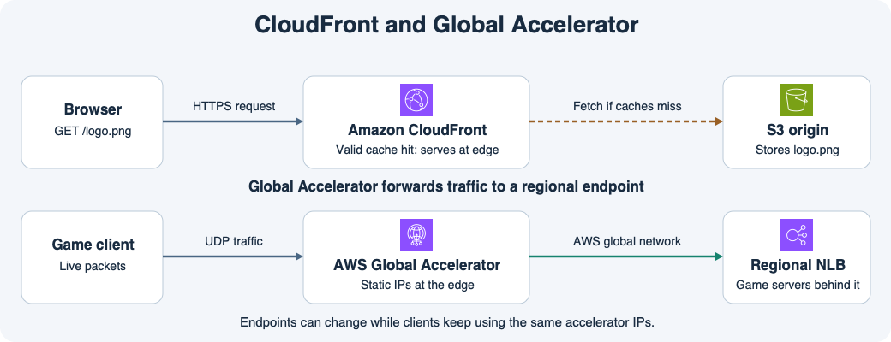

# 12주차 세 번째 수업 · Global Accelerator와 CloudFront

## 1. 같은 파일을 여러 사용자가 읽을 때

웹사이트 로고가 S3에 있고 여러 나라의 사용자가 HTTPS로 같은 로고를 요청한다고 하자.
CloudFront는 사용자 요청을 엣지에서 받고, 같은 캐시 키의 유효한 응답이 있으면 엣지에서 바로 반환한다.
캐시 계층 어디에도 응답이 없으면 원본에서 파일을 가져온다.
그림의 위쪽 점선은 원본 조회가 필요한 경우다.
히트가 많을수록 원본 요청이 줄어든다.

## 2. 서버가 실시간으로 처리할 패킷을 보낼 때

여러 나라의 게임 클라이언트가 리전의 게임 서버에 UDP 패킷을 보낸다고 하자.
클라이언트는 Global Accelerator가 제공하는 정적 IP에 연결한다.
트래픽은 가까운 AWS 엣지에서 AWS 글로벌 네트워크로 들어간 뒤 리전의 엔드포인트로 전달된다.
그림에서는 리전의 Network Load Balancer가 엔드포인트이고 게임 서버는 그 뒤에 있다.
게임 패킷은 리전까지 전달되며 Global Accelerator가 캐시한 응답을 반환하지 않는다.

표준 Global Accelerator의 리스너는 TCP 또는 UDP를 받는다.
여러 리전에 엔드포인트를 구성하면 위치, 상태, 가중치 등을 고려해 트래픽을 보낸다.
다른 리전에 정상 엔드포인트가 남아 있다면 장애가 난 리전 대신 해당 엔드포인트로 새 트래픽을 전달할 수 있다.
클라이언트가 접속하는 Accelerator IP는 그대로 유지된다.
애플리케이션 데이터나 게임 세션 복제는 별도로 설계해야 한다.

## 3. 요구사항으로 선택하기

| 요구사항 | 선택 | 개선하는 부분 |
|---|---|---|
| 여러 사용자가 읽는 HTTPS 정적 파일의 응답 시간과 원본 부하를 줄인다 | CloudFront | 유효한 캐시 응답을 엣지에서 반환 |
| UDP 게임 서버에 고정된 공개 진입점이 필요하고 리전까지의 경로를 개선한다 | Global Accelerator | 정적 IP로 받아 AWS 글로벌 네트워크를 통해 엔드포인트로 전달 |

## 공식 문서 핵심 요약

- CloudFront는 캐시 키가 일치하고 엣지에 유효한 응답이 있을 때 그 응답을 반환한다. 캐시 히트는 원본 부하와 사용자 지연을 줄인다. [AWS CloudFront 캐시 키 문서](https://docs.aws.amazon.com/AmazonCloudFront/latest/DeveloperGuide/understanding-the-cache-key.html)
- Global Accelerator는 정적 IP를 진입점으로 제공한다. 표준 Accelerator는 위치와 엔드포인트 상태 등을 고려해 AWS 글로벌 네트워크로 리전 엔드포인트에 트래픽을 전달한다. [AWS Global Accelerator 동작 방식](https://docs.aws.amazon.com/global-accelerator/latest/dg/introduction-how-it-works.html)

## 확인 문제

**1-1.** 세계 여러 지역에서 동일한 S3 로고를 HTTPS로 읽는다. 원본 요청 수를 줄이려면 어떤 서비스를 선택하고 캐시 히트 때 누가 응답하는가?

**1-2.** 글로벌 게임 서비스는 UDP를 사용하고 클라이언트에 고정 IP를 제공해야 한다. 어떤 서비스를 고르고, 가까운 AWS 엣지에 도착한 패킷은 어디로 전달되는가?

**2-1.** 표준 Global Accelerator에서 리전 A와 B에 엔드포인트를 등록했다. A가 비정상이고 B가 정상이라면 새 연결은 어느 쪽으로 갈 수 있는가? 클라이언트가 B의 IP로 접속 주소를 바꿔야 하는가?

**2-2.** 장애 전에 A의 게임 서버 RAM에만 있던 사용자 세션은 B에 새 연결을 시작하면 그대로 이어지는가? 이유는 무엇인가?
