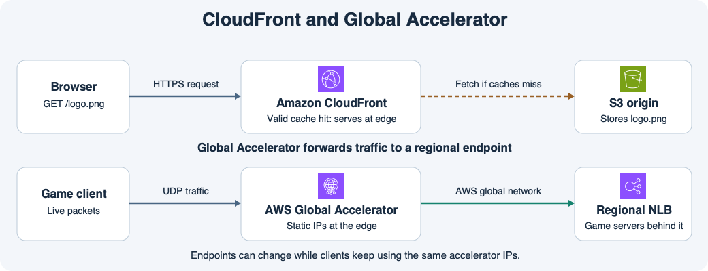

# 12주차 종합 확인 · 엣지와 성능

## 시나리오

게임사가 공개 홈페이지, 게임 에셋, 실시간 멀티플레이를 운영한다.
홈페이지의 `example.com`은 Route 53에서 관리하고 현재 ALB에 연결한다.
게임 배너는 S3에 저장하며 CloudFront를 통해 HTTPS로 제공한다.
멀티플레이 클라이언트는 UDP로 연결하고 접속 주소는 고정해야 한다.
게임 서버는 두 리전에 있고 각 리전에는 NLB가 있다.

## 설계 검토

주소 조회, HTTP 응답, 실시간 연결에는 서로 다른 조건이 적용된다.
DNS 레코드를 바꿀 때는 리졸버에 남은 응답을 확인한다.
배너 파일을 바꿀 때는 CloudFront에 남은 응답과 언어별 캐시 키를 확인한다.
실시간 연결은 어느 엔드포인트로 전달되는지와 해당 서버에서 세션을 이어갈 수 있는지를 각각 확인한다.

## 확인 문제

**1-1.** 루트 도메인 `example.com`을 기존 ALB에 연결하려면 Route 53에서 어떤 레코드를 만들고 무엇을 대상으로 지정하는가?

**1-2.** 홈페이지를 새 ALB로 옮기고 DNS 레코드를 수정했다. 리졸버에 이전 응답의 TTL이 남은 사용자도 즉시 새 ALB의 주소를 받는가? 이유는 무엇인가?

**2-1.** `/banner.png?lang=ko`와 `/banner.png?lang=en`에 원본이 서로 다른 이미지를 반환한다. 두 응답을 따로 캐시하려면 CloudFront 캐시 정책에 무엇을 포함하는가?

**2-2.** 한국어 배너를 S3에서 덮어썼다. 엣지에 같은 캐시 키의 유효한 이전 응답이 있다면 사용자가 어떤 이미지를 받을 수 있고, S3까지 요청이 가는가?

**3-1.** UDP 게임에 고정 IP와 개선된 리전 연결 경로가 필요하다. 어떤 서비스를 사용하고 가까운 엣지에 들어온 패킷은 어떤 네트워크를 통해 어느 엔드포인트에 도착하는가?

**3-2.** 리전 A의 게임 엔드포인트가 비정상이고 B는 정상이다. 새 트래픽은 어느 리전으로 갈 수 있으며, 클라이언트는 접속 주소를 변경해야 하는가? A의 RAM에만 저장한 세션은 B에서 이어지는가?

## 종합 확인 평가 · 2026-11-11

하위 정답 5개, 부분 정답 1개.

- **1-1 부분 정답.** A 유형과 기존 ALB를 선택한 방향은 맞다. 일반 A 레코드의 값은 IPv4 주소다. 이 구성은 A 유형 Alias를 만들고 기존 ALB를 Alias 대상으로 지정한다.
- **1-2 정답.** 이전 응답의 TTL이 남아 있으면 리졸버가 이전 ALB 주소를 반환할 수 있다.
- **2-1 정답.** 캐시 키에 `lang` 쿼리 파라미터를 포함한다.
- **2-2 정답.** 유효한 캐시 응답이 있으므로 CloudFront가 이전 한국어 배너를 반환하고 S3에 요청하지 않는다.
- **3-1 정답.** Global Accelerator가 AWS 글로벌 네트워크로 리전 NLB에 UDP 트래픽을 전달한다.
- **3-2 정답.** 새 트래픽은 리전 B로 갈 수 있고 클라이언트는 같은 Accelerator 정적 IP를 사용한다. A의 RAM에만 저장한 세션은 B에서 이어지지 않는다.

**1-1 보완 정답.** 루트 도메인에 A 유형 Alias 레코드를 만들고 기존 ALB를 Alias 대상으로 지정한다.
