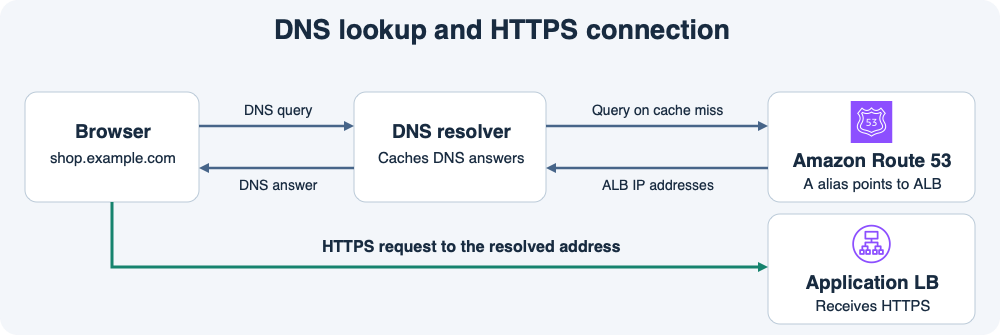
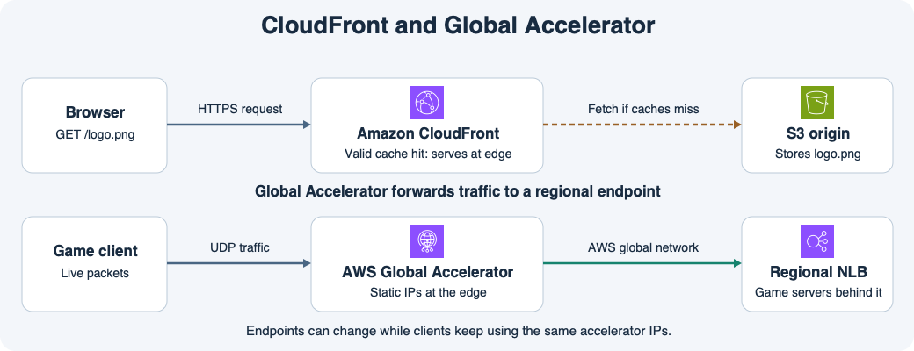

# 12주차 마지막 회상 복습 · 공연 예매와 실시간 중계

위 그림은 DNS 주소 조회와 HTTPS 연결을 구분하기 위한 참고 그림이다.
이번 문제의 예매 사이트는 루트 도메인 `tickets.example`을 사용한다.

## 시나리오

예매 웹은 Route 53이 관리하는 도메인에 연결한 ALB에서 HTTPS 요청을 받는다.
공연장 안내 이미지인 `/venue-map.png`는 S3에 저장하고 CloudFront로 제공한다.
캐시 미스 시 원본 요청 단계에서 `floor=1`과 `floor=2`를 서로 다른 S3 객체 경로로 변환하도록 설정했다.
실시간 중계 앱은 UDP를 쓰고 고정 접속 IP가 필요하다.
리전 A와 B에 각각 중계 서버와 NLB가 있다.

아래 문제에서는 그림 위쪽을 공연장 안내 이미지 요청, 아래쪽을 실시간 중계 패킷으로 읽는다.

## 회상 문제

**1-1.** `https://tickets.example/checkout`에서 어떤 부분이 DNS 조회에 쓰이는가? 루트 도메인을 기존 ALB에 연결하려면 어떤 유형의 레코드를 만들고 어떤 대상을 지정하는가?

**1-2.** 새 ALB로 레코드를 바꿨는데 특정 사용자는 여전히 이전 ALB 주소를 받는다. 리졸버의 캐시와 TTL을 사용해 설명한다.

**2-1.** `/venue-map.png?floor=1`과 `/venue-map.png?floor=2`를 각각 캐시하려면 CloudFront 캐시 정책에서 무엇을 캐시 키에 포함하는가?

**2-2.** S3에 2층 안내 이미지를 새로 올렸다. 같은 캐시 키에 해당하는 이전 2층 이미지가 엣지에서 아직 유효하다면 어떤 응답을 받고 원본 요청이 발생하는가?

**3-1.** UDP 중계에 고정 IP를 제공하려면 어떤 서비스를 선택하는가? 클라이언트 패킷은 AWS 엣지에서 어떤 네트워크를 지나 어느 엔드포인트로 가는가?

**3-2.** 리전 A의 엔드포인트가 비정상이고 B가 정상이다. 새 트래픽이 전달될 리전과 클라이언트가 사용할 접속 IP는 어떻게 되는가? 리전 A의 서버 RAM에만 있던 세션은 B에서 이어지는가?

## 회상 평가 · 2026-11-11

하위 정답 5개, 부분 정답 1개.

- **1-1 부분 정답.** DNS 조회 이름은 `tickets.example`이다. Route 53에서 레코드 유형을 A로 선택하고 Alias를 활성화한 뒤 기존 ALB를 대상으로 지정한다.
- **1-2 정답.** 리졸버는 이전 DNS 응답의 TTL이 남아 있는 동안 캐시된 이전 ALB 주소를 반환할 수 있다.
- **2-1·2-2 정답.** 캐시 정책에 `floor` 쿼리 파라미터를 포함한다. 같은 키에 유효한 이전 응답이 남아 있으면 엣지가 이전 2층 이미지를 반환하고 S3에는 요청하지 않는다.
- **3-1·3-2 정답.** Global Accelerator는 엣지에서 AWS 글로벌 네트워크를 통해 리전 NLB로 전달한다. 리전 A 엔드포인트가 비정상이면 새 트래픽은 정상인 B로 갈 수 있고 클라이언트는 기존 Accelerator 정적 IP를 사용한다. A의 RAM에만 있던 세션은 B에서 이어지지 않는다.

**1-1 보완 정답.** A 유형을 선택한 뒤 Alias를 활성화한다. 기존 ALB를 대상으로 지정한다. 12주차 종합 확인과 마지막 회상 복습을 마쳤다.
