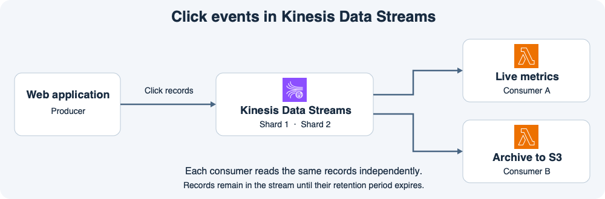

# 13주차 첫 수업 · Kinesis Data Streams 기초

## 1. 클릭을 발생할 때마다 기록하기

쇼핑몰 사용자가 상품을 누를 때마다 웹 앱이 클릭 정보를 보낸다.
예를 들어 고객 C17이 상품 P42를 눌렀다면 생산자(Producer)인 웹 앱이 고객 ID, 상품 ID, 클릭 시각을 담은 레코드를 Kinesis Data Streams에 기록한다.
**스트림**은 이런 레코드를 연속해서 받아 보존하는 공간이다.
**소비자(Consumer)**는 스트림을 읽고 필요한 작업을 수행하는 앱이다.

그림에서 소비자 A는 클릭 수를 집계하고 소비자 B는 원본 이벤트를 S3에 기록한다.
두 Lambda는 같은 스트림을 각자의 진행 위치에서 읽는다.
A가 한 레코드를 읽어도 그 레코드는 보존 기간 안에 스트림에 남아 B도 읽을 수 있다.
예를 들어 스트림의 보존 기간이 24시간이라면 B가 두 시간 멈췄다가 마지막 처리 위치에서 재개해 밀린 레코드를 읽을 수 있다.
보존 기간을 넘긴 레코드는 이 스트림에서 읽을 수 없다.

지난 SQS 팬아웃에서는 팀마다 메시지를 받도록 별도 큐를 만들었다.
이 예에서는 집계와 보관 소비자가 같은 Kinesis 스트림을 독립적으로 읽는다.

## 2. 샤드와 파티션 키

**샤드(Shard)**는 스트림을 구성하는 단위다.
스트림은 레코드를 여러 샤드에 나눠 저장하고 각 샤드 안에는 레코드의 순서가 있다.
**파티션 키(Partition key)**는 생산자가 쓰기 요청마다 주는 값이다.
Kinesis는 그 값을 해시해 어떤 샤드에 기록할지 정한다.

예를 들어 고객별 클릭 순서가 중요하다면 `customerId`를 파티션 키로 사용할 수 있다.
샤드 구성이 고정된 상태에서 같은 C17 키는 같은 샤드로 간다.
서로 다른 키도 같은 샤드로 갈 수 있다.
샤드 간에는 스트림 전체에 걸친 단일 순서가 보장되지 않는다.
모든 이벤트에 `click`처럼 같은 키를 쓰면 같은 샤드에 쓰기가 몰릴 수 있다.

## 공식 문서 핵심 요약

- Kinesis 스트림은 여러 샤드로 이루어지며 생산자가 지정하는 파티션 키로 레코드를 샤드에 배치한다. 레코드는 스트림의 보존 기간 동안 소비자가 읽을 수 있다. [AWS Kinesis Data Streams 개념 문서](https://docs.aws.amazon.com/streams/latest/dev/key-concepts.html)

## 확인 문제

쇼핑몰 웹 앱이 클릭 레코드를 Kinesis에 기록한다.
소비자 A는 실시간 집계를 하고 소비자 B는 원본 클릭 데이터를 S3에 저장한다.
스트림의 보존 기간은 24시간이고 샤드 구성은 바뀌지 않는다고 가정한다.

**1-1.** 이 구성에서 생산자는 무엇이고 소비자 두 개는 각각 무슨 일을 하는가?

**1-2.** A가 이미 클릭 레코드를 읽었다. B가 두 시간 중단됐다가 마지막 처리 위치에서 재개할 때 아직 보존 기간 안에 있는 그 레코드를 읽을 수 있는가? 이유는 무엇인가?

**2-1.** 같은 고객 C17의 클릭을 같은 샤드로 보내려면 어떤 값을 파티션 키로 쓰는가? C17과 다른 고객 C29가 반드시 서로 다른 샤드로 가는가?

**2-2.** 모든 클릭에 고정값 `click`을 파티션 키로 쓰면 쓰기 부하가 샤드에 고르게 나뉘는가? 이유는 무엇인가?

## 확인 문제 평가 · 2026-11-11

하위 4/4 정답.

- **1-1.** 웹 앱이 클릭 레코드를 생산한다. 소비자 A는 실시간 집계하고 B는 원본을 S3에 저장한다.
- **1-2.** A의 읽기는 레코드를 삭제하지 않는다. B가 재개하면 자신의 진행 위치부터 보존 기간 내 레코드를 읽을 수 있다.
- **2-1.** 고객 ID를 파티션 키로 지정한다. 같은 고객 키는 샤드 구성이 고정된 동안 같은 샤드로 간다. 서로 다른 고객 키도 해시 결과가 같은 샤드의 범위에 들어갈 수 있다.
- **2-2.** 모든 레코드에 같은 키를 쓰면 동일한 해시 결과가 나오므로 하나의 샤드에 쓰기가 집중된다.
