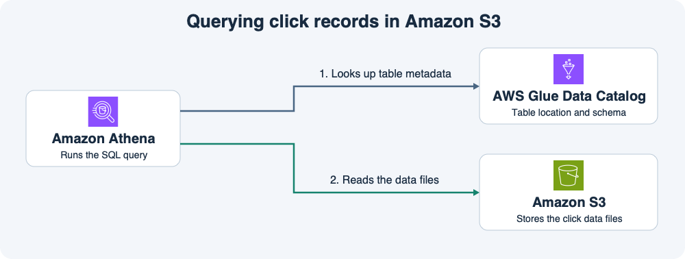

# 13주차 두 번째 수업 · S3, Glue Data Catalog, Athena



## 1. 클릭 파일을 SQL 테이블로 읽기

지난 수업에서 소비자 B는 Kinesis의 클릭 레코드를 S3에 저장했다.
이번에는 S3의 `s3://shop-analytics-demo/clicks/`에 쌓인 CSV에서 상품별 클릭 수를 확인한다.

**S3**는 클릭 레코드가 들어 있는 실제 파일을 저장한다.
**Glue Data Catalog**는 파일을 어떻게 읽을지 설명하는 메타데이터를 관리한다.
예를 들어 `clicks` 테이블에 S3 위치와 CSV 형식, `customer_id`, `product_id`, `clicked_at` 같은 컬럼 이름과 타입을 등록한다.

**Athena**는 SQL을 실행하는 서비스다.
그림에서 파란 화살표는 Athena가 Data Catalog에서 테이블 정의를 찾는 단계다.
초록 화살표는 Athena가 그 정의를 사용해 S3의 실제 데이터를 읽는 단계다.
테이블을 정의할 때 파일은 기존 S3 경로에 있고, 조회할 때 Athena가 직접 읽는다.

```sql
SELECT product_id, COUNT(*) AS click_count
FROM clicks
GROUP BY product_id;
```

## 2. 테이블 정의를 만드는 방법

팀이 파일 형식과 컬럼을 알고 있다면 Athena의 `CREATE EXTERNAL TABLE`로 외부 테이블을 정의할 수 있다.
**Glue Crawler**는 지정한 S3 경로의 파일을 살펴보고 형식과 스키마를 추론해 Data Catalog에 테이블을 만들거나 갱신할 수 있다.
정의가 이미 있다면 매번 SELECT를 실행하기 전에 Crawler를 실행할 필요는 없다.

테이블 정의의 S3 위치가 실제 파일이 있는 경로와 다르면 Athena는 등록된 위치를 읽는다.
정의는 남아 있어도 실제 파일이 없으면 그 파일의 레코드를 조회할 수 없다.

## 공식 문서 핵심 요약

- Athena는 Glue Data Catalog의 테이블과 컬럼 메타데이터를 사용해 S3 데이터를 조회한다. 스키마는 직접 정의하거나 Glue Crawler로 추론해 등록할 수 있다. [AWS Athena와 Glue Data Catalog 연동 문서](https://docs.aws.amazon.com/athena/latest/ug/data-sources-glue.html)

## 확인 문제

소비자 B가 `s3://shop-analytics-demo/clicks/`에 CSV 파일을 저장한다.
Data Catalog의 `clicks` 외부 테이블은 이 경로를 가리킨다.
다른 경로에 복제한 파일은 없다고 가정한다.

**1-1.** 실제 클릭 레코드는 어디에 있고, 컬럼 이름과 파일 위치 같은 테이블 정의는 어디에 있는가?

**1-2.** 분석가가 상품별 클릭 수를 SQL로 조회한다. SQL을 실행하는 서비스는 무엇이고, 테이블 정의와 실제 파일을 각각 어디에서 읽는가?

**2-1.** 새 데이터 세트의 파일 형식과 컬럼 구성을 자동으로 추론해 카탈로그에 등록하려면 무엇을 실행하는가?

**2-2.** `clicks` 테이블 정의는 남았지만 S3의 클릭 CSV를 모두 삭제했다. 테이블 정의만으로 이전 클릭 레코드를 조회할 수 있는가? 이유는 무엇인가?

## 확인 문제 평가 · 2026-11-11

하위 4/4 정답.

- **1-1.** 실제 클릭 레코드는 S3 경로에 저장하고 컬럼과 파일 위치 등의 테이블 정의는 Glue Data Catalog에 저장한다.
- **1-2.** Athena가 SQL을 실행한다. Glue Data Catalog에서 정의를 조회하고 S3에서 실제 파일을 읽는다.
- **2-1.** Glue Crawler를 실행해 파일을 조사하고 스키마를 추론해 카탈로그에 등록한다.
- **2-2.** 클릭 CSV가 모두 삭제됐다면 정의만 남아 있어도 이전 클릭 레코드를 조회할 수 없다. 레코드는 S3 파일에 저장되어 있었다.
