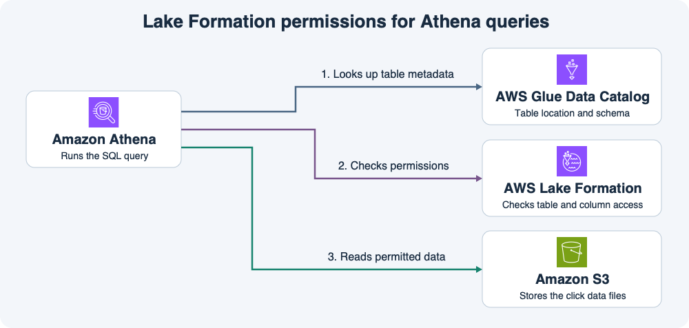

# 13주차 세 번째 수업 · Lake Formation과 데이터 접근 제어

## 1. 같은 테이블을 팀마다 다르게 읽기

쇼핑몰의 `clicks` 테이블에 `customer_id`, `product_id`, `clicked_at`이 있다.
상품팀은 상품별 클릭 수만 집계하고 고객 지원팀은 고객 ID를 사용해 문의를 조사한다.
상품팀에는 `product_id`, `clicked_at`에 대한 Lake Formation `SELECT` 권한을 부여한다.
고객 지원팀에는 세 컬럼에 대한 `SELECT` 권한을 부여한다.
두 팀은 같은 Glue Data Catalog 테이블과 S3 파일을 사용한다.

## 2. Athena로 조회하는 흐름

이 예에서는 S3 위치를 Lake Formation에 등록했고, 두 팀의 테이블 접근을 Lake Formation 권한으로 관리한다.

1. **Glue Data Catalog**에는 테이블 이름, 컬럼, S3 경로가 있다.
2. **Lake Formation**은 요청한 역할이 어떤 테이블과 컬럼을 읽을 수 있는지 확인한다.
3. **Athena**는 허용된 쿼리를 실행하고 **S3**에 있는 실제 파일을 읽는다.

역할이 Athena에서 쿼리를 실행하려면 관련 IAM 권한이 필요하다.
이 구성에서는 `lakeformation:GetDataAccess`도 IAM으로 허용한다.
Lake Formation의 `SELECT` 권한은 해당 역할이 어떤 데이터를 읽을 수 있는지 정한다.
예를 들어 상품팀 역할이 Athena 쿼리를 시작할 권한이 있어도 `SELECT customer_id FROM clicks`에는 해당 컬럼의 Lake Formation 권한이 필요하다.

## 3. S3 파일을 직접 읽는 경우

상품팀 역할에 원본 객체의 직접 `s3:GetObject` 권한도 있으면 Athena를 거치지 않고 원본 파일을 가져올 수 있다.
원본 CSV에 고객 ID가 들어 있으면 파일을 직접 읽을 때 고객 ID도 볼 수 있다.
컬럼 제한을 적용하려면 팀이 쓰는 Athena 조회 경로에서 Lake Formation 권한을 설정하고 원본 S3 객체의 직접 읽기 권한도 따로 관리한다.

## 공식 문서 핵심 요약

- 등록된 S3 위치의 데이터를 Lake Formation으로 관리할 때 사용자는 카탈로그 테이블에 대한 데이터 접근 권한과 IAM의 `lakeformation:GetDataAccess`가 필요하다. [AWS Lake Formation 데이터 접근 제어 문서](https://docs.aws.amazon.com/lake-formation/latest/dg/access-control-underlying-data.html)
- Athena에서 Lake Formation 관리 데이터를 조회할 때 IAM은 Athena 호출과 `lakeformation:GetDataAccess` 등 필요한 작업을 허용한다. Lake Formation 권한은 테이블이나 컬럼에 대한 접근을 제어한다. [AWS Athena와 Lake Formation 사용자 권한 문서](https://docs.aws.amazon.com/athena/latest/ug/lf-athena-user-permissions.html)

## 확인 문제

상품팀은 `product_id`, `clicked_at`에만 Lake Formation `SELECT` 권한이 있다.
고객 지원팀은 세 컬럼에 대한 `SELECT` 권한이 있다.
두 팀의 Athena 실행 권한과 `lakeformation:GetDataAccess`는 정상이라고 가정한다.

**1-1.** 실제 클릭 파일을 저장하는 서비스, 테이블 정의를 보관하는 서비스, 역할별 컬럼 접근을 제어하는 서비스는 각각 무엇인가?

**1-2.** 상품팀이 `SELECT product_id, COUNT(*) FROM clicks GROUP BY product_id`를 실행한다. 현재 컬럼 권한으로 이 쿼리를 실행할 수 있는가? 이유는 무엇인가?

**2-1.** 상품팀이 `SELECT customer_id FROM clicks`를 실행한다. Athena 실행 권한이 있어도 왜 이 쿼리가 거부되는가?

**2-2.** 상품팀 역할에 원본 S3 객체의 직접 `s3:GetObject` 권한을 추가했다. 그 역할이 S3에서 CSV를 직접 읽으면 파일의 `customer_id`도 볼 수 있는가? 이유는 무엇인가?

## 확인 문제 평가 · 2026-11-11

하위 4/4 정답.

- **1-1.** S3가 파일을 저장하고 Glue Data Catalog가 테이블 정의를 보관한다. Lake Formation이 역할별 컬럼 접근을 제어한다.
- **1-2.** 상품팀에 `product_id`의 Lake Formation `SELECT` 권한이 있으므로 상품별 클릭 수를 집계할 수 있다.
- **2-1.** Athena 실행 권한은 쿼리 시작을 허용한다. 상품팀에는 `customer_id`의 Lake Formation `SELECT` 권한이 없어 이 조회가 거부된다.
- **2-2.** 직접 `s3:GetObject`로 CSV 전체를 가져올 수 있다면 파일에 들어 있는 `customer_id`도 볼 수 있다. 이 요청은 S3 객체 접근 권한에 따라 처리된다.
