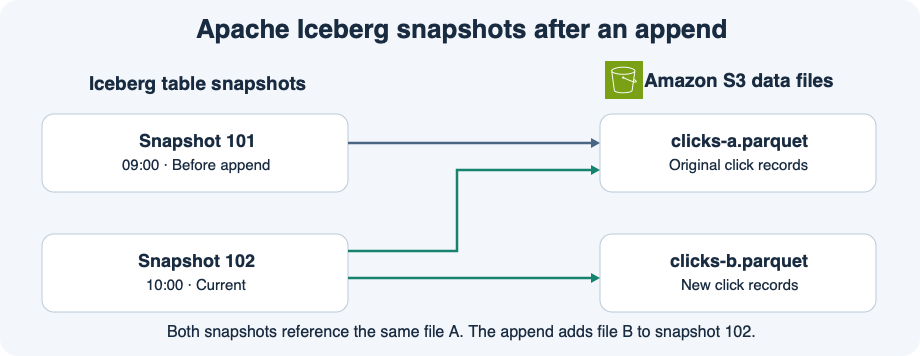

# 13주차 네 번째 수업 · Apache Iceberg와 테이블 스냅샷



## 1. S3 파일에 테이블 상태를 연결하기

지금까지 Athena는 Glue Data Catalog에 등록한 위치의 CSV를 읽었다.
파일을 계속 추가하면서 이전 시점에 어떤 레코드가 테이블에 있었는지 알아야 한다면 파일 목록의 변경 이력도 필요하다.
**Apache Iceberg**는 데이터 파일과 테이블의 변경 이력을 메타데이터로 관리하는 오픈 테이블 형식이다.
이 예에서는 S3에 Parquet 데이터 파일과 Iceberg 메타데이터를 저장하고 Glue Data Catalog에 테이블을 등록한다.
Athena는 Iceberg 메타데이터를 따라 조회할 파일을 찾는다.

## 2. 스냅샷으로 읽는 파일이 달라진다

**스냅샷**은 커밋된 특정 시점의 테이블 상태다.
그림에서 오전 9시 스냅샷 101은 파일 A를 참조한다.
오전 10시에 새 클릭을 담은 파일 B를 추가하고 커밋하면 현재 스냅샷 102는 A와 B를 참조한다.
두 스냅샷 모두 같은 파일 A를 참조할 수 있다.
예제처럼 파일을 추가하는 경우 기존 파일 A를 스냅샷마다 통째로 복사할 필요가 없다.

일반 SELECT는 현재 스냅샷을 읽는다.
이전 스냅샷과 필요한 파일이 남아 있다면 **타임 트래블**로 과거 상태를 조회할 수 있다.
Athena에서는 시각으로 조회할 때 `FOR TIMESTAMP AS OF`를 사용하고 스냅샷 ID로 조회할 때 `FOR VERSION AS OF`를 사용한다.

```sql
SELECT *
FROM clicks_iceberg FOR VERSION AS OF 101;
```

이 SELECT는 스냅샷 101의 데이터를 읽는다.
쿼리 후에도 현재 스냅샷은 102다.

## 공식 문서 핵심 요약

- Iceberg 테이블의 메타데이터에는 버전별로 어떤 S3 객체를 읽을지에 대한 정보가 있다. Athena에서는 시각이나 스냅샷 ID를 지정해 해당 스냅샷의 데이터를 조회할 수 있다. [AWS Athena Iceberg 타임 트래블 문서](https://docs.aws.amazon.com/athena/latest/ug/querying-iceberg-time-travel-and-version-travel-queries.html)

## 확인 문제

스냅샷 101은 기존 파일 A를 참조한다.
새 파일 B를 추가한 뒤 스냅샷 102가 현재 상태가 됐다.
두 스냅샷과 필요한 S3 파일이 모두 남아 있다고 가정한다.

**1-1.** 실제 클릭 레코드는 어디에 저장되는가? Iceberg 스냅샷 정보는 Athena가 무엇을 정하는 데 쓰는가?

**1-2.** 이 예에서 일반 SELECT는 A와 B 중 어떤 파일의 데이터를 읽는가? 스냅샷 101을 지정한 SELECT는 어떤 파일의 데이터를 읽는가?

**2-1.** B를 추가할 때 A를 새 스냅샷용으로 통째로 복사해야 하는가? 이유는 무엇인가?

**2-2.** 스냅샷 101을 ID로 지정하려면 Athena SELECT에 어떤 절을 사용하는가? 이 조회를 실행하면 현재 스냅샷도 101로 바뀌는가?

## 확인 문제 평가 · 2026-11-11

정답 2개, 부분 정답 2개.

- **1-1 부분 정답.** 실제 클릭 레코드는 S3의 Parquet 파일에 있다. Athena는 선택한 스냅샷의 메타데이터를 따라 읽을 파일을 정한다.
- **1-2 정답.** 일반 SELECT는 현재 스냅샷 102를 사용해 A와 B를 읽고, 스냅샷 101을 지정하면 A만 읽는다.
- **2-1 정답.** 스냅샷 102는 기존 A와 새 B를 참조하므로 A를 복사할 필요가 없다.
- **2-2 부분 정답.** 스냅샷 ID 101을 지정하려면 `FOR VERSION AS OF 101`을 쓴다. `FOR TIMESTAMP AS OF`는 시각을 지정할 때 쓴다. 과거 스냅샷을 조회한 뒤에도 현재 스냅샷은 102다.

**보완 완료.** 스냅샷은 커밋된 특정 시점의 테이블 상태다. Athena는 그 상태가 참조하는 S3 파일을 읽는다. 스냅샷 ID 101을 지정하는 절은 `FOR VERSION AS OF 101`이다.
