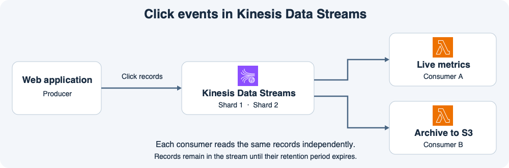
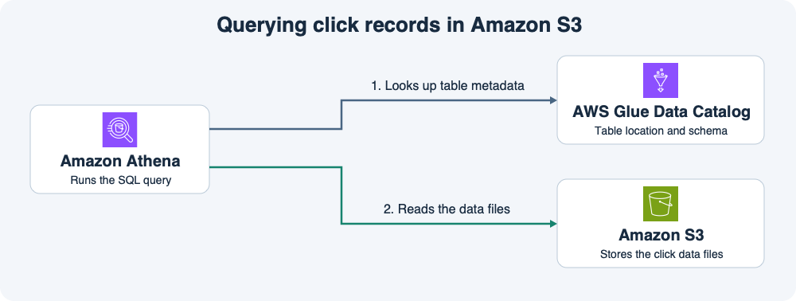
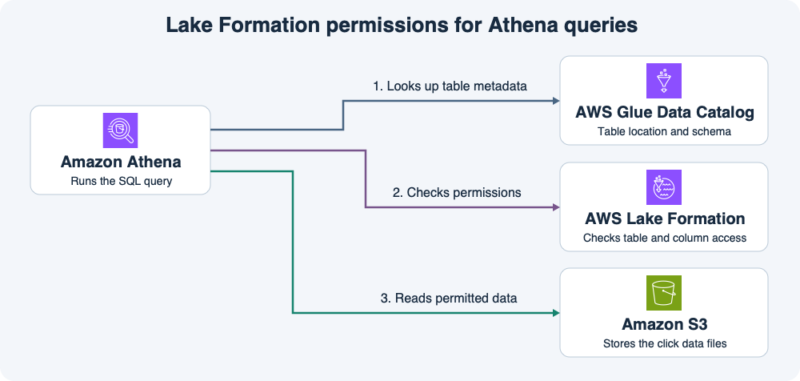
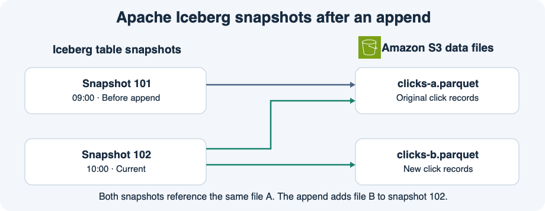

# 13주차 종합 확인 · 데이터 처리와 분석

쇼핑몰은 클릭이 들어오는 즉시 상품별 집계를 갱신한다.
분석팀은 S3에 보관한 파일로 일별 보고서를 만들고, 지난 시점의 테이블도 조회해야 한다.

## 1. 실시간 수집과 보관

웹 앱은 클릭마다 고객 ID, 상품 ID, 클릭 시각을 Kinesis Data Streams에 보낸다.
소비자 A는 실시간 집계를 하고 소비자 B는 원본 클릭을 S3에 보관한다.
스트림의 보존 기간은 24시간이며 문제를 푸는 동안 샤드 구성은 바뀌지 않는다.

**1-1.** B가 두 시간 멈춘 사이에 A는 클릭 레코드를 계속 읽었다. B가 마지막 처리 위치에서 재개하면 아직 보존 기간 안에 있는 레코드를 읽을 수 있는가? A의 읽기가 B에 어떤 영향을 주는지 설명하자.

**1-2.** 웹 앱이 모든 클릭의 파티션 키를 `click`으로 지정했다. 쓰기가 여러 샤드에 고르게 나뉘는가? 같은 고객의 클릭이 같은 샤드에 가도록 하면서 여러 고객의 키를 나눠 쓰려면 어떤 값을 파티션 키로 지정할까?

## 2. S3 파일을 SQL로 분석

B는 원본 CSV를 `s3://shop-analytics-demo/clicks/`에 쓴다.
`clicks` 외부 테이블의 정의에는 CSV 형식, 컬럼 이름과 타입, S3 경로가 들어 있다.

**2-1.** 분석가가 `SELECT product_id, COUNT(*) FROM clicks GROUP BY product_id`를 실행한다. 어떤 서비스가 SQL을 실행하고 테이블 정의와 실제 파일을 각각 어디에서 읽는가?

**2-2.** 실제 CSV는 `clicks/`에 있는데 테이블의 위치를 빈 `clicks-test/`로 잘못 등록했다. Athena는 어떤 경로를 읽고, 원본을 조회하려면 무엇을 고쳐야 하는가?

## 3. 고객 ID 접근 제한

S3 위치는 Lake Formation에 등록돼 있다.
상품팀 역할에는 `product_id`와 `clicked_at`의 Lake Formation `SELECT` 권한이 있다.
Athena 쿼리 실행 권한과 `lakeformation:GetDataAccess`도 정상이다.

**3-1.** 상품팀이 상품별 클릭 수 집계와 `SELECT customer_id FROM clicks`를 각각 실행했다. 어느 쿼리가 가능하고 어느 쿼리가 거부되는가? 어떤 권한이 그 차이를 만드는가?

**3-2.** 같은 역할에 원본 CSV를 직접 가져올 수 있는 `s3:GetObject` 권한을 추가했다. S3에서 CSV를 직접 받으면 파일에 든 `customer_id`를 볼 수 있는가? 이유는 무엇인가?

## 4. Iceberg로 이전 집계 확인

그림은 파일을 추가했을 때 두 스냅샷이 기존 파일을 함께 참조하는 예시다.
이번 문제의 `clicks_iceberg` 테이블에서는 스냅샷 201이 S3의 파일 A와 B를 참조한다.
새 클릭을 담은 파일 C를 추가한 뒤 스냅샷 202가 현재 상태가 됐다.
두 스냅샷과 참조 파일은 모두 남아 있다고 가정한다.

**4-1.** 일반 `SELECT`와 스냅샷 201을 지정한 `SELECT`는 각각 어떤 파일을 읽는가? 202를 만들 때 기존 A와 B를 새로 복사해야 하는가?

**4-2.** Athena에서 스냅샷 ID 201을 지정하는 `SELECT`를 한 줄로 작성하자. 이 조회 뒤에 일반 `SELECT`는 어느 스냅샷을 읽는가?

## 종합 확인 평가 · 2026-11-11

하위 8/8 정답.

- **1-1·1-2.** A가 읽어도 보존 기간 내 레코드는 B가 읽을 수 있다. 모든 이벤트에 같은 키를 쓰면 쓰기가 한 샤드에 집중된다. 고객 ID를 파티션 키로 사용할 수 있다.
- **2-1·2-2.** Athena가 Data Catalog의 정의를 사용해 S3 파일을 읽는다. 잘못 등록한 위치를 clicks/로 수정한다. 답변의 clickets-test는 clicks-test의 입력 오타로 처리했다.
- **3-1·3-2.** 상품팀은 product_id 집계가 가능하고 customer_id는 Lake Formation SELECT 권한이 없어 거부된다. 원본 S3 객체를 직접 가져올 수 있는 권한이 있으면 파일의 customer_id도 볼 수 있다. Lake Formation 권한은 Athena 외에도 연동된 분석 서비스에서 적용된다.
- **4-1·4-2.** 현재 스냅샷 202는 A·B·C를 읽고 201은 A·B를 읽는다. 기존 파일은 공유 참조한다. FOR VERSION AS OF 201로 과거 상태를 읽어도 일반 SELECT는 현재 스냅샷 202를 읽는다.
