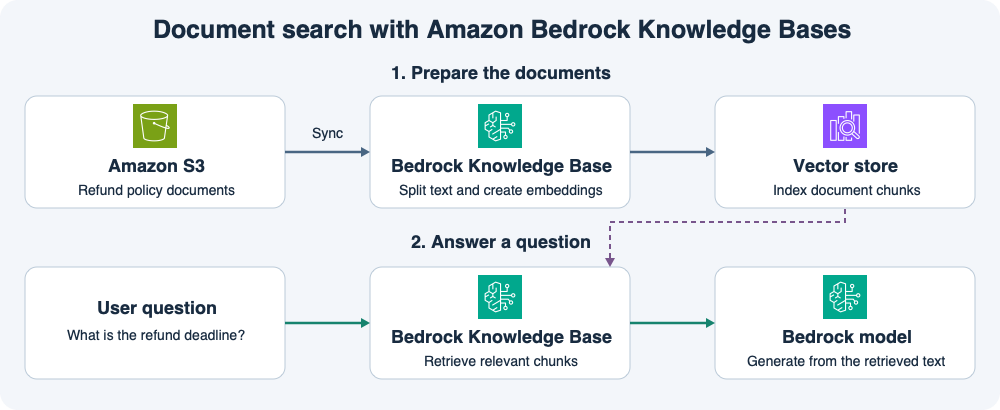

# 14주차 첫 수업 · Amazon Bedrock과 RAG

## 1. 답변에 사내 문서 사용하기

직원이 “미개봉 상품은 며칠 안에 환불할 수 있나요?”라고 묻는다.
이 회사의 환불 정책은 S3에 문서로 보관돼 있다.
**Amazon Bedrock**은 생성형 AI 모델을 사용할 수 있는 AWS 서비스다.
**RAG**는 답변을 만들기 전에 관련 문서를 검색해 모델에 참고 자료로 주는 방식이다.
이 예제에서는 S3를 데이터 소스로 쓰는 벡터 기반 **Bedrock Knowledge Base**를 사용한다.

## 2. 문서 준비와 질문 처리

그림 위쪽은 문서 동기화다.
Knowledge Base가 S3의 문서를 읽고 작은 텍스트 조각으로 나눈다.
임베딩 모델은 각 조각의 내용을 검색에 사용할 숫자 벡터로 바꾼다.
벡터 저장소는 이 조각을 찾을 수 있게 인덱싱한다. 그림은 OpenSearch를 사용하는 예다.

그림 아래쪽은 질문 처리다.
Knowledge Base가 질문과 관련된 문서 조각을 검색한다.
Bedrock의 생성 모델은 질문과 검색된 텍스트를 함께 받아 답변을 만든다.
예를 들어 정책 조각에 “미개봉 상품은 수령 후 14일 이내”라고 적혀 있으면 그 조건을 답변에 담을 수 있다.
애플리케이션은 출처를 같이 표시해 직원이 원문을 확인할 수 있게 한다.
이 흐름은 검색한 문서를 모델의 입력으로 사용한다. 모델을 다시 학습시키는 단계는 없다.

## 3. 정책이 바뀌었을 때

S3 문서의 환불 기간을 14일에서 30일로 수정했다고 하자.
수정된 문서를 검색하려면 S3 데이터 소스를 Knowledge Base와 동기화하고 변경 내용이 인덱스에서 조회 가능한 상태가 될 때까지 기다린다.
동기화 전에는 검색에서 이전 버전 조각이 반환될 수 있다.

## 공식 문서 핵심 요약

- 벡터 기반 Knowledge Base에서 `Retrieve`는 관련 문서 조각을 반환한다. 지원되는 구성의 `RetrieveAndGenerate`는 검색과 답변 생성을 함께 수행하며 근거를 인용할 수 있다. [AWS Bedrock Knowledge Bases 검색 문서](https://docs.aws.amazon.com/bedrock/latest/userguide/kb-how-retrieval.html)
- S3 문서를 추가·수정·삭제한 경우 데이터 소스를 동기화해 변경 내용을 반영한다. 동기화 완료 후 새 데이터가 검색 가능해지는 데 시간이 걸릴 수 있다. [AWS Bedrock 데이터 소스 동기화 문서](https://docs.aws.amazon.com/bedrock/latest/userguide/kb-data-source-sync-ingest.html)

## 확인 문제

**1-1.** 이 구성에서 원본 환불 정책 문서는 어디에 있고, 문서 조각과 임베딩은 어느 단계에서 만들어지는가?

**1-2.** 직원이 환불 기간을 물었다. 관련 정책 조각을 찾는 작업과 문장을 만들어 답하는 작업은 각각 무엇이 담당하는가?

**2-1.** S3 문서에서 환불 기간을 14일에서 30일로 바꿨다. 새 정책이 검색되도록 어떤 작업을 하고 무엇을 확인해야 하는가?

**2-2.** 질문에 답할 때 문서 조각을 모델에 전달한다. 이때 모델을 다시 학습시키는가? 직원이 답변의 근거를 확인하도록 무엇을 함께 보여줄 수 있는가?

## 확인 문제 평가 · 2026-11-11

정답 3개, 부분 정답 1개.

- **1-1 정답.** 원본 문서는 S3에 저장하고, 데이터 소스를 동기화할 때 문서 조각을 만들고 임베딩 모델로 벡터를 생성한다.
- **1-2 정답.** Knowledge Base가 관련 조각을 검색하고 생성 모델이 질문과 그 조각을 바탕으로 답변을 작성한다.
- **2-1 부분 정답.** S3 데이터 소스를 Knowledge Base와 동기화한다. 동기화 성공 후 테스트 검색을 실행해 변경된 30일 정책 조각이 반환되는지 확인한다.
- **2-2 정답.** 검색된 조각은 답변 생성 시 모델 입력으로 사용한다. 이 과정에서 모델 재학습은 없다. 직원에게 출처를 표시해 원문을 확인할 수 있게 한다.

**2-1 보완 정답.** 동기화 성공 여부를 확인하고 테스트 검색에서 변경된 30일 정책 조각이 반환되는지 확인한다.
