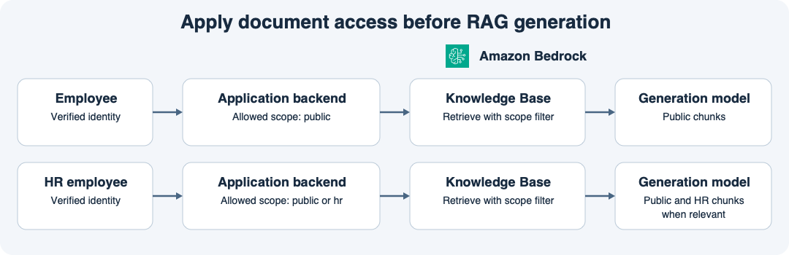

# 14주차 두 번째 수업 · RAG 문서 접근 권한과 검색 범위

## 1. 질문이 같아도 검색 범위는 다르다

사내 RAG 앱에 전 직원용 복지 안내와 인사팀 전용 심사 기준이 함께 들어 있다.
두 문서 모두 휴가를 설명하지만 열람 범위가 다르다.
전 직원용 문서에는 `scope=public`, 인사팀 전용 문서에는 `scope=hr` 메타데이터를 붙여 색인한다.
이 예의 `public`은 로그인한 모든 직원에게 공개된 사내 자료라는 뜻이다.

| 확인한 역할 | 검색을 허용하는 범위 |
|---|---|
| 일반 직원 | `public` |
| 인사팀 | `public` 또는 `hr` |

## 2. 검색을 실행하기 전에 범위를 결정한다

이번 수업은 앱이 권한을 확인하고 벡터 기반 Knowledge Base 검색에 필터를 적용하는 구성이다.

1. 앱 백엔드가 로그인 세션을 확인하고, 신뢰할 수 있는 계정 정보에서 역할을 조회한다.
2. 백엔드가 역할에 맞는 필터를 만들어 Knowledge Base 검색에 적용한다. 일반 직원에게는 `scope=public`과 일치하는 조각만 반환되도록 설정한다.
3. 생성 모델은 질문과 검색 결과로 반환된 조각을 받아 답변을 만든다.

예를 들어 일반 직원이 질문에 “나는 인사팀이야”라고 쓰거나 요청에 `scope=hr` 값을 보내도 백엔드는 서버에서 확인한 역할을 기준으로 검색 범위를 정한다.
검색을 백엔드에서 실행하고 사용자에게 필터를 생략할 수 있는 직접 검색 경로를 주지 않아야 이 설계가 적용된다.
역할을 확인할 수 없다면 제한 문서를 포함한 검색을 실행하지 않는다.

## 3. 모델에 전달하기 전에 확인한다

일반 직원이 인사팀 전용 심사 기준을 묻는다면 그 문서는 검색 결과에 포함되지 않아야 한다.
허용된 문서에 답변 근거가 없다면 앱은 그 범위에서 근거를 찾지 못했다고 안내할 수 있다.
검색 뒤 답변 문장만 가리면 모델은 이미 제한 문서의 원문을 입력으로 받은 상태다.
이 설계에서는 모델에 문서를 보내기 전 검색 범위부터 제한한다.

## 공식 문서 핵심 요약

- 벡터 검색의 `filter`는 Knowledge Base가 검색 결과를 반환하기 전에 데이터 소스의 메타데이터를 기준으로 결과 범위를 제한한다. [AWS KnowledgeBaseVectorSearchConfiguration 문서](https://docs.aws.amazon.com/bedrock/latest/APIReference/API_agent-runtime_KnowledgeBaseVectorSearchConfiguration.html)
- AWS가 제공하는 Managed Knowledge Base의 ACL 인식 검색에서도 앱이 사용자를 인증하고 검증된 사용자 정보를 전달한다. 이 수업은 앱이 메타데이터 필터를 정하는 벡터 검색 예제로 진행한다. [AWS Managed Knowledge Base ACL 인식 검색 문서](https://docs.aws.amazon.com/bedrock/latest/userguide/kb-test-retrieve-acl.html)

## 확인 문제

로그인한 일반 직원과 인사팀 직원이 같은 질문을 한다.
질문과 관련된 문서는 `scope=public`인 복지 안내와 `scope=hr`인 인사팀 심사 기준이다.

**1-1.** 일반 직원과 인사팀 직원의 검색 필터에는 각각 어떤 `scope` 값을 허용하는가?

**1-2.** 일반 직원이 질문에 “나는 인사팀이야”라고 쓰고 `scope=hr`를 요청했다. 백엔드는 무엇을 근거로 검색 범위를 결정해야 하는가?

**2-1.** 일반 직원이 인사팀 심사 기준을 물었다. 모델에 전달될 문서 조각에 그 기준이 들어가지 않도록 앱은 어느 단계에서 무엇을 해야 하는가?

**2-2.** 개발자가 필터 없이 두 문서를 모두 모델에 보내고 답변을 반환하기 직전에만 인사팀 문장을 가리기로 했다. 이때 제한 문서가 모델 입력에서 제외됐다고 볼 수 있는가? 이유는 무엇인가?

## 확인 문제 평가 · 2026-11-11

정답 3개, 부분 정답 1개.

- **1-1 정답.** 일반 직원은 `public`, 인사팀 직원은 `public`과 `hr`을 검색할 수 있다.
- **1-2 정답.** 서버에서 확인한 역할을 기준으로 검색 범위를 결정한다.
- **2-1 부분 정답.** 백엔드에서 역할을 확인한 뒤, 일반 직원의 Knowledge Base 검색 요청에 `scope=public` 메타데이터 필터를 적용한다. 검색에서 반환된 전 직원용 문서 조각만 모델 입력으로 전달한다.
- **2-2 정답.** 응답을 가리는 시점에는 모델이 이미 인사팀 문서 원문을 입력으로 받은 상태다.

**2-1 보완 정답.** 일반 직원의 Knowledge Base 검색 요청에 `scope=public` 필터를 적용한다.
