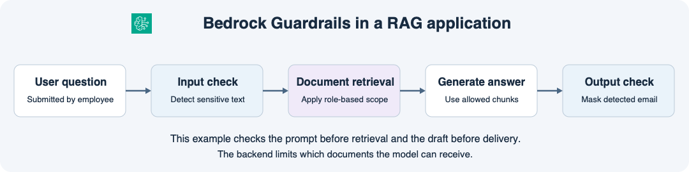

# 14주차 세 번째 수업 · Amazon Bedrock Guardrails

## 1. 질문과 답변에 콘텐츠 정책 적용하기

지난 수업에서는 사용자 역할에 따라 모델에 전달할 문서 범위를 정했다.
이번에는 사내 RAG 앱에서 질문과 답변에 포함된 이메일 주소를 검사한다.
**Amazon Bedrock Guardrails**는 입력이나 출력에 설정한 콘텐츠 정책을 적용할 수 있다.
민감 정보 필터는 탐지한 정보를 설정에 따라 차단하거나 가린다.

이 예에서 앱은 검색 전에 사용자 질문을 검사하고 사용자에게 답변을 보내기 전에 모델이 작성한 텍스트를 검사한다.
이메일 주소를 **입력에서는 차단**, **출력에서는 가림**으로 설정했다고 가정한다.

| 검사 대상 | 이메일을 탐지했을 때 |
|---|---|
| 입력 질문 | 질문을 차단하고 안내를 표시한다. 이 앱은 차단된 요청의 검색과 생성을 진행하지 않는다. |
| 출력 답변 | 답변에 포함된 이메일을 `{EMAIL}`로 바꾼 뒤 사용자에게 반환한다. |

## 2. 검색 권한도 함께 적용하기

일반 직원이 인사팀 전용 문서를 묻는다면 백엔드는 로그인 역할에 따라 검색 요청에 `scope=public` 필터를 적용한다.
검색 결과로 반환된 조각만 생성 모델에 전달한다.
답변에서 이메일을 가리는 정책은 응답 텍스트에 적용된다.
문서 접근 범위는 모델에 문서 조각을 전달하기 전 검색 단계에서 결정한다.

## 공식 문서 핵심 요약ㅇ

- 민감 정보 필터는 입력 질문과 출력 답변의 이메일 등 민감 정보를 탐지할 수 있다. 입력과 출력에 각각 차단 또는 가림을 설정할 수 있다. [AWS Bedrock Guardrails 민감 정보 필터 문서](https://docs.aws.amazon.com/bedrock/latest/userguide/guardrails-sensitive-filters.html)
- 벡터 검색 필터는 데이터 소스 메타데이터를 기준으로 검색 결과를 제한한다. [AWS Bedrock 벡터 검색 설정 문서](https://docs.aws.amazon.com/bedrock/latest/APIReference/API_agent-runtime_KnowledgeBaseVectorSearchConfiguration.html)

## 확인 문제

아래 문제는 설정한 필터가 이메일 주소를 탐지했다고 가정한다.

**1-1.** 직원이 이메일 주소를 포함한 질문을 보냈다. 입력 정책이 차단이면 어느 단계에서 어떤 일이 일어나는가? 검색과 답변 생성까지 진행하는가?

**1-2.** 모델의 답변에 이메일 주소가 들어 있다. 출력 정책이 가림이면 직원에게 전달되는 답변에서 그 이메일은 어떻게 바뀌는가?

**2-1.** 일반 직원이 이메일 없이 인사팀 전용 심사 기준을 물었다. 그 문서 조각이 모델로 가지 않도록 어디에 어떤 필터를 적용하는가?

**2-2.** 백엔드가 인사팀 문서 조각을 모델에 보낸 뒤 답변에 나온 이메일을 모두 가렸다. 이 경우 인사팀 문서에 대한 접근 범위가 모델 입력에 적용됐다고 볼 수 있는가? 이유를 설명하자.

## 확인 문제 평가 · 2026-11-12

정답 2개, 부분 정답 1개, 오답 1개.

- **1-1 정답.** 앱은 입력 검사에서 차단 안내를 표시하고 해당 요청의 검색과 답변 생성을 중단한다.
- **1-2 정답.** 출력에서 탐지한 이메일 주소는 `{EMAIL}`로 바뀐다.
- **2-1 오답.** 백엔드가 서버에서 확인한 일반 직원 역할을 기준으로 Knowledge Base 검색 요청에 `scope=public` 메타데이터 필터를 적용한다.
- **2-2 부분 정답.** 이메일 가림은 모델 출력에 적용된다는 점이 맞다. 모델은 가림 전에 이미 인사팀 문서 조각을 입력받았으므로 모델 입력 단계의 문서 접근 제한은 적용되지 않았다.

**보완 2/2 정답.** 일반 직원의 Knowledge Base 검색 요청에 `scope=public` 필터를 적용한다. 출력에서 이메일을 가리기 전에 모델은 이미 인사팀 문서 조각을 입력받았다.
