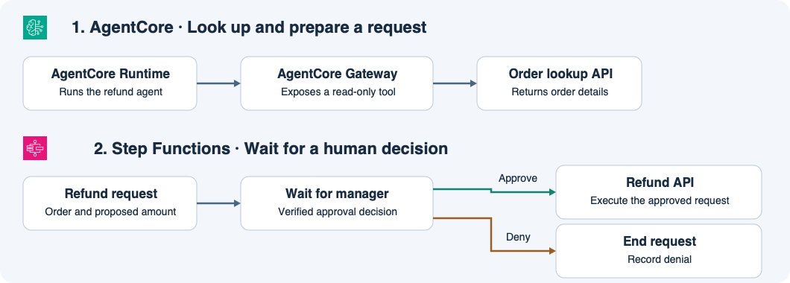

# 14주차 네 번째 수업 · Amazon Bedrock AgentCore와 사람 승인

## 주문 조회와 실제 환불

고객 상담사가 주문의 결제 내역을 확인하고 환불을 요청하는 예제다.
**에이전트**는 사용자의 요청을 받아 필요한 도구를 사용하고 결과를 정리하는 앱이다.
**AgentCore Runtime**은 에이전트 코드를 실행할 환경을 제공한다.
이 예제의 **AgentCore Gateway**는 주문 조회 API를 에이전트가 호출할 수 있는 도구로 제공한다.
상담사의 주문 조회 권한은 확인됐다고 가정한다.

조회 도구는 결제 내역을 반환한다.
에이전트는 그 결과를 바탕으로 주문 번호와 환불 예정 금액이 담긴 요청을 준비한다.
실제 환불 API를 호출할 권한은 승인 워크플로의 실행 역할에만 부여한다.

## 사람이 승인한 뒤 실행하기

**Step Functions**는 환불 요청을 받으면 대기 상태로 들어간다.
승인 화면에서 관리자가 주문 번호와 금액을 확인한다.
예를 들어 Step Functions의 콜백 패턴을 사용하면 앱이 검증된 승인 또는 거절 결과를 돌려줄 때까지 워크플로가 기다릴 수 있다.
승인된 경우 승인된 요청의 주문 번호와 금액으로 환불 API를 호출한다.
거절되면 거절을 기록하고 요청을 종료한다.

이전 수업의 **Guardrails**는 입력과 출력에 콘텐츠 정책을 적용한다.
이 예제에서는 실제 결제 상태를 바꾸기 전에 워크플로가 관리자의 승인 결정을 확인한다.

## 공식 문서 핵심 요약

- Runtime은 에이전트 코드를 실행하는 서버리스 환경을 제공한다. Gateway는 API 등을 에이전트가 사용할 도구로 연결할 수 있다. [AWS AgentCore Runtime](https://docs.aws.amazon.com/bedrock-agentcore/latest/devguide/harness-vs-runtime.html) · [AWS AgentCore 도구](https://docs.aws.amazon.com/bedrock-agentcore/latest/devguide/harness-tools.html)
- Step Functions는 태스크 토큰을 이용한 콜백으로 외부 응답을 기다릴 수 있다. 사람 승인을 기다리는 흐름도 이 패턴으로 구현할 수 있다. [AWS Step Functions 콜백 패턴](https://docs.aws.amazon.com/step-functions/latest/dg/connect-to-resource.html#connect-wait-token)

## 확인 문제

상담사는 주문 O-17을 조회할 권한이 있다.
에이전트는 O-17을 조회하고 3만 원 환불 요청을 준비했다.
에이전트에는 조회 도구가 연결돼 있고, 환불 API는 Step Functions 워크플로만 호출할 수 있다.
승인 화면에서 관리자가 주문 번호와 금액을 검토한다.

**1-1.** 이 구성에서 에이전트 코드를 실행하는 구성 요소와 주문 조회 API를 도구로 연결하는 구성 요소는 각각 무엇인가?

**1-2.** 에이전트가 O-17의 3만 원 환불 요청을 준비했다. 관리자가 아직 결정하지 않았다면 워크플로는 어느 상태이며 결제 상태는 어떻게 되는가?

**2-1.** 관리자가 승인했을 때와 거절했을 때 워크플로는 각각 어떤 작업을 하는가?

**2-2.** 환불 요청 메시지가 Guardrails의 콘텐츠 검사를 통과했다. 관리자가 아직 승인하지 않았다면 환불 API를 호출할 수 있는가? 이 설계에서 API 호출을 허용하는 조건은 무엇인가?

## 확인 문제 평가 · 2026-11-14

정답 3개, 부분 정답 1개.

- **1-1 정답.** AgentCore Runtime이 에이전트 코드를 실행한다. AgentCore Gateway가 주문 조회 API를 도구로 연결한다.
- **1-2 부분 정답.** 워크플로는 관리자 결정을 기다린다. 환불 요청은 승인 대기 상태이고 실제 결제는 결제된 상태다.
- **2-1 정답.** 승인되면 승인된 주문 번호와 금액으로 환불 API를 호출한다. 거절되면 거절을 기록하고 요청을 종료한다.
- **2-2 정답.** 워크플로는 관리자의 승인 결정을 확인한 뒤 환불 API를 호출한다. Guardrails 통과는 콘텐츠 검사 결과다.

**1-2 보완 정답.** 관리자 결정 전 환불 요청은 승인 대기 상태이고 실제 결제는 결제 완료 상태다.
