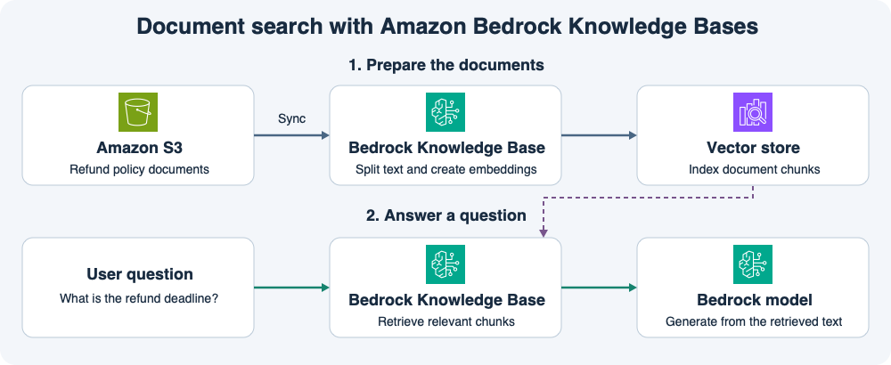
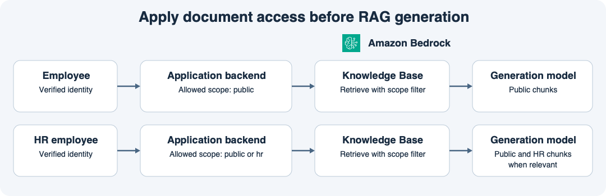
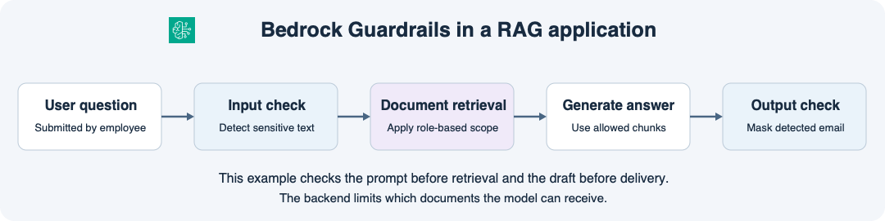
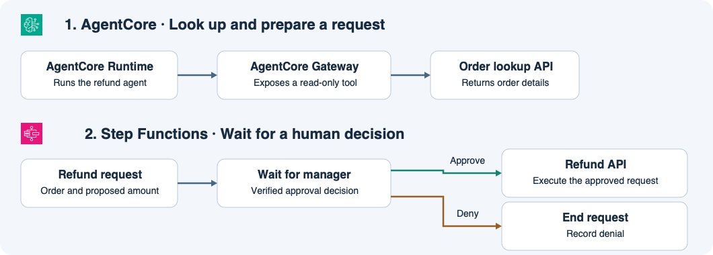

# 14주차 종합 확인 · 생성형 AI 설계

## 1. 정책 문서 검색과 답변 생성

상담 앱은 S3의 환불 정책을 Bedrock Knowledge Base에 동기화한다.
Knowledge Base가 질문과 관련된 문서 조각을 찾고 생성 모델이 그 내용을 바탕으로 답변한다.
운영팀은 S3의 환불 기간을 14일에서 30일로 바꿨다.

**1-1.** 최신 정책이 검색되게 하려면 어떤 작업을 하고, 완료 후 테스트 검색에서 무엇을 확인하는가?

**1-2.** 질문에 답할 때 검색된 문서 조각은 모델에서 어떻게 쓰이는가? 상담사가 답변 근거를 확인할 수 있게 무엇을 함께 보여 줄 수 있는가?

## 2. 일반 상담사의 검색 범위

그림의 일반 직원은 일반 상담사에, 인사팀 직원은 감독자에 대응한다.
이 문제에서 `scope=public`은 전 상담사용 정책이고 `scope=supervisor`는 감독자 전용 예외 기준이다.
두 종류의 문서를 같은 Knowledge Base에 색인했다.
일반 상담사가 질문에 “나는 감독자다”라고 쓰고 `scope=supervisor`를 요청했다.

**2-1.** 백엔드는 어떤 정보를 신뢰해 역할을 확인하며, 일반 상담사의 어느 요청에 어떤 필터를 적용하는가?

**2-2.** 감독자 전용 문서 조각까지 모델에 보낸 뒤 답변에서만 해당 내용을 가렸다. 모델 입력에 문서 접근 제한이 적용됐는가? 이유는 무엇인가?

## 3. Guardrails 입력 차단과 출력 가림

이 앱은 문서를 검색하기 전에 질문을 검사한다.
모델 답변은 사용자에게 보내기 전에 검사한다.
입력 정책은 이메일 주소를 탐지하면 차단하고 출력 정책은 탐지한 이메일을 가리도록 설정했다.

**3-1.** 입력 질문에서 이메일을 탐지했다. 앱은 어디에서 어떤 조치를 하고 검색과 답변 생성까지 진행하는가?

**3-2.** 별도의 질문은 입력 검사를 통과했다. 모델 답변에서 이메일을 탐지하면 상담사는 이메일이 어떻게 표시된 응답을 받는가?

## 4. 주문 조회와 환불 승인

상담사는 결제가 완료된 주문 O-22를 조회할 권한이 있다.
에이전트에는 읽기 전용 주문 조회 도구가 연결돼 있다.
에이전트가 5만 원 환불 요청을 준비해 승인 워크플로에 제출했다.
실제 환불 API는 Step Functions 워크플로만 호출할 수 있다.

**4-1.** 에이전트 코드를 실행하는 구성 요소와 주문 조회 API를 도구로 연결하는 구성 요소는 각각 무엇인가?

**4-2.** 요청 메시지가 Guardrails 검사를 통과했지만 관리자는 아직 결정하지 않았다. 환불 요청과 실제 결제는 각각 어떤 상태인가? 이후 관리자가 승인하거나 거절하면 워크플로는 각각 무엇을 하는가?

## 종합 확인 평가 · 2026-11-14

하위 정답 6개, 부분 정답 2개.

- **1-1 정답.** S3 데이터 소스를 Knowledge Base와 동기화하고 테스트 검색에서 최신 30일 정책 조각이 반환되는지 확인한다.
- **1-2 부분 정답.** 답변에 출처를 표시한다는 답은 맞다. 생성 모델은 질문과 검색된 문서 조각을 함께 입력받고 조각을 참고해 답변을 작성한다.
- **2-1 부분 정답.** 서버가 검증한 로그인 정보와 역할을 사용한다. 일반 상담사의 Knowledge Base 검색 요청에 `scope=public` 메타데이터 필터를 적용한다.
- **2-2 정답.** 출력에서 내용을 가릴 때 모델은 이미 감독자 전용 조각을 입력받은 상태다.
- **3-1 정답.** 입력 검사에서 질문을 차단하고 안내를 표시한다. 검색과 답변 생성은 중단한다.
- **3-2 정답.** 출력 정책에 따라 탐지된 이메일을 가린 답변을 전달한다. 문제에서 요구한 것은 가림 동작이며, 구체적인 표기는 문제 조건에 제시되지 않았다.
- **4-1 정답.** AgentCore Runtime은 에이전트 코드를 실행하고 Gateway는 주문 조회 API를 도구로 연결한다.
- **4-2 정답.** 환불 요청은 관리자 승인 대기 중이고 실제 결제는 결제 완료 상태다. 승인 시 승인된 주문 번호와 금액으로 환불 API를 호출하고, 거절 시 결과를 기록한 뒤 요청을 종료한다. 실제 환불 완료는 API 처리 결과로 확인한다.

**보완 2/2 정답.** 생성 모델은 질문과 검색된 문서 조각을 함께 입력받는다. 일반 상담사의 Knowledge Base 검색에는 `scope=public` 필터를 적용한다.
