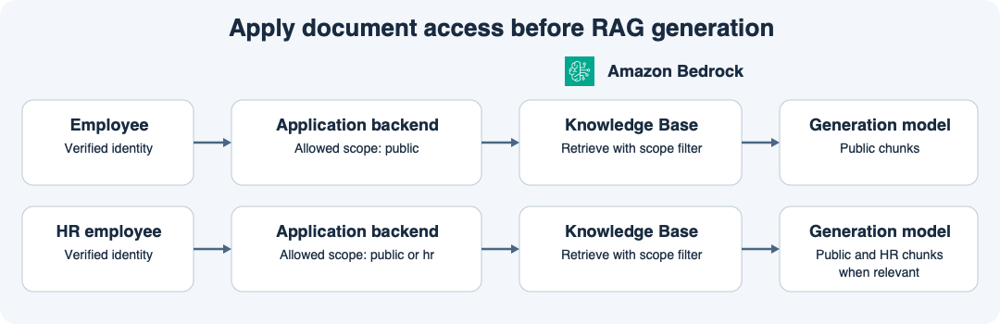
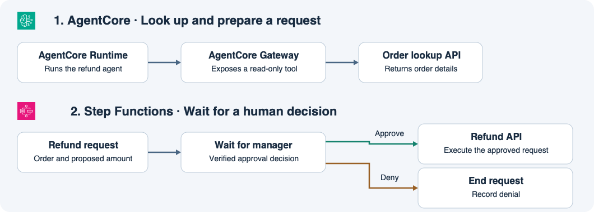

# 14주차 마지막 회상 복습 · 품질 문의와 보상 승인

고객 지원 앱은 S3의 보증 정책을 Amazon Bedrock Knowledge Base에 동기화한다.
일반 상담사와 품질 담당자는 같은 Knowledge Base를 사용한다.
문서에는 일반 상담사용 `audience=staff` 또는 품질 담당자 전용 `audience=quality`가 지정되어 있다.
이 앱에서는 백엔드가 인증된 역할을 바탕으로 검색 범위를 적용한다.

그림의 직원 역할과 문서 분류를 이 문제의 상담사 역할과 `audience`로 바꾸어 읽는다.

## 회상 문제

**1-1.** S3에서 무상 교환 기한을 7일에서 21일로 수정했다.
최신 정책을 검색에 반영하려면 어떤 작업을 하고 완료 후 무엇을 확인하는가?

**1-2.** “무상 교환은 며칠 동안 가능한가요?”라는 질문에 답할 때 모델에 어떤 두 가지 정보를 보내는가?
상담사가 근거를 직접 확인할 수 있게 응답에 무엇을 포함하는가?

**2-1.** 일반 상담사가 요청 본문에 `audience=quality`를 보냈다.
백엔드는 어느 정보로 역할을 판단하고 어느 요청에 어떤 필터를 적용해야 하는가?

**2-2.** 앱은 질문을 검색 전에 검사하며 탐지된 전화번호를 차단한다.
별도 요청에서는 질문이 검사를 통과했고 답변에서 전화번호가 탐지되었다.
출력 설정은 가림이다.
첫 요청에서 검색과 모델 호출이 진행되는가? 두 번째 요청에서 사용자에게 어떤 답변을 전달하는가?

그림의 주문 조회와 환불은 이 문제의 보증 상태 조회와 보상금 지급에 대응한다.

**3-1.** 에이전트는 읽기 전용 보증 상태 API를 도구로 호출한다.
에이전트 코드를 실행하는 AgentCore 구성 요소와 API를 도구로 연결하는 구성 요소는 각각 무엇인가?

**3-2.** 에이전트가 보상금 3만 원 지급 요청을 제출했고 Guardrails 검사는 통과했다.
관리자는 아직 결정하지 않았으며 실제 지급 API는 Step Functions 워크플로만 호출할 수 있다.
현재 요청 상태와 지급 여부를 설명한다.
이후 관리자가 승인하거나 거절하면 워크플로는 각각 무엇을 하는가?

## 공식 참고 자료

- [Amazon Bedrock Knowledge Bases](https://docs.aws.amazon.com/bedrock/latest/userguide/knowledge-base.html)
- [Amazon Bedrock Guardrails](https://docs.aws.amazon.com/bedrock/latest/userguide/guardrails.html)

## 회상 평가 · 2026-11-16

정답 3개, 부분 정답 2개, 오답 1개.

- **1-1 정답.** S3 데이터 소스를 Knowledge Base와 동기화한다. 테스트 검색에서 21일 정책 조각이 반환되는지 확인한다.
- **1-2 정답.** 질문과 검색된 문서 조각을 모델에 전달한다. 응답에는 원문을 확인할 수 있는 출처를 포함한다.
- **2-1 부분 정답.** `audience=staff` 값은 맞다. 백엔드는 서버가 검증한 로그인 정보로 역할을 확인하고 이 값을 Knowledge Base 검색 요청의 필터에 넣는다.
- **2-2 정답.** 첫 요청은 입력 단계에서 차단해 검색과 모델 호출을 중단한다. 두 번째 요청은 전화번호를 가린 답변을 반환한다.
- **3-1 오답.** AgentCore Runtime이 에이전트 코드를 실행하고 AgentCore Gateway가 읽기 전용 보증 상태 API를 도구로 연결한다. Step Functions는 승인 흐름을 진행한다.
- **3-2 부분 정답.** 실제 지급이 아직 이뤄지지 않았다는 답은 맞다. 현재 요청 상태는 관리자 승인 대기다. 승인 시 보상금 지급 API를 호출하고 거절 시 결과를 기록하고 요청을 종료한다. 답변의 Refund API와 End Request는 문제에서 사용한 참고 그림의 분기 이름으로 인정했다.

**보완 3/3 정답.** 백엔드가 검증한 로그인 정보로 역할을 확인하고 Knowledge Base 검색에 `audience=staff`를 적용한다. AgentCore Runtime은 코드를 실행하고 Gateway는 API를 도구로 연결한다. 지급 요청은 관리자 승인 대기 상태다.

### 3-2 시나리오의 요청 흐름

- **접수 → 관리자 승인 대기.** Step Functions가 관리자 결정을 기다린다. 보상금은 미지급 상태다.
- **승인 → 지급 API 호출 → 지급 결과 확인.** API가 지급 성공을 반환하면 지급 완료로 처리한다.
- **거절 → 거절 기록 → 요청 종료.** 보상금은 미지급 상태다.
