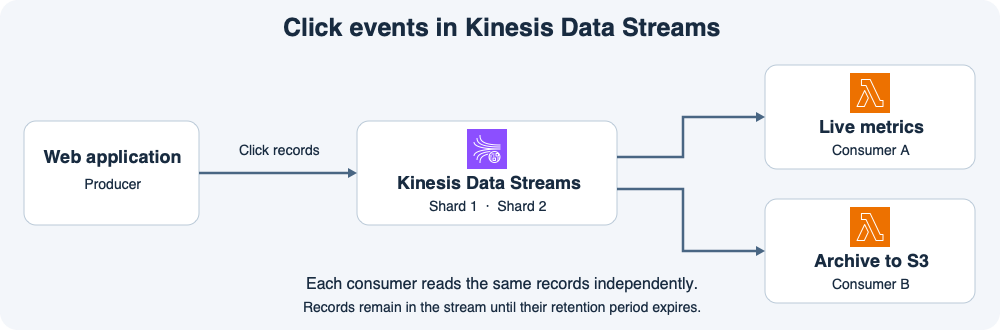
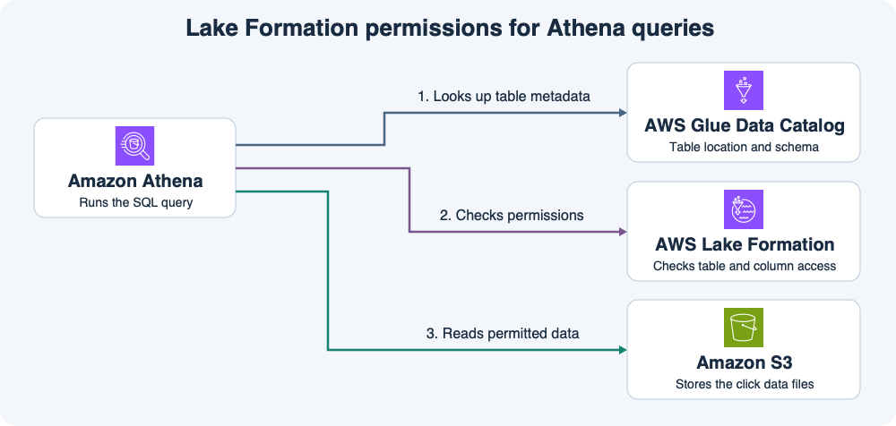
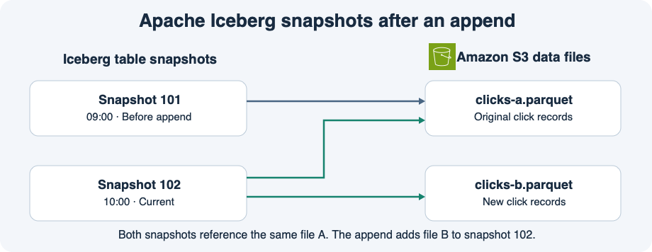

# 13주차 마지막 회상 복습 · 공연 예매 데이터

## 1. Kinesis로 예매 이벤트 수집



그림의 클릭 이벤트를 예매 이벤트로 바꿔 생각한다. 예매 앱은 공연 ID와 예매 시각이 담긴 이벤트를 Kinesis에 기록한다. 소비자 A는 실시간 집계를 하고 B는 원본을 S3에 저장한다. 보존 기간은 24시간이고 샤드 구성은 고정돼 있다.

**1-1.** A가 정오의 이벤트를 이미 읽었다. B가 한 시간 뒤 자신의 마지막 처리 위치에서 재개하면 이 이벤트를 읽을 수 있는가? 이유는 무엇인가?

**1-2.** 같은 공연의 이벤트를 같은 샤드에 보내면서 공연별로 파티션 키를 나누려면 어떤 값을 쓰는가? 모든 공연에 고정값 `booking`을 쓰면 부하는 어떻게 분포하는가?

## 2. Athena 조회와 컬럼 권한



`bookings` 외부 테이블이 S3의 `bookings/`에 있는 CSV를 가리킨다. CSV에는 `show_id`와 `buyer_email` 컬럼이 있다. 이 위치는 Lake Formation에 등록돼 있다. 분석가 역할에는 `show_id`에 대한 Lake Formation `SELECT`와 Athena 쿼리 실행에 필요한 IAM 권한이 있다.

**2-1.** 분석가가 공연별 예매 건수를 집계한다. SQL을 실행하는 서비스는 무엇이며, 테이블 정의와 실제 CSV는 각각 어디에서 읽는가?

**2-2.** 같은 역할이 Athena에서 `SELECT buyer_email FROM bookings`를 실행하면 어떤 결과가 나오는가? 이후 해당 원본 객체를 직접 읽을 수 있는 유효한 S3 권한을 부여받는다면 CSV에서 이메일을 볼 수 있는가? 두 경우에 적용되는 권한을 설명한다.

## 3. Iceberg 과거 조회



그림은 이전 스냅샷과 현재 스냅샷이 기존 파일을 함께 참조하는 예다. 이 문제에서는 `bookings_iceberg`의 스냅샷 301이 파일 P를 참조한다. 파일 Q를 추가해 커밋한 스냅샷 302가 현재 상태다. 두 스냅샷과 참조 파일은 모두 보존돼 있다.

**3-1.** 일반 `SELECT`와 스냅샷 301을 지정한 조회는 각각 어떤 파일을 읽는가? Q를 추가하면서 P를 새 스냅샷용으로 복사해야 하는가?

**3-2.** Athena에서 스냅샷 **ID 301**을 지정하는 `SELECT`를 한 줄로 작성한다. 이 쿼리를 실행한 뒤 일반 `SELECT`는 어느 스냅샷을 읽는가?

## 회상 평가 · 2026-11-16

정답 5개, 부분 정답 1개.

- **1-1 정답.** 소비자 B는 자신의 처리 위치에서 재개한다. A가 읽은 레코드도 24시간 보존 기간 안에는 읽을 수 있다.
- **1-2 정답.** 공연 ID를 파티션 키로 사용한다. 고정값 `booking`을 쓰면 해당 쓰기가 한 샤드에 집중된다.
- **2-1 정답.** Athena가 SQL을 실행한다. Glue Data Catalog에서 테이블 정의를 읽고 S3에서 CSV를 읽는다.
- **2-2 정답.** Athena의 이메일 조회는 Lake Formation 컬럼 권한 때문에 거부된다. 유효한 `s3:GetObject` 권한으로 원본 CSV를 직접 읽으면 이메일을 볼 수 있다.
- **3-1 정답.** 일반 SELECT는 302의 P와 Q를 읽고, 301을 지정하면 P를 읽는다. 두 스냅샷이 파일 P를 참조한다.
- **3-2 부분 정답.** 일반 SELECT가 현재 스냅샷 302를 읽는다는 답은 맞다. 스냅샷 ID 301을 지정하는 SQL은 아래와 같다.

```sql
SELECT * FROM bookings_iceberg FOR VERSION AS OF 301;
```

**3-2 보완 정답.** `SELECT * FROM bookings_iceberg FOR VERSION AS OF 301;`로 스냅샷 301을 조회한다. 13주차 종합 확인과 마지막 회상 복습을 마쳤다.
