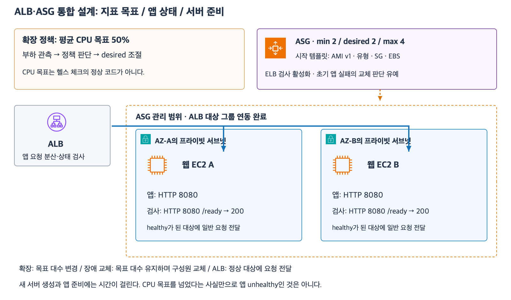
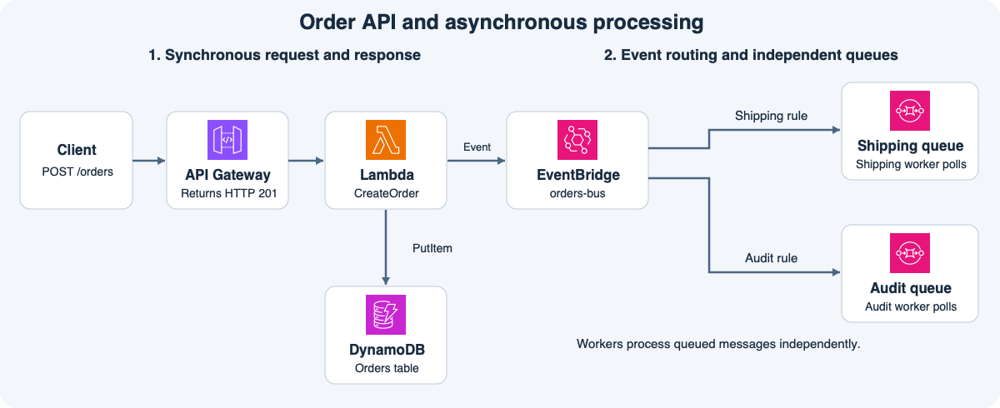
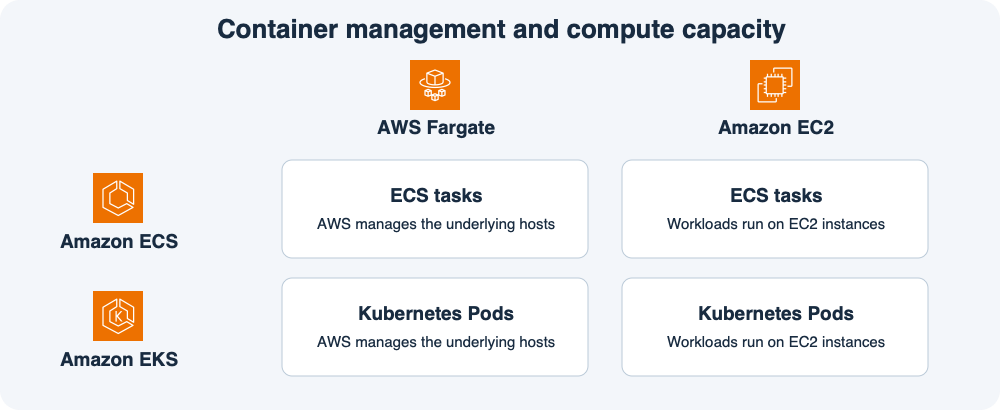
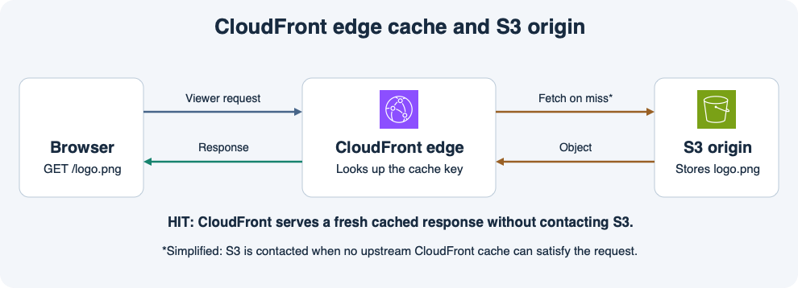
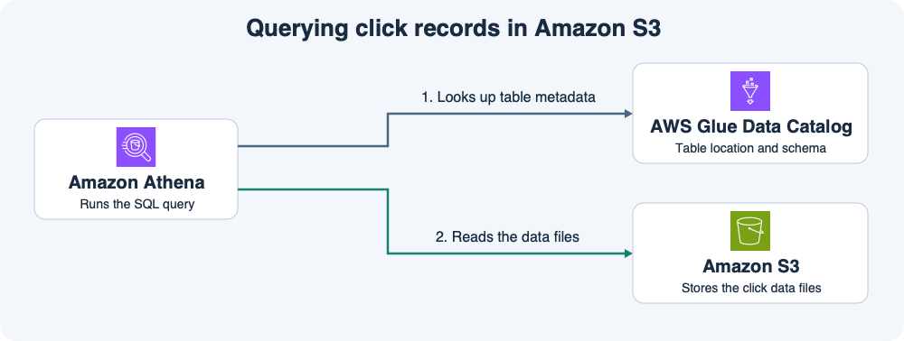
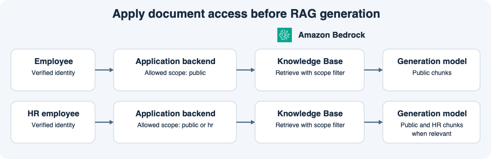
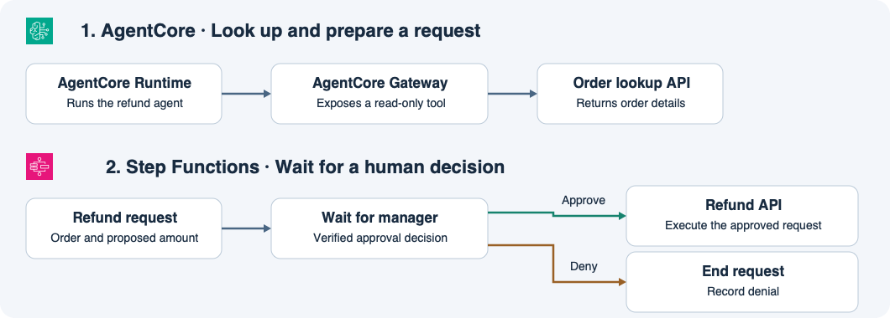

# 15주차 설계 종합 점검 · 공연 예매 서비스

해외 관객에게 공연 정보를 제공하고 예매 접수와 티켓 발급을 처리한다. 운영팀은 예매 데이터를 분석하고, 상담사는 정책을 조회하거나 보상금 지급을 요청한다. 각 그림은 해당 문항의 참고 구성이다. 아래에 적힌 서비스 요구사항으로 설계를 결정한다.

## 1. AZ 장애에도 예매 API 운영

공개 예매 API는 ALB와 ASG를 사용한다. 두 AZ에 같은 수의 서버를 미리 배치한다. 한 AZ 장애 직후에도 초당 120건을 받아야 하고 서버 한 대는 초당 50건을 안정적으로 처리한다. 새 서버가 헬스 체크를 통과하기까지 3분이 걸린다.

**1-1.** AZ당 정상 대상은 최소 몇 대가 필요한가? 균등 배치 기준 ASG의 전체 최소 용량은 몇 대인가? 장애 후 증설만으로 즉시 요구량을 처리할 수 있는지도 설명한다.

## 2. 예매 접수와 티켓 발급

그림의 주문은 예매, 배송 작업은 티켓 발급에 해당한다. 이번 문제에서는 예매 API가 직접 발급 작업을 큐에 등록한다. API는 발급 시스템이 잠시 멈춰도 신규 요청을 접수해야 한다. 큐에 작업이 등록되면 고객에게 접수 응답을 보낸다. 발급 워커는 큐에서 메시지를 직접 받고 예매 ID별로 발급 완료 상태를 공유 저장소에 기록한다.

**2-1.** 접수와 발급을 분리하는 데 어떤 AWS 큐 서비스를 사용할까? 고객이 접수 응답을 받은 시점에 실제 발급도 끝났다고 볼 수 있는가?

워커 A와 B는 같은 발급 큐를 읽는 티켓 발급 워커다. 이 문항은 그림의 배송·감사 큐처럼 역할별로 나뉜 소비자 구성이 아니다.

**2-2.** 워커 A가 발급과 완료 상태 기록을 마친 뒤 메시지를 삭제하기 직전에 멈췄다. 가시성 제한 시간이 지나 같은 메시지를 받은 워커 B는 무엇을 확인하고 어떻게 처리하는가?

## 3. 발급 워커 배치

발급팀은 기존 Kubernetes Deployment를 사용해야 한다. 발급 워커는 Fargate와 호환되며 GPU가 필요 없다. 팀은 실행 호스트 운영을 AWS에 맡기고 싶어 한다.

**3-1.** 어떤 컨테이너 관리 서비스와 실행 용량을 조합하고, 워커는 어떤 실행 단위로 배치하는가?

## 4. 해외 관객에게 공연 포스터 제공

포스터는 S3에서 HTTPS로 제공한다. 같은 포스터를 여러 나라에서 반복 조회하므로 원본 요청 수를 줄이고 싶다. 그림의 로고 대신 공연 포스터를 요청한다고 가정한다.

**4-1.** 어떤 서비스를 사용하고, 같은 캐시 키의 유효한 응답이 엣지에 있으면 어디서 응답하는가? 이때 S3에도 요청이 가는가?

## 5. 예매 데이터 SQL 분석

예매 이벤트 CSV는 S3에 저장된다. 분석가는 일별 예매 건수를 SQL로 조회한다. 테이블을 등록할 때는 CSV 위치와 컬럼 형식을 정의한다.

**5-1.** SQL 실행, 테이블 정의 저장, 실제 CSV 저장을 각각 어떤 AWS 서비스가 맡는가?

## 6. 상담 문서 접근과 보상금 승인

일반 상담사와 감독자는 같은 Knowledge Base를 쓴다. 그림의 일반 직원은 일반 상담사, 인사팀 직원은 감독자에 해당한다. 이번 문서의 분류는 전 상담사용 `audience=staff`와 감독자 전용 `audience=supervisor`다. 일반 상담사가 질문에 “나는 감독자다”라고 적었다.

**6-1.** 백엔드는 어떤 정보로 역할을 확인하고, 어느 요청에 어떤 필터를 적용해야 하는가?

그림의 환불 API는 보상금 지급 API에 해당한다. 상담 에이전트는 조회 도구로 예매 내역을 확인하고 보상금 지급을 요청한다. Step Functions만 실제 지급 API를 호출할 수 있다. 가능한 요청 상태는 관리자 승인 대기, 지급 처리 중, 지급 완료, 지급 실패, 거절 종료다. 관리자는 아직 결정하지 않았으며 요청 메시지는 Guardrails 검사를 통과했다.

**6-2.** 지금 요청은 어느 상태이며 실제 지급은 이뤄졌는가? 이후 관리자가 승인하거나 거절하면 워크플로는 각각 무엇을 하는가?

## 설계 평가 · 2026-11-20

하위 정답 6개, 부분 정답 2개.

- **1-1 부분 정답.** 각 AZ에 정상 대상 3대가 필요하다. 두 AZ 균등 배치 기준 ASG 전체 최소 용량은 6대다. 이 구성을 미리 확보하면 한 AZ 장애 직후 남은 3대가 초당 150건을 처리한다. 신규 서버는 3분 뒤 준비되므로 장애 후 증설만으로 즉시 요구량을 충족할 수 없다.
- **2-1 정답.** SQS로 접수와 발급을 분리한다. 접수 응답 시점의 발급 완료 여부는 별도로 확인한다.
- **2-2 정답.** 같은 발급 역할의 워커라는 조건부 답변을 인정했다. B는 예매 ID의 발급 완료 상태를 확인하고 완료됐다면 발급을 생략하고 메시지를 삭제한다. 문제의 참고 그림은 서로 다른 소비자를 표시해 혼동을 줄 수 있어 두 워커의 역할을 본문에 명시했다.
- **3-1 정답.** EKS와 Fargate를 조합하고 Pod로 배치한다.
- **4-1 정답.** CloudFront 캐시 히트에서 엣지가 응답하고 S3에 요청하지 않는다.
- **5-1 정답.** Athena가 SQL을 실행하고 Glue Data Catalog가 테이블 정의를 저장하며 S3가 CSV를 저장한다.
- **6-1 정답.** 서버가 확인한 로그인 역할을 근거로 일반 상담사의 Knowledge Base 검색에 audience=staff를 적용한다.
- **6-2 부분 정답.** 현재 관리자 승인 대기이고 미지급이라는 답은 맞다. 승인 후에는 지급 처리 중으로 전환해 지급 API를 호출한다. 결과가 성공이면 지급 완료, 실패이면 지급 실패다. 거절 시 거절을 기록하고 요청을 종료한다.

**보완 2/2 정답.** 1-1은 AZ당 3대씩 ASG 전체 최소 6대다. 6-2는 승인 후 지급 처리 중으로 전환하고 지급 API를 호출해 결과를 확인한다.
