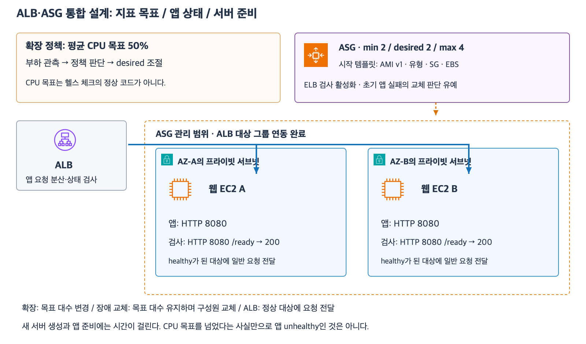
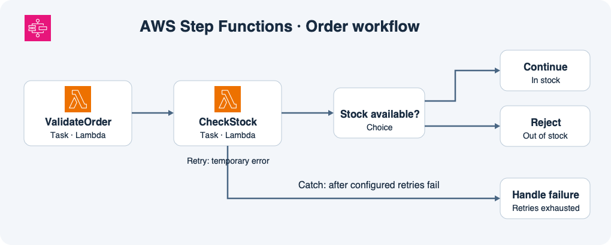
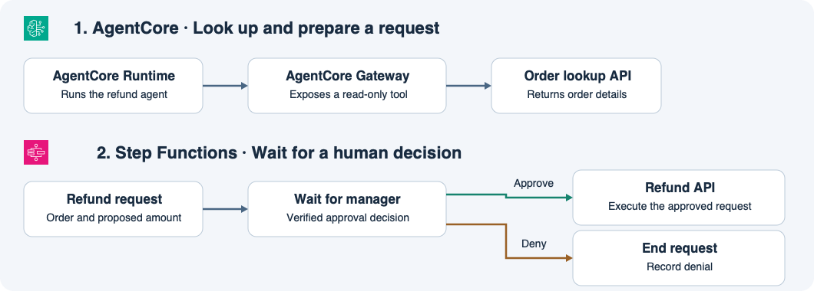

# 15주차 종합 확인 · 9~14주차 20문항

문항 번호를 붙여 답한다. 이유를 묻는 문항은 한 문장으로 설명한다.

## 1~3. 고가용성과 확장성



1번의 계산에는 아래 수치와 조건을 적용한다.

1. 두 AZ에 같은 수의 웹 서버를 배치한다. 한 대는 초당 80건을 안정적으로 처리한다. 어느 한 AZ가 멈춘 직후에도 초당 250건을 처리하려면 AZ당 몇 대를 미리 확보하고 ASG 전체 최소 용량을 몇 대로 잡아야 하는가?
2. 결제 기능과 무관한 공개 상품 목록을 제공하는 웹 앱이 있다. ALB 헬스 체크가 모든 서버에 공통인 결제 API까지 검사해 결제 API 장애 시 모든 서버를 비정상으로 판정했다. 상품 목록을 계속 제공하면서 결제 장애를 감지하려면 서버별 ALB 검사와 별도 점검에서 무엇을 확인할까?
3. 이 웹 ASG의 목표 추적 기준은 대당 분당 450건이고 안정 처리 한도는 650건이다. 정상 대상 8대가 분당 4,000건을 균등하게 받는다. 대당 부하는 얼마이며 두 기준을 각각 충족하는가?

## 4~7. 서버리스와 메시징

4. API Gateway가 Lambda를 동기 호출한다. Lambda는 SQS에 작업을 등록한 뒤 성공 결과를 반환한다. API Gateway가 기다리는 결과는 무엇이며, 고객이 성공 응답을 받았을 때 후속 작업까지 끝났다고 판단할 수 있는가?
5. 워커가 SQS 메시지를 수신했지만 삭제 전에 종료됐다. 메시지는 보존 기간 안에 있고 수신 한도도 남아 있다. 어떤 시간이 지난 뒤 다른 워커가 다시 받을 수 있는가?
6. 이벤트 하나를 알림팀과 정산팀이 각각 처리하고, 각 팀 내부 워커는 작업을 나눠 맡아야 한다. SNS 토픽과 SQS 큐를 어떻게 연결할까?
7. Classic EventBridge 버스의 규칙 A는 `shop.orders`의 `OrderPaid`만 배송 큐로 보낸다. 규칙 B는 같은 출처의 `OrderPaid`와 `OrderCancelled`를 감사 큐로 보낸다. 두 이벤트가 하나씩 들어오면 각각 어디로 전달되는가?

## 8~10. 컨테이너와 워크플로

8. ECS 서비스가 ECR의 `api:v1`을 가리키는 태스크 정의를 사용한다. ECR에 `api:v2`를 별도 태그로 올렸고 서비스 설정은 그대로다. 종료된 태스크를 대체할 때 어느 버전을 실행하는가? v2로 배포하려면 무엇을 바꿀까?
9. 기존 Kubernetes Deployment를 그대로 사용하고 GPU가 필요 없는 호환 워커의 호스트 운영은 AWS에 맡기고 싶다. 어떤 서비스와 실행 용량을 조합하며 실행 단위는 무엇인가?



10. Step Functions의 재고 조회 Task는 정상 결과 `inStock=false`를 반환하거나 타임아웃 오류를 낸다. 정상 결과에 따른 분기에는 어떤 상태를 쓰는가? 타임아웃을 최대 두 번 재시도하도록 설정했는데 계속 실패하면 총 몇 번 호출하며 무엇이 실패 처리 경로로 넘기는가?

## 11~13. DNS와 엣지

11. Route 53에서 루트 도메인 `example.com`을 기존 ALB로 연결한다. 레코드 유형, 켜야 할 설정, 대상을 각각 적는다.
12. 원본이 `/poster.png?lang=ko`와 `/poster.png?lang=en`에 다른 이미지를 준다. 언어별 응답을 분리하려면 CloudFront 캐시 키에 무엇을 넣을까? 같은 키에 유효한 이전 응답이 있으면 원본 교체 직후 어느 이미지가 반환될 수 있는가?
13. UDP 게임 클라이언트에 고정 진입 IP를 제공하고 가까운 AWS 엣지에서 리전 NLB까지 AWS 글로벌 네트워크를 사용하려 한다. 어떤 서비스를 선택하는가? 장애로 새 트래픽이 다른 리전으로 가면 클라이언트가 진입 IP를 바꿔야 하는가?

## 14~17. 데이터 처리와 분석

14. Kinesis에서 소비자 A가 이벤트를 읽었다. 소비자 B는 두 시간 멈췄다가 자기 처리 위치에서 재개했다. 이벤트는 24시간 보존 기간 안에 있다. B도 해당 이벤트를 읽을 수 있는가? 이유는 무엇인가?
15. Athena로 S3의 CSV를 조회하는데 Glue Data Catalog의 테이블 위치가 실제 파일이 없는 접두사를 가리킨다. 어느 설정을 바꿔야 하며 Athena는 실제 파일을 어디에서 읽는가?
16. 분석가에게 Lake Formation의 `product_id` 컬럼 SELECT 권한만 있고 Athena 실행 권한은 있다. `customer_id` 조회가 가능한가? 원본 CSV에 대한 유효한 `s3:GetObject` 권한을 별도로 받으면 S3에서 직접 내려받아 해당 컬럼을 볼 수 있는가?
17. Athena의 `sales_iceberg` 테이블은 현재 스냅샷 412를 사용한다. 보존된 스냅샷 ID 411을 읽는 SQL을 한 줄로 쓰고 이후 일반 SELECT가 읽는 스냅샷을 적는다.

## 18~20. 생성형 AI 설계



20번에서 그림의 주문 조회는 보상 기준 조회, 환불 API는 보상금 지급 API에 대응한다.

18. S3에서 보증 기한을 7일에서 21일로 바꿨다. Bedrock Knowledge Base가 최신 문서 조각을 검색하게 하려면 어떤 작업을 하고 테스트 검색에서 무엇을 확인할까?
19. 일반 상담사용 문서는 `audience=staff`, 감독자 전용 문서는 `audience=supervisor`다. 일반 상담사가 요청 본문에 감독자라고 적었다. 백엔드는 무엇으로 역할을 확인하고 어느 요청에 어떤 필터를 넣을까?
20. 보상금 지급 요청이 Guardrails를 통과했고 관리자는 아직 결정하지 않았다. 가능한 요청 상태는 관리자 승인 대기, 지급 처리 중, 지급 완료, 지급 실패, 거절 종료다. 현재 상태와 실제 지급 여부를 적고, 관리자가 승인하면 Step Functions가 어떤 API를 호출하며 그 결과를 어떻게 반영하는지 설명한다.

## 종합 확인 평가 · 2026-11-25

정답 14개, 부분 정답 5개, 오답 1개.

- **정답.** 1~4, 6~9, 11~14, 16, 18번. 8번의 배포는 v2를 가리키는 태스크 정의 리비전을 ECS 서비스에 적용한다. 11번은 기존 ALB를 Alias 대상으로 선택한다.
- **5번 오답.** 수신 후 숨겨지는 기간은 가시성 제한 시간이다. 그 시간이 지나면 삭제되지 않은 메시지를 다른 워커가 다시 받을 수 있다. 수신 한도는 메시지를 받은 횟수 기준이다.
- **10번 부분 정답.** 3회 호출은 맞다. 정상 결과는 Choice에서 분기하고, 재시도를 소진한 타임아웃 오류는 Catch가 실패 처리 경로로 넘긴다. 문항 앞에 누락된 워크플로 그림을 추가했다.
- **15번 부분 정답.** Glue Data Catalog의 해당 테이블 `LOCATION`을 실제 CSV가 있는 S3 경로로 수정한다. Athena는 S3에서 파일을 읽는다.
- **17번 부분 정답.** 일반 SELECT는 현재 스냅샷 412를 읽는다. 스냅샷 ID 411을 지정하는 구문은 아래와 같다.
- **19번 부분 정답.** 백엔드가 검증된 로그인 정보로 역할을 확인한다. 일반 상담사의 **Knowledge Base 검색 요청**에 `audience=staff` 필터를 넣는다.
- **20번 부분 정답.** 승인 대기 및 미지급 상태와 지급 API 호출은 맞다. 승인하면 지급 처리 중으로 전환하고 API를 호출한다. 결과에 따라 지급 완료 또는 지급 실패로 처리한다.

```sql
SELECT * FROM sales_iceberg FOR VERSION AS OF 411;
```

**보완 완료.** 가시성 제한 시간, 실제 S3 경로를 가리키는 테이블 LOCATION, `FOR VERSION AS OF 411`, Knowledge Base 검색 요청의 필터, 지급 결과에 따른 완료·실패 기록을 확인했다. 10번은 이번 Catch 답변과 66번 수업에서 답한 Choice 분기를 함께 반영했다. 15주차 설계 과제와 종합 확인을 마쳤다.
