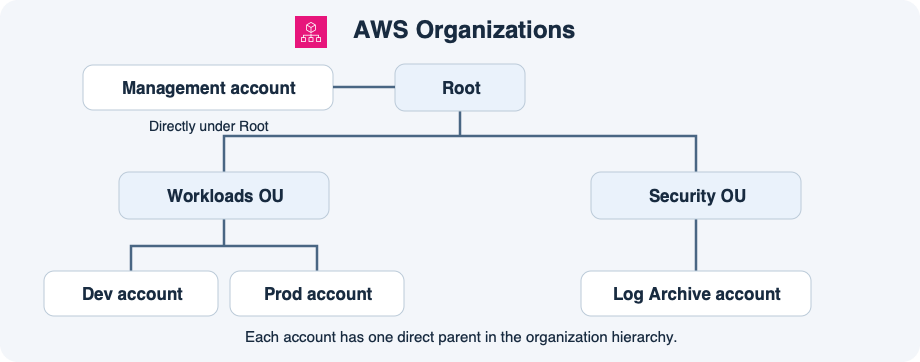

# 16주차 첫 수업 · AWS Organizations와 OU

AWS Organizations는 여러 AWS 계정을 한 조직에서 관리하는 서비스다.
개발 환경, 운영 환경, 감사 로그 저장소를 서로 다른 멤버 계정에 두면 계정별로 리소스와 권한을 관리할 수 있다.
이 예에서는 관리 계정이 조직을 관리하고 개발·운영 리소스는 멤버 계정에서 실행한다.

조직의 **Root**는 계정과 OU를 묶는 계층의 맨 위다. **OU(Organizational Unit)**는 여러 계정을 그룹화하고 공통 정책을 적용할 수 있는 단위다.
OU 안에 하위 OU도 만들 수 있다. 계정의 직접 상위는 Root 또는 OU 하나다.

예를 들어 개발 계정과 운영 계정은 Workloads OU에 두고 로그 보관 계정은 Security OU에 둔다.
개발과 운영에 서로 다른 정책을 적용하고 싶다면 Workloads 아래에 Dev OU와 Prod OU를 만들 수 있다.
운영 계정을 Prod OU로 옮기는 작업은 조직 계층에서 계정의 위치를 바꾼다.
기존 운영 리소스는 그 운영 계정에 계속 속한다.

AWS 공식 문서는 조직이 하나의 Root를 가지며 OU가 계정 그룹을 이룬다고 설명한다.
AWS는 워크로드를 멤버 계정에 배치하고 관리 계정은 조직 관리에 집중하도록 권장한다.
[AWS Organizations 용어와 개념](https://docs.aws.amazon.com/organizations/latest/userguide/orgs_getting-started_concepts.html)

## 확인 문제

그림에서 관리 계정은 Root 바로 아래에 있다.
Workloads OU에는 Dev 계정과 Prod 계정이 있고 Security OU에는 Log Archive 계정이 있다.
회사는 운영 환경에만 별도 조직 정책을 적용할 계획이다.

**1-1.** 그림에서 조직의 최상위 컨테이너는 무엇인가? Dev 계정의 직접 상위는 무엇인가?

**1-2.** 운영 앱과 감사 로그를 각 목적에 맞는 멤버 계정에 둔다면 어느 계정에 각각 배치하는가?

**2-1.** Workloads 아래에 Prod OU를 새로 만들었다. Prod 계정을 Workloads와 Prod OU에 동시에 직접 소속시킬 수 있는가? 옮긴 뒤 직접 상위는 무엇인가?

**2-2.** Prod 계정을 새 OU로 옮기면 기존 운영 EC2는 어느 계정에 속하는가? 이때 무엇의 위치를 바꾼 것인가?

## 확인 문제 평가 · 2026-11-26

정답 3개, 부분 정답 1개.

- **1-1 정답.** 최상위 컨테이너는 Root이고 Dev 계정의 직접 상위는 Workloads OU다.
- **1-2 정답.** 운영 앱은 Prod 계정에, 감사 로그는 Log Archive 계정에 둔다.
- **2-1 정답.** 계정은 직접 상위를 하나만 갖는다. 이동 뒤 Prod 계정의 직접 상위는 Prod OU다.
- **2-2 부분 정답.** 운영 EC2는 Prod 계정에 속한다. 조직 계층에서 위치를 옮긴 대상은 Prod 계정이다. 이동으로 Prod 계정의 직접 상위가 Workloads OU에서 Prod OU로 바뀐다.

**2-2 보완 정답.** Prod 계정을 옮겨 직접 상위가 Workloads OU에서 Prod OU로 바뀐다.
