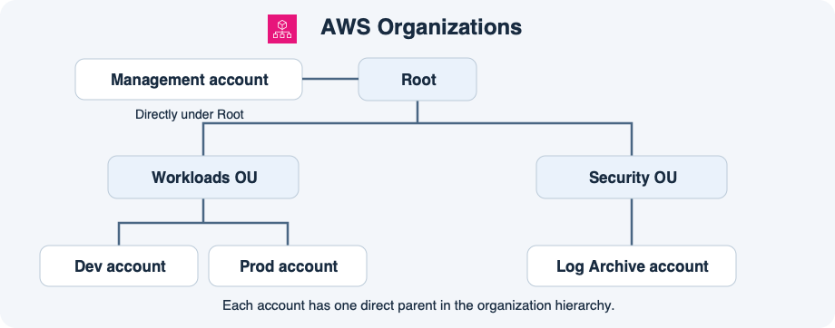

# 16주차 두 번째 수업 · SCP와 IAM 권한

AWS Organizations의 **SCP(Service Control Policy)**는 멤버 계정의 IAM 사용자와 역할이 사용할 수 있는 권한의 범위를 정한다.
역할이 어떤 작업을 수행하려면 IAM 권한도 있어야 하고 조직 계층의 SCP가 그 작업을 허용하는 범위 안에 있어야 한다.

예를 들어 Prod 계정의 역할에 IAM으로 `s3:DeleteBucket`을 허용해도 상위 OU의 SCP가 그 작업을 명시적으로 거부하면 요청은 거부된다.
역할에 `AdministratorAccess`를 부여한 경우에도 적용되는 SCP의 명시적 거부가 우선한다.

반대로 SCP가 작업을 허용하는 범위에 넣어도 그 자체로 역할에 권한을 부여하지 않는다.
이 수업처럼 IAM 역할의 자격 증명 기반 정책을 통해 접근하는 예에서는 해당 역할에 IAM 허용도 필요하다.

SCP의 적용 범위는 연결한 위치로 정한다.
Root에 연결하면 조직의 멤버 계정에, OU에 연결하면 그 아래의 멤버 계정에, 멤버 계정에 직접 연결하면 그 계정에 적용된다.
관리 계정의 사용자와 역할은 조직 SCP의 제한을 받지 않는다.

| IAM이 작업을 허용하는가 | 적용되는 SCP의 범위 안에 있는가 | 이 예제의 결과 |
|---|---|---|
| 예 | 예 | 허용 |
| 예 | 아니요 | 거부 |
| 아니요 | 예 | 거부 |

SCP는 멤버 계정의 권한 상한을 정하며 IAM 권한과 함께 평가된다.
특정 작업을 SCP가 차단한 경우 IAM에서 같은 작업을 허용해도 수행할 수 없다.
[AWS Organizations SCP 공식 문서](https://docs.aws.amazon.com/organizations/latest/userguide/orgs_manage_policies_scps.html)

## 확인 문제

그림처럼 Dev와 Prod 계정은 **Workloads OU**, Log Archive 계정은 **Security OU**에 있다.
관리 계정은 Root 바로 아래에 있다.
아래 문제는 각 역할의 IAM 정책과 SCP만 고려한다. 
문에 명시한 제한 외에는 조직 계층의 SCP가 요청을 허용하는 범위라고 가정한다.

**1-1.** Dev와 Prod의 운영 역할은 모두 IAM에서 `s3:DeleteBucket`을 허용받았다. **Prod 계정에만 직접 연결된 SCP**가 `s3:DeleteBucket`을 명시적으로 거부한다. 각 역할이 자기 계정의 버킷을 삭제하려 하면 어떻게 되는가?

**1-2.** 1-1에서 Prod 역할에 IAM의 `AdministratorAccess`를 부여했다. 이 역할로 버킷을 삭제할 수 있는가? 이유는 무엇인가?

**2-1.** Dev의 별도 조회 역할에는 `s3:ListBucket`에 대한 IAM 허용이 없다. 이 작업은 적용되는 SCP의 허용 범위에 있다. 이 역할이 버킷의 객체 목록을 조회할 수 있는가? 이유는 무엇인가?

**2-2.** 이번에는 `s3:DeleteBucket`을 명시적으로 거부하는 SCP를 **Workloads OU**에 연결했다. 이 SCP는 Dev, Prod, Log Archive 중 어느 계정의 IAM 역할에 적용되는가? 같은 SCP를 **Root**에 연결하면 관리 계정의 IAM 역할에도 적용되는가?

## 확인 문제 평가 · 2026-11-27

하위 4/4 정답.

- **1-1.** Dev 역할은 버킷을 삭제할 수 있다. Prod 역할의 삭제 요청은 계정에 연결된 SCP의 명시적 거부로 차단된다.
- **1-2.** IAM의 `AdministratorAccess`를 부여해도 SCP에서 `s3:DeleteBucket`을 명시적으로 거부하므로 삭제 요청은 차단된다. 답변의 액션 이름은 입력 오타로 처리했다.
- **2-1.** Dev 조회 역할에 IAM의 `s3:ListBucket` 허용이 없어 목록을 조회할 수 없다. SCP는 해당 작업이 가능한 권한 범위를 정한다.
- **2-2.** Workloads OU의 SCP는 Dev와 Prod의 역할에 적용된다. Root에 연결한 SCP는 멤버 계정에 적용되며 관리 계정의 역할은 SCP 제한에서 제외된다.
