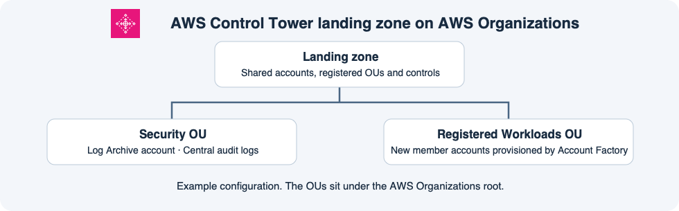

# 16주차 세 번째 수업 · AWS Control Tower 기초

**AWS Organizations**에서는 Root 아래에 OU를 배치하고 각 AWS 계정을 Root 또는 OU 아래에 둔다.
예를 들어 직전 수업에서는 Root 아래에 Workloads OU를 두고 Dev 계정과 Prod 계정을 그 OU에 배치했다.

**AWS Control Tower**는 이 Organizations 구조 위에서 등록된 OU와 계정에 공통 보안·운영 기준을 적용한다.

**랜딩 존(Landing zone)**은 여러 계정을 운영하기 위한 기본 환경이다.
공유 계정과 로그 수집 설정을 마련하고 등록된 OU에 공통 기준을 적용할 수 있다.
[AWS Control Tower 랜딩 존 계획](https://docs.aws.amazon.com/controltower/latest/userguide/planning-your-deployment.html)

**Account Factory**는 새 AWS 계정을 표준 구성으로 만들 때 사용한다.
계정을 만들 때 어느 OU에 배치할지 지정할 수 있다.
[AWS Account Factory 계정 프로비저닝](https://docs.aws.amazon.com/controltower/latest/userguide/provision-as-end-user.html)

기존 조직의 OU와 계정도 Control Tower의 관리 범위에 포함할 수 있다.
어느 OU와 계정이 등록되었는지 확인하면 컨트롤의 적용 범위를 파악할 수 있다.
[기존 조직에 Control Tower 적용](https://docs.aws.amazon.com/controltower/latest/userguide/about-extending-governance.html)

**Log Archive 계정**은 여러 계정에서 수집한 감사 로그를 한곳에 보관한다.
이 수업의 구성에서는 Log Archive 계정을 Security OU에 둔다.
[AWS Control Tower 로깅과 모니터링](https://docs.aws.amazon.com/controltower/latest/userguide/logging-and-monitoring.html)

| 컨트롤 유형 | 동작 | 구현 예시 |
|---|---|---|
| 예방적(Preventive) | 정책으로 금지된 작업 요청을 거부한다. | SCP로 특정 리전에서 리소스 생성을 막는다. |
| 탐지적(Detective) | 생성된 리소스의 설정을 검사해 위반을 비준수로 표시한다. | AWS Config 규칙으로 EBS 볼륨의 암호화 여부를 검사한다. |
| 사전 검증(Proactive) | 지원되는 CloudFormation 리소스를 배포하기 전에 검사한다. | CloudFormation Hook으로 암호화 설정이 빠진 배포를 막는다. |

예방적 컨트롤은 정책을 평가해 작업 요청을 거부한다.
사전 검증 컨트롤은 CloudFormation 배포 과정에서 리소스 설정을 검사한다.
[AWS Control Tower 컨트롤 동작 방식](https://docs.aws.amazon.com/controltower/latest/userguide/how-controls-work.html)

## 확인 문제

회사에는 Control Tower 랜딩 존과 등록된 Workloads OU가 있다.
Security OU에는 Log Archive 계정이 있다.
새 팀에는 테스트용 AWS 계정이 필요하다.

**1-1.** 새 팀의 계정을 표준 구성으로 생성하려면 Control Tower의 어떤 기능을 사용할까?
새 계정은 어느 OU에 배치할까?

**1-2.** 여러 계정에서 수집한 감사 로그는 어느 계정에 모을까?

**2-1.** 생성된 EBS 볼륨을 검사해 암호화되지 않은 볼륨을 비준수로 표시하고 싶다.
어떤 유형의 컨트롤을 사용할까?

**2-2.** 지원되는 리소스의 CloudFormation 배포 전에 암호화 설정을 검사하고 싶다.
암호화 설정이 빠진 배포를 막으려면 어떤 유형의 컨트롤을 사용할까?

## 확인 문제 평가 · 2026-11-27

하위 4/4 정답.

- **1-1.** Account Factory로 계정을 표준 구성으로 생성한다.
  새 계정은 등록된 Workloads OU에 배치한다.
- **1-2.** 여러 계정의 감사 로그는 Log Archive 계정에 모은다.
- **2-1.** 탐지적 컨트롤은 생성된 EBS 볼륨을 검사해 암호화되지 않은 볼륨을 비준수로 표시한다.
- **2-2.** 사전 검증 컨트롤은 지원되는 CloudFormation 리소스의 암호화 설정을 배포 전에 검사하고 위반 시 배포를 막는다.
