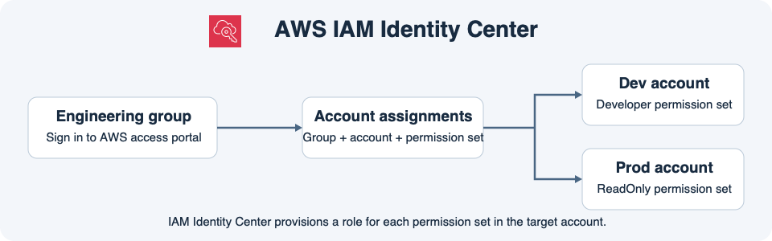

# 16주차 네 번째 수업 · AWS IAM Identity Center 기초

**IAM Identity Center**는 직원이 여러 AWS 계정에 접속할 수 있도록 회사의 사용자·그룹과 계정별 권한을 연결한다.
직원은 **AWS 액세스 포털**에 로그인하고 자신에게 할당된 계정과 권한 옵션을 선택한다.

**권한 세트(Permission set)**는 AWS 계정에서 사용할 권한을 정의한다.
예를 들어 Developer 권한 세트에는 개발 작업에 필요한 권한을 넣고 ReadOnly 권한 세트에는 조회 권한만 넣는다.
**계정 할당**은 사용자 또는 그룹에 특정 AWS 계정의 권한 세트를 연결하는 설정이다.

| 그룹 | 대상 AWS 계정 | 권한 세트 |
|---|---|---|
| Engineering | Dev | Developer |
| Engineering | Prod | ReadOnly |

이렇게 할당하면 Engineering 그룹의 직원은 같은 포털에서 Dev와 Prod를 선택할 수 있다.
Dev에서는 Developer 권한을 사용한다.
Prod에서는 ReadOnly 권한을 사용한다.

IAM Identity Center는 대상 계정에 권한 세트에 대응하는 IAM 역할을 만들고 그 권한 세트의 정책을 역할에 적용한다.
직원이 포털에서 계정과 권한 옵션을 선택하면 해당 역할을 사용한다.
[AWS IAM Identity Center가 만드는 IAM 역할](https://docs.aws.amazon.com/singlesignon/latest/userguide/identity-center-and-iam-roles.html)

멤버 계정의 역할에는 SCP도 적용된다.
Dev의 Developer 권한 세트가 `s3:DeleteBucket`을 허용하더라도 Dev에 적용되는 SCP가 이 작업을 명시적으로 거부하면 삭제 요청은 거부된다.
[AWS Organizations SCP 공식 문서](https://docs.aws.amazon.com/organizations/latest/userguide/orgs_manage_policies_scps.html)

## 확인 문제

민지는 Engineering 그룹 소속이다.
이 그룹에는 Dev 계정의 Developer 권한 세트와 Prod 계정의 ReadOnly 권한 세트가 할당돼 있다.
아래 문항에서는 이 그룹 할당과 지문에 명시된 정책을 기준으로 판단한다.

**1-1.** 민지가 AWS 액세스 포털에 로그인하면 각 계정에서 어떤 권한 세트를 사용할 수 있을까?

**1-2.** 계정 할당 설정에서 함께 지정하는 그룹과 대상 계정 외에 어떤 항목을 선택해야 할까?

**2-1.** Prod에 ReadOnly 권한 세트를 할당하면 IAM Identity Center는 민지의 접속에 사용할 IAM 역할을 어느 계정에 만들까?

**2-2.** Developer 권한 세트는 `s3:DeleteBucket`을 허용한다.
Dev 계정에 적용된 SCP는 같은 작업을 명시적으로 거부한다.
민지가 포털에서 Dev의 Developer 옵션을 선택하면 버킷을 삭제할 수 있을까?

## 확인 문제 평가 · 2026-11-27

하위 4/4 정답.

- **1-1.** 민지는 Dev에서 Developer 권한 세트를 사용하고 Prod에서 ReadOnly 권한 세트를 사용한다.
- **1-2.** 계정 할당에서 그룹과 대상 계정에 권한 세트를 연결한다.
  답변의 권한 옵션은 수업에서 사용한 표현으로 이해해 정답으로 인정했다.
- **2-1.** IAM Identity Center는 ReadOnly에 대응하는 IAM 역할을 대상 계정인 Prod에 만든다.
- **2-2.** 민지가 Dev의 Developer 역할로 버킷을 삭제하려 하면 SCP의 명시적 거부가 적용된다.
