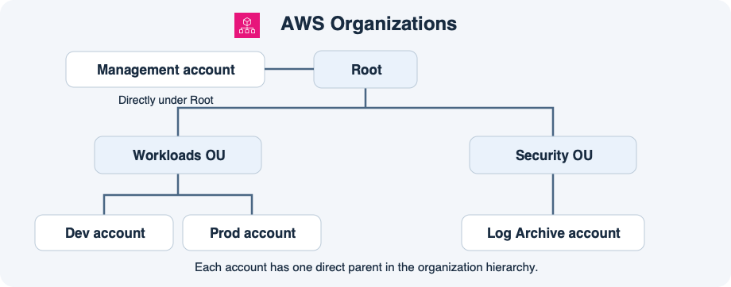
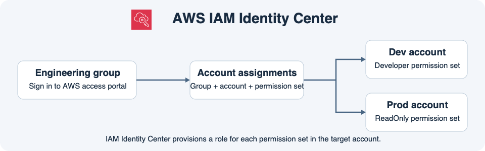
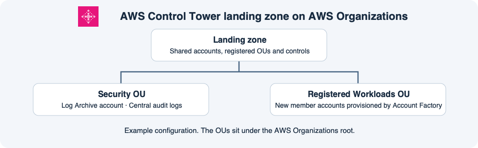

# 16주차 · 멀티 계정과 거버넌스 종합 확인

쇼핑몰 팀의 AWS 계정 구성을 살펴보고 계정을 옮겼을 때 접근 권한이 어떻게 달라지는지 확인한다.
각 문제에는 판단에 필요한 그림과 설정이 함께 있다.
후속 변경이 명시된 문항에서는 해당 변경을 적용한 상태로 답한다.

## 1. Organizations와 계정 이동

초기에는 Root 바로 아래에 관리 계정, Workloads OU, Security OU가 있다.
Dev와 Prod는 Workloads OU에 있고 Log Archive는 Security OU에 있다.
운영 EC2는 Prod 계정에 있다.

**1-1.** 회사가 Root 바로 아래에 Production OU를 추가하고 Prod 계정을 그곳으로 옮긴다.
이동 후 Prod의 직접 상위는 어디인가?
기존 운영 EC2는 어느 AWS 계정에 속하는가?

## 2. IAM Identity Center와 SCP

민지는 Engineering 그룹 소속이다.
이 그룹에는 Dev 계정의 `Developer`와 Prod 계정의 `ReadOnly` 권한 세트가 할당돼 있다.
`Developer`는 `s3:DeleteBucket`을 허용하고 `ReadOnly`에는 이 작업에 대한 IAM 허용이 없다.
`s3:DeleteBucket`을 명시적으로 거부하는 SCP는 **Workloads OU에만** 연결돼 있다.
아래 문항에서는 삭제할 버킷이 비어 있고 지문에 적힌 IAM 정책과 SCP가 접근을 결정한다고 가정한다.

**2-1.** 민지가 AWS 액세스 포털에 로그인하면 Dev와 Prod에서 각각 어떤 권한 세트를 선택할 수 있는가?
`ReadOnly`에 대응하는 IAM 역할은 어느 계정에 만들어지는가?

**2-2.** Dev는 Workloads OU에 그대로 있다.
민지가 Dev의 `Developer` 역할로 Dev의 버킷을 삭제할 수 있는가?
IAM과 SCP를 함께 근거로 설명한다.

**2-3.** Prod는 1-1에서 Root 바로 아래의 Production OU로 이동했다.
기존 계정 할당과 권한 세트는 그대로다.
이동 후 Workloads OU의 SCP가 Prod에 적용되는가?
민지가 Prod의 `ReadOnly` 역할로 Prod의 버킷을 삭제할 수 있는가?

**2-4.** 별도 상황으로 같은 거부 SCP를 Organizations Root에도 연결했다.
이 SCP는 Dev, Prod, 관리 계정 중 어느 계정의 IAM 역할에 적용되는가?

## 3. Control Tower와 운영 기준

회사는 Control Tower 랜딩 존을 운영한다.
Workloads OU는 등록돼 있고 Security OU에는 Log Archive 계정이 있다.
새 팀의 테스트 계정은 Workloads OU에서 공통 운영 기준을 적용받아야 한다.

**3-1.** 새 테스트 계정을 표준 구성으로 만드는 데 어떤 기능을 사용하고 어느 OU에 배치할까?
여러 계정의 감사 로그는 어느 계정에 모을까?

**3-2.** 다음 요구에 각각 어떤 유형의 컨트롤을 적용할까?
각 컨트롤이 어느 시점에 동작하는지도 설명한다.

1. 금지 리전에서 EC2 시작 API 요청을 거부한다.
2. 이미 생성되어 EC2에 연결된 비암호화 EBS 볼륨을 찾아 비준수로 표시한다.
3. 지원되는 CloudFormation 배포에서 EBS 암호화 설정이 빠지면 리소스를 만들기 전에 배포를 막는다.

## 공식 문서

- AWS Organizations의 Root는 계정 계층의 최상위 컨테이너다. 각 계정의 직접 상위는 Root 또는 하나의 OU다. [Organizations 용어와 개념](https://docs.aws.amazon.com/organizations/latest/userguide/orgs_getting-started_concepts.html)
- SCP는 멤버 계정의 권한 상한을 정하며 명시적 거부는 IAM 허용보다 우선한다. 관리 계정의 IAM 역할은 SCP 제한에서 제외된다. [Organizations SCP](https://docs.aws.amazon.com/organizations/latest/userguide/orgs_manage_policies_scps.html)
- IAM Identity Center는 권한 세트가 할당된 대상 계정에 역할을 만들고 해당 정책을 적용한다. [IAM Identity Center가 만드는 IAM 역할](https://docs.aws.amazon.com/singlesignon/latest/userguide/identity-center-and-iam-roles.html)
- Account Factory로 표준 AWS 계정을 프로비저닝할 수 있다. [Account Factory로 계정 생성](https://docs.aws.amazon.com/controltower/latest/userguide/provision-as-end-user.html)
- 예방적 컨트롤은 작업 요청을 제한하고 탐지적 컨트롤은 비준수 상태를 찾는다. 사전 검증 컨트롤은 지원되는 CloudFormation 리소스를 생성 전에 검사한다. [Control Tower 컨트롤의 동작 방식](https://docs.aws.amazon.com/controltower/latest/userguide/how-controls-work.html)

## 종합 확인 평가 · 2026-11-27

정답 6개, 부분 정답 1개(3-2).

- **1-1.** Prod의 직접 상위는 Production OU가 된다. 운영 EC2는 Prod 계정에 속한다.
- **2-1.** 민지는 Dev에서 Developer, Prod에서 ReadOnly를 선택한다. ReadOnly에 대응하는 IAM 역할은 Prod 계정에 만들어진다.
- **2-2.** Developer의 IAM 허용에도 Workloads OU의 SCP가 `s3:DeleteBucket`을 명시적으로 거부한다.
- **2-3.** 이동한 Prod에는 Workloads OU의 SCP가 적용되지 않는다. ReadOnly 역할에 `s3:DeleteBucket` IAM 허용이 없으므로 삭제 요청은 여전히 거부된다.
- **2-4.** Root에 붙인 SCP는 Dev와 Prod의 IAM 역할에 적용된다. 관리 계정의 IAM 역할은 제외된다.
- **3-1.** Account Factory로 테스트 계정을 만들어 등록된 Workloads OU에 배치한다. 감사 로그는 Security OU의 Log Archive 계정에 모은다.
- **3-2.** 예방적(Preventive) 컨트롤은 EC2 시작 API 요청을 평가하면서 금지 요청을 거부한다. 탐지적(Detective) 컨트롤은 리소스가 생성된 뒤 AWS Config가 구성을 평가할 때 비암호화 볼륨을 비준수로 표시한다. 사전 검증(Proactive) 컨트롤은 지원되는 CloudFormation 리소스의 생성 전에 설정을 검사하고 위반 시 배포를 막는다. Proaction은 용어 오타로 처리했으며 Detective의 평가 시점은 재확인한다.

**3-2 보완.** AWS Config가 구성을 평가할 때 비준수로 표시된다고 답해 정답으로 확인했다.
보완 후 7/7로 16주차를 완료했다.
