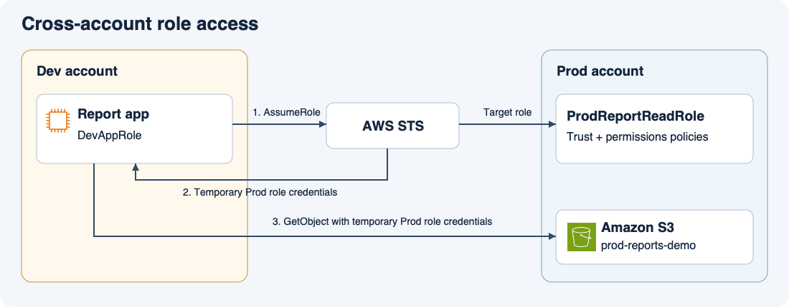

# 17주차 첫 수업 · IAM 역할과 교차 계정 접근

**교차 계정 접근(Cross-account access)**은 한 AWS 계정의 주체가 다른 계정의 리소스에 접근하는 것이다.
이번 수업에서는 Dev의 EC2에서 실행되는 보고서 앱이 Prod의 S3 객체를 읽는 상황을 다룬다.
앱은 평소에 Dev의 `DevAppRole`을 사용하고 보고서를 읽을 때만 Prod의 `ProdReportReadRole`을 맡는다.
이때 **역할을 맡는 요청**과 **맡은 역할로 객체를 읽는 요청**을 따로 판단한다.

## 1. 역할을 맡는 요청

앱은 현재 `DevAppRole` 자격 증명으로 AWS STS에 `AssumeRole`을 요청한다.
대상은 Prod 계정에 있는 `ProdReportReadRole`의 ARN이다.
AWS는 Dev가 **그 역할을 맡을 수 있는지**와 Prod의 역할이 **그 호출자를 받아들이는지**를 각각 확인한다.

| 정책이 있는 곳 | 정책 | 이 예제의 설정 |
|---|---|---|
| Dev의 `DevAppRole` | 호출자의 IAM 권한 정책 | Prod의 `ProdReportReadRole` ARN에 대해 `sts:AssumeRole` 허용 |
| Prod의 `ProdReportReadRole` | 대상 역할의 신뢰 정책 | 신뢰할 `Principal`로 Dev의 `DevAppRole` ARN을 지정하고 `sts:AssumeRole` 허용 |

예를 들어 Dev의 권한 정책에서 허용할 `Resource`는 `arn:aws:iam::222222222222:role/ProdReportReadRole`이다.
Prod 역할의 신뢰 정책에서 허용할 `Principal`은 `arn:aws:iam::111111111111:role/DevAppRole`이다.
두 계정의 평가가 모두 허용이면 STS가 Prod 역할 세션의 임시 자격 증명을 앱에 반환한다.
이 자격 증명에는 액세스 키 ID, 비밀 액세스 키, 세션 토큰과 만료 시각이 포함된다.

## 2. 맡은 역할로 객체를 읽는 요청

앱은 STS가 반환한 **Prod 역할 세션의 임시 자격 증명**으로 S3에 `GetObject`를 요청한다.
이 예제에서는 Prod 역할의 IAM 권한 정책이 어떤 객체를 읽을 수 있는지 정한다.

| 정책 요소 | 예제 값 |
|---|---|
| Action | `s3:GetObject` |
| Resource | `arn:aws:s3:::prod-reports-demo/reports/*` |

예를 들어 `reports/june.csv`는 허용한 범위에 있다.
`private/payroll.csv`는 이 정책의 범위 밖이다.
S3는 임시 자격 증명이 나타내는 Prod 역할 세션으로 요청을 판단하므로, 앱이 평소 Dev 역할로 사용하던 권한은 이 요청의 권한에 더해지지 않는다.
`AssumeRole`이 성공해도 Prod 역할에 해당 객체의 `s3:GetObject` 허용이 없으면 객체 조회는 거부된다.

## 확인 문제

Dev(`111111111111`)의 EC2에서 실행하는 앱은 `DevAppRole`로 시작한다.
대상 역할은 Prod(`222222222222`)의 `ProdReportReadRole`이고 버킷 `prod-reports-demo`도 Prod에 있다.
두 객체 `reports/june.csv`와 `private/payroll.csv`는 이미 존재한다.
각 문항은 적어 둔 정책 조건만 적용한다.

**1-1.** Prod 역할의 신뢰 정책은 `DevAppRole`을 허용한다.
Dev 역할의 IAM 권한 정책에는 `sts:AssumeRole` 허용이 없다.
앱의 `AssumeRole` 요청은 성공할까? 빠진 허용은 어느 역할의 어떤 정책에 어떤 대상 ARN을 지정해 추가할까?

**1-2.** 이번에는 Dev 역할에 `ProdReportReadRole`에 대한 `sts:AssumeRole` 허용이 있다.
Prod 역할의 신뢰 정책에는 Dev의 다른 역할인 `DevBatchRole`만 허용돼 있다.
`DevAppRole`로 시작한 앱의 요청은 어디에서 막힐까? 어떤 역할을 신뢰 대상으로 추가해야 할까?

**2-1.** 두 계정에서 역할을 맡는 데 필요한 허용을 모두 넣어서 `AssumeRole`은 성공했다.
하지만 Prod 역할에는 `s3:GetObject` 허용이 없다.
앱은 어느 역할의 임시 자격 증명으로 S3를 호출할까? `reports/june.csv`를 읽을 수 있을까?

**2-2.** 2-1에 이어 Prod 역할에 `arn:aws:s3:::prod-reports-demo/reports/*`를 대상으로 `s3:GetObject`를 허용했다.
앱이 Prod 역할의 임시 자격 증명으로 `reports/june.csv`와 `private/payroll.csv`를 각각 읽으면 결과는 어떻게 될까?

## 공식 문서

- 교차 계정 요청은 호출자 계정과 대상 계정에서 각각 평가된다. 역할 인수에서는 대상 역할의 신뢰 정책이 호출 주체를 제한한다. [IAM 교차 계정 정책 평가](https://docs.aws.amazon.com/IAM/latest/UserGuide/reference_policies_evaluation-logic-cross-account.html)
- AWS STS의 `AssumeRole`은 대상 역할 세션의 임시 자격 증명을 반환한다. 이 자격 증명으로 대상 역할에 허용된 작업을 요청할 수 있다. [AWS STS AssumeRole API](https://docs.aws.amazon.com/STS/latest/APIReference/API_AssumeRole.html)
- `s3:GetObject`는 지정한 객체의 데이터를 읽는 작업이다. [Amazon S3 GetObject API](https://docs.aws.amazon.com/AmazonS3/latest/API/API_GetObject.html)
- 구성도에는 AWS가 제공하는 EC2 인스턴스와 Amazon S3 아이콘을 사용했다. [AWS 아키텍처 아이콘](https://aws.amazon.com/architecture/icons/)
