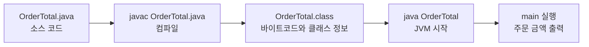
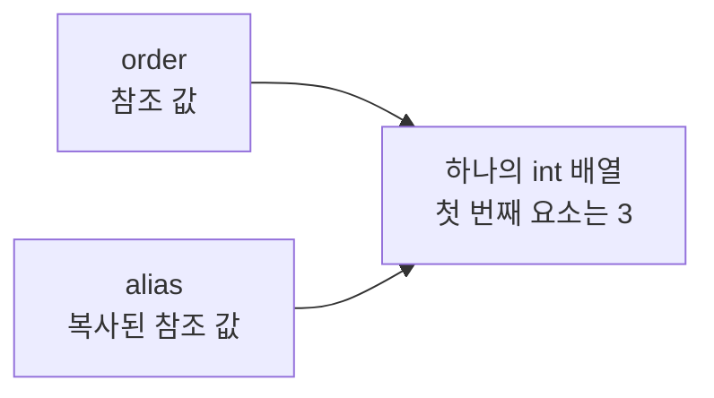

# 1주차 첫 수업 · Java 실행 흐름과 기본형·참조형

## 학습 목표

- `.java` 소스 파일을 작성한 뒤 컴파일하고 실행하기까지의 흐름을 설명한다.
- 기본형 변수와 참조형 변수에 어떤 값이 들어가고, 대입할 때 어떤 값이 복사되는지 설명한다.
- 주문 금액을 계산하는 작은 Java 프로그램을 읽고 실행한다.

## 1. 소스 코드에서 실행까지

우리가 작성한 `OrderTotal.java`는 사람이 읽고 수정하는 소스 파일이다.
`javac OrderTotal.java`를 실행하면 컴파일러가 소스 문법과 타입을 검사하고 이 예제의 컴파일 결과를 `OrderTotal.class`로 만든다.
클래스 파일에는 JVM이 실행할 바이트코드와 클래스 정보가 들어 있다.

`java OrderTotal`을 실행하면 Java 실행기가 JVM을 시작한다.
JVM은 `OrderTotal` 클래스를 읽고 프로그램의 시작점인 `main` 메서드를 실행한다.



| 이름 | 이 예제에서 하는 일 |
|---|---|
| JDK | 코드를 컴파일하고 실행하는 데 필요한 도구와 실행 환경을 제공한다. |
| `javac` | 소스 파일을 클래스 파일로 컴파일한다. |
| `java` | 실행할 클래스 이름을 받아 JVM을 시작한다. |
| JVM | 클래스 파일을 읽고 프로그램의 코드를 실행한다. |

Java 컴파일러는 소스를 JVM용 클래스 파일로 변환한다. `java` 실행기는 실행할 클래스를 찾아 `main`을 호출하도록 JVM을 시작한다. [JDK 21 javac 명령 문서](https://docs.oracle.com/en/java/javase/21/docs/specs/man/javac.html) · [JDK 21 java 명령 문서](https://docs.oracle.com/en/java/javase/21/docs/specs/man/java.html)

## 2. 주문 금액 계산기

아래 코드를 `OrderTotal.java`로 저장한다.
`int unitPrice = 3200;`은 정수 값을 담는 `unitPrice` 변수를 선언하고 초기값을 3,200으로 넣는다.
`main`의 코드가 위에서부터 실행되면 단가와 수량이 저장되고 곱한 결과가 `total`에 들어간다.

```java
public class OrderTotal {
    public static void main(String[] args) {
        int unitPrice = 3200;
        int quantity = 3;
        int total = unitPrice * quantity;

        System.out.println(total);
    }
}
```

파일을 저장한 폴더에서 두 명령을 순서대로 실행한다. 예제는 Java 21 문법을 기준으로 검증했다.

```sh
javac OrderTotal.java
java OrderTotal
```

기대 출력은 `9600`이다.
`public class OrderTotal`의 이름과 파일 제목 `OrderTotal.java`를 맞춘다.
`java OrderTotal`에서 `OrderTotal`은 실행할 클래스 이름이다.

## 3. 기본형과 참조형

**기본형 변수**는 `int`의 정수나 `boolean`의 참·거짓처럼 기본형 값을 직접 담는다.
`int copy = quantity;`는 그 시점의 정숫값을 복사한다.
그 뒤에 `copy`에 다른 값을 넣어도 `quantity`에 들어 있는 정숫값은 그대로다.

```java
int quantity = 3;
int copy = quantity;
copy = 5;

System.out.println(quantity); // 3
System.out.println(copy);     // 5
```

**참조형 변수**는 객체를 가리키는 참조 값을 담을 수 있다.
`String`과 배열은 참조형이다.
`int[] order = {3};`에서 `order`에는 배열을 가리키는 참조가 담기고, 배열의 첫 번째 칸에는 정수 `3`이 담긴다.
`int[] alias = order;`는 참조 값을 복사하므로 두 변수가 같은 배열을 가리킨다.



```java
int[] order = {3};
int[] alias = order;
alias[0] = 5;

System.out.println(order[0]); // 5
System.out.println(alias[0]); // 5
```

배열의 첫 번째 요소는 인덱스 `0`으로 읽고 쓴다.
`alias[0] = 5;`는 `alias`가 가리키는 배열의 첫 번째 요소를 수정한다.
`alias = new int[]{9};`처럼 변수에 새 배열의 참조를 넣으면 그 시점부터 `alias`는 새 배열을 가리킨다. `order`는 계속 기존 배열을 가리킨다.

Java 언어 명세는 값을 기본형 값과 참조 값으로 구분한다. 배열도 객체이며 여러 참조가 하나의 객체를 가리킬 수 있다. [Java 언어 명세 4장](https://docs.oracle.com/javase/specs/jls/se21/html/jls-4.html)

## 확인 문제

코드의 결과를 먼저 예상하고 근거를 적는다.
실행해 봤다면 예상과 실제 결과가 달랐던 부분을 함께 알려준다.

### 1. 컴파일과 실행

`OrderTotal.java`를 컴파일해 `OrderTotal.class`를 만들어 두었다.
이후 `OrderTotal.java`의 수량을 바꿔 저장하고 같은 폴더에서 `java OrderTotal`만 실행했다.

- **1-1.** `javac OrderTotal.java`와 `java OrderTotal`은 각각 어떤 일을 하는가?
- **1-2.** 이번 실행에는 변경 전 수량과 변경 후 수량 중 어느 값이 쓰이는가? 파일을 기준으로 이유를 설명한다.

### 2. 기본형 변수에 대입하기

```java
int unitPrice = 2400;
int quantity = 2;
int savedQuantity = quantity;
quantity = 4;
```

- **2-1.** 마지막 줄이 실행된 뒤 `quantity`와 `savedQuantity`는 각각 얼마인가?
- **2-2.** `unitPrice * savedQuantity`는 얼마인가? `savedQuantity`에 대입할 때 무엇이 복사됐는지 설명한다.

### 3. 배열 요소 수정과 참조 재대입

```java
int[] stock = {8};
int[] view = stock;
view[0] = 6;
view = new int[]{4};
```

- **3-1.** 세 번째 줄 직후 `stock[0]`과 `view[0]`은 각각 얼마인가? 두 변수가 가리키는 배열의 수를 함께 설명한다.
- **3-2.** 네 번째 줄까지 실행하면 `stock[0]`과 `view[0]`은 각각 얼마인가? 세 번째 줄과 네 번째 줄이 무엇을 바꾸는지 설명한다.

## 채점과 해설

2026-11-15 최초 평가 · 정답 5개, 부분 정답 1개.

| 문항 | 판정 | 해설 |
|---|---|---|
| 1-1 | 정답 | `javac`는 소스를 JVM용 바이트코드가 담긴 클래스 파일로 컴파일한다. `java OrderTotal`은 JVM을 시작해 해당 클래스를 읽고 `main`을 실행한다. |
| 1-2 | 정답 | 소스만 저장하면 기존 `OrderTotal.class`는 바뀌지 않는다. 이 실행에는 클래스 파일의 변경 전 수량이 쓰인다. |
| 2-1 | 정답 | `quantity`는 4이고 `savedQuantity`는 2다. |
| 2-2 | 정답 | 2,400 × 2는 4,800이다. 대입 시점에 `quantity`에 있던 값 2가 `savedQuantity`에 복사됐다. |
| 3-1 | 정답 | 둘 다 6이다. `view = stock`은 `stock`에 들어 있는 참조 값을 복사하므로 두 변수가 배열 한 개를 공유한다. |
| 3-2 | 부분 정답 | 기존 배열의 첫 요소가 6이고 `view`가 새 배열을 가리킨다는 설명은 맞다. `new int[]{4}`로 만든 배열의 첫 요소는 4다. 최종 결과는 `stock[0] = 6`, `view[0] = 4`다. |

`view[0] = 6;`은 기존 배열의 요소를 바꾼다.
`view = new int[]{4};`는 첫 요소가 4인 새 배열을 만들고 그 참조를 `view`에 넣는다.
`new int[1]`로 길이만 지정하면 첫 요소에 `int`의 기본값인 0이 들어간다.

Java 언어 명세는 배열 초기화식의 각 값이 대응하는 요소에 대입된다고 설명한다. 기본값으로 채워지는 정수 배열 요소의 값은 0이다. [Java 언어 명세 10.6절 · 배열 초기화식](https://docs.oracle.com/javase/specs/jls/se21/html/jls-10.html#jls-10.6) · [4.12.5절 · 초기값](https://docs.oracle.com/javase/specs/jls/se21/html/jls-4.html#jls-4.12.5)

## 보완 확인

```java
int[] stock = {9};
int[] view = stock;
view[0] = 7;
view = new int[1];
view = new int[]{12};
```

- **4-1.** 네 번째 줄 직후 `stock[0]`과 `view[0]`은 각각 얼마인가? `view`가 가리키는 배열의 요소가 그 값인 이유를 설명한다.
- **4-2.** 다섯 번째 줄 직후 두 값은 각각 얼마인가? 네 번째 줄과 다섯 번째 줄에서 새 배열을 초기화하는 방법의 차이를 설명한다.

### 보완 채점과 해설

2026-11-15 보완 평가 · 정답 1개, 부분 정답 1개. 배열 요소의 기본값과 명시적 초기값을 구분했다.

| 문항 | 판정 | 해설 |
|---|---|---|
| 4-1 | 정답 | `stock[0] = 7`, `view[0] = 0`이다. 4-2 답변에서 `new int[1]`로 만든 길이 1 배열의 첫 요소가 기본값 0임을 설명했다. |
| 4-2 | 부분 정답 | 두 배열의 길이가 1이고 초기값이 각각 0과 12라는 설명은 맞다. 다섯 번째 줄 직후에는 `stock[0] = 7`, `view[0] = 12`다. 답변에는 `stock[0]`이 빠졌고 `view[12]`는 인덱스 12의 요소를 읽는 표기다. |

세 번째 줄에서 기존 배열의 첫 요소를 7로 바꿨다.
네 번째와 다섯 번째 줄은 `view`에 새 배열의 참조를 대입한다. `stock`은 계속 기존 배열을 가리킨다.
