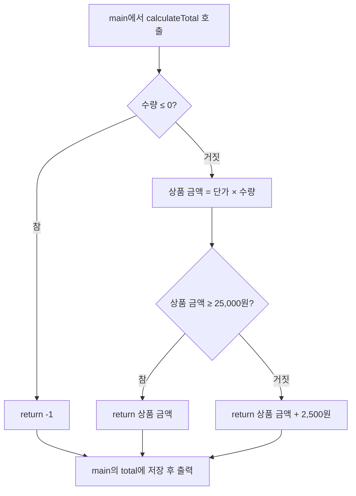

# 1주차 두 번째 수업 · Java 조건문과 메서드

## 학습 목표

- `if`의 조건이 참이거나 거짓일 때 다음으로 실행할 코드를 찾는다.
- 메서드 호출에서 인자, 매개변수, 반환값을 구분한다.
- 조건의 경계와 잘못된 수량을 넣어 주문 총액 계산기를 검증한다.

## 1. 조건에 따라 실행 경로 고르기

`if (quantity <= 0)`는 수량이 0 이하인지 검사한다.
조건이 참이면 중괄호 안의 코드가 실행된다.
조건이 거짓이면 중괄호를 건너뛰고 아래 줄로 이어진다.
`<=`의 등호 때문에 수량 0도 이 조건을 만족한다.

아래 계산기에서는 수량이 0 이하일 때 연습용 값 `-1`을 반환한다.
유효한 수량이면 상품 금액을 계산하고, 상품 금액이 25,000원 이상이면 배송비가 무료다.
그보다 적으면 배송비 2,500원을 상품 금액에 더한다.
이번 예제의 단가는 양의 정수로 가정한다.

## 2. 메서드가 값을 받아 돌려주는 흐름

`static int calculateTotal(int unitPrice, int quantity)`에서 메서드 이름은 `calculateTotal`이다.
괄호 안의 `unitPrice`와 `quantity`는 **매개변수**다. 호출할 때 전달받는 값을 메서드 안에서 이 이름으로 사용한다.
`calculateTotal(5000, 4)`에서 `5000`과 `4`는 호출할 때 넣는 **인자**다.
이름 앞의 `int`는 **반환 타입**이다. 이 메서드는 호출한 곳에 정숫값을 돌려준다.
이 예제에서는 `static`이 붙은 메서드를 같은 클래스의 `main`에서 바로 호출할 수 있다.

`return`이 실행되면 현재 메서드가 끝나고 값이 호출한 곳으로 돌아간다.
수량 검사에서 `return -1;`이 실행되면 이 호출에서 상품 금액과 배송비 계산은 건너뛴다.
`main`은 돌려받은 값을 `total`에 저장하고 다음 줄의 `System.out.println(total)`로 출력한다.



Java 언어 명세에서 `if`는 조건식의 참·거짓에 따라 실행할 문장을 결정한다. `return`은 메서드 호출 지점으로 제어를 돌려주며 값이 있는 경우 그 값을 반환한다. [Java 언어 명세 14장 · 문장](https://docs.oracle.com/javase/specs/jls/se21/html/jls-14.html)

## 3. 주문 금액 계산기 실행

아래 코드를 `OrderTotalWithShipping.java`로 저장한다.
단가와 수량은 `main`에 있는 메서드 호출의 두 인자를 바꿔 테스트할 수 있다.

```java
public class OrderTotalWithShipping {
    public static void main(String[] args) {
        int total = calculateTotal(5000, 4);
        System.out.println(total);
    }

    static int calculateTotal(int unitPrice, int quantity) {
        if (quantity <= 0) {
            return -1;
        }

        int subtotal = unitPrice * quantity;
        if (subtotal >= 25000) {
            return subtotal;
        }

        return subtotal + 2500;
    }
}
```

```sh
javac OrderTotalWithShipping.java
java OrderTotalWithShipping
```

기본 예제에서는 상품 금액이 20,000원이라 배송비 2,500원이 더해진다. 기대 출력은 `22500`이다.
수량을 5로 바꾸면 상품 금액이 25,000원으로 기준과 같아지고 `>=` 조건이 참이다.
출력을 바꿔 확인할 때는 소스를 수정한 뒤 다시 컴파일한다.

## 확인 문제

위 예제의 `calculateTotal`을 기준으로 코드가 실행되는 순서를 생각해 보고 답한다.

### 1. 수량 검증과 배송비

- **1-1.** `calculateTotal(7000, 0)`은 무엇을 반환하는가? 상품 금액과 배송비 계산까지 실행되는가?
- **1-2.** `calculateTotal(7000, 3)`과 `calculateTotal(12500, 2)`는 각각 무엇을 반환하는가? 각 호출에 배송비가 붙는지 설명한다.

### 2. 메서드의 인자와 반환값

```java
int orderTotal = calculateTotal(8000, 2);
System.out.println(orderTotal);
```

- **2-1.** 두 인자 `8000`과 `2`는 각각 어떤 매개변수에 들어가는가?
- **2-2.** 반환값을 받는 변수는 무엇이며, 어느 줄에서 터미널에 출력하는가?

### 3. 무료 배송 조건 변경하기

상품 금액이 30,000원 **이상**일 때 무료 배송으로 정책을 바꾼다.

- **3-1.** 현재 예제의 어느 조건을 어떻게 바꾸면 되는가? 새 조건식을 적는다.
- **3-2.** 상품 금액이 29,999원인 주문과 30,000원인 주문의 총액은 각각 얼마인가? 새 기준 바로 아래와 기준에 같은 값을 둘 다 확인하는 이유를 설명한다.

## 채점과 해설

2026-11-15 최초 평가 · 정답 4개, 부분 정답 2개.

| 문항 | 판정 | 해설 |
|---|---|---|
| 1-1 | 정답 | 수량 0은 `quantity <= 0`을 만족한다. `return -1;`에서 메서드가 끝나므로 상품 금액과 배송비는 계산하지 않는다. |
| 1-2 | 부분 정답 | 두 반환값은 맞다. 배송비 적용 여부가 답변에서 빠졌다. `7000 × 3`은 21,000원이므로 배송비 2,500원을 더해 23,500원을 반환한다. `12500 × 2`는 기준과 같은 25,000원이므로 무료 배송이다. |
| 2-1 | 정답 | 첫 번째 인자 8,000은 `unitPrice`에, 두 번째 인자 2는 `quantity`에 들어간다. |
| 2-2 | 정답 | 첫 줄에서 반환값을 `orderTotal`에 저장하고, 두 번째 줄의 `System.out.println(orderTotal);`에서 출력한다. |
| 3-1 | 정답 | 무료 배송 조건을 `subtotal >= 30000`으로 바꾼다. |
| 3-2 | 부분 정답 | 30,000원은 무료 배송이므로 총액 30,000원이 맞다. 29,999원에는 배송비 2,500원을 더하므로 총액은 32,499원이다. 기준 바로 아래와 기준값을 함께 확인하면 `>=`에서 등호가 포함되는지 검증할 수 있다. |

## 보완 확인

무료 배송 기준을 **18,000원 이상**으로 바꾼다. 배송비는 2,500원이다.

- **4-1.** 상품 금액이 17,999원인 주문과 18,000원인 주문은 각각 배송비가 붙는가? 각 주문의 총액도 함께 적는다.

2026-11-15 보완 평가 · 4-1 정답(1/1).
`17,999 < 18,000`이므로 배송비 2,500원을 더한 총액은 20,499원이다.
18,000원은 기준값을 포함하는 `>=` 조건을 만족하므로 배송비가 없고 총액은 18,000원이다.
