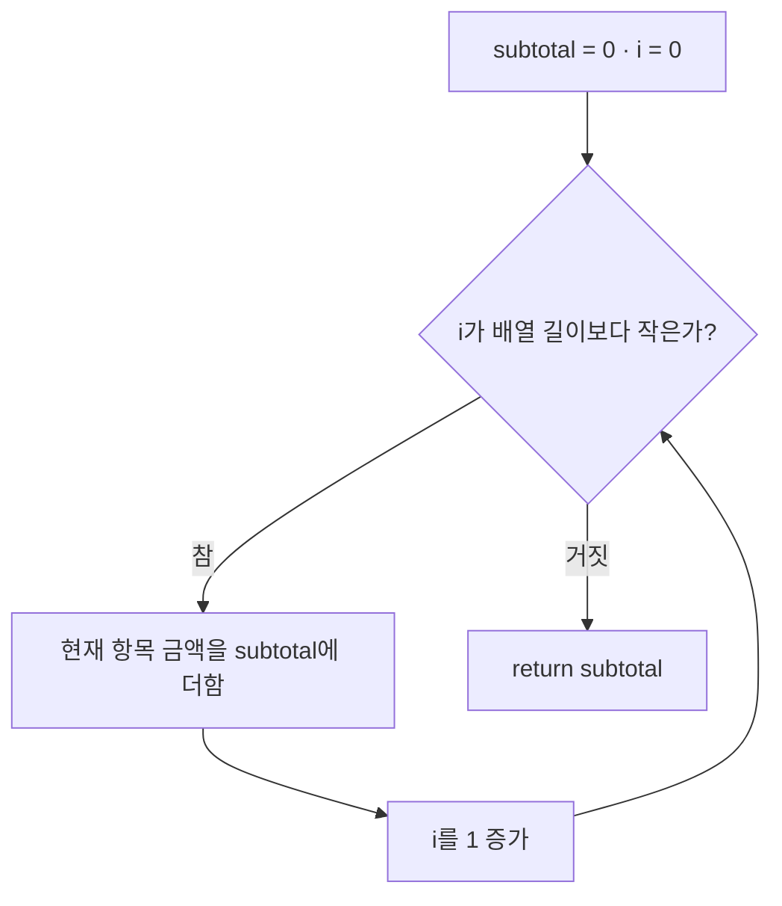

# 1주차 세 번째 수업 · Java 반복문과 주문 합산

## 학습 목표

- `for`문의 초기화, 조건 검사, 본문 실행, 증감 순서를 설명한다.
- 배열의 인덱스와 길이를 이용해 각 주문 항목을 한 번씩 읽는다.
- 상품 금액을 합산하는 메서드와 배송비를 계산하는 메서드의 반환값을 확인한다.

## 1. 배열을 처음부터 끝까지 읽기

주문에 금액이 6,000원, 9,000원, 4,000원인 항목이 있다. 각 금액은 수량까지 반영된 항목별 금액이다.
`int[] itemTotals = {6000, 9000, 4000};`으로 저장하면 `itemTotals.length`는 3이다.
Java 배열의 인덱스는 0부터 시작하므로 읽을 수 있는 인덱스는 0, 1, 2다.

`for (int i = 0; i < itemTotals.length; i++)`의 실행 순서는 다음과 같다.

| 부분 | 동작 |
|---|---|
| `int i = 0` | 반복에 들어갈 때 처음 한 번 인덱스를 0으로 초기화한다. |
| `i < itemTotals.length` | 매 반복 전 조건을 검사한다. 참이면 본문을 실행하고 거짓이면 반복을 끝낸다. |
| `subtotal += itemTotals[i]` | 현재 인덱스의 금액을 누적한다. `subtotal = subtotal + itemTotals[i]`와 같은 계산이다. |
| `i++` | 본문이 끝나면 인덱스를 1 증가시키고 다시 조건을 검사한다. |



누적 금액은 0에서 시작해 6,000원 → 15,000원 → 19,000원으로 바뀐다.
`i`가 3이 되면 `3 < 3`이 거짓이라 반복을 끝낸다. 빈 배열은 길이가 0이라 본문을 한 번도 실행하지 않는다.
조건을 `i <= itemTotals.length`로 쓰면 `i`가 배열 길이와 같은 경우에도 본문이 실행된다. 그 자리의 배열 요소를 읽으면 `ArrayIndexOutOfBoundsException`이 발생한다.

Java 언어 명세에서 `for`는 초기화 후 조건을 검사하고, 본문이 정상 종료하면 증감식을 실행한다. Java 배열은 길이를 `length`로 제공하고 유효한 인덱스의 마지막 값은 길이에서 1을 뺀 값이다. [Java 언어 명세 14.14.1절 · 기본 for문](https://docs.oracle.com/javase/specs/jls/se21/html/jls-14.html#jls-14.14.1) · [10장 · 배열](https://docs.oracle.com/javase/specs/jls/se21/html/jls-10.html)

## 2. 항목 합산과 배송비를 메서드로 실행

`calculateSubtotal`은 항목 배열을 받아 상품 금액의 합을 반환한다.
`calculateShipping`은 그 합계를 받아 배송비만 반환한다. 지난 수업과 같이 25,000원 이상이면 0원이고 그 아래는 2,500원이다.
`main`은 두 값의 합을 출력한다. 주문 항목이 있는 경우를 예제로 삼고 빈 배열은 합산 메서드만 확인한다.

```java
public class OrderItemsTotal {
    public static void main(String[] args) {
        int[] itemTotals = {6000, 9000, 4000};
        int subtotal = calculateSubtotal(itemTotals);
        int shipping = calculateShipping(subtotal);
        System.out.println(subtotal + shipping);
    }

    static int calculateSubtotal(int[] itemTotals) {
        int subtotal = 0;
        for (int i = 0; i < itemTotals.length; i++) {
            subtotal += itemTotals[i];
        }
        return subtotal;
    }

    static int calculateShipping(int subtotal) {
        if (subtotal >= 25000) {
            return 0;
        }
        return 2500;
    }
}
```

`OrderItemsTotal.java`로 저장한 뒤 파일이 있는 폴더에서 실행한다.

```sh
javac OrderItemsTotal.java
java OrderItemsTotal
```

예제는 상품 금액 19,000원에 배송비 2,500원을 더한 `21500`을 출력한다.

## 확인 문제

### 1. 반복 중 누적값 읽기

`calculateSubtotal`에 `new int[]{4000, 8000, 1500}`을 전달한다.

- **1-1.** `i = 0`일 때와 `i = 1`일 때, 본문에서 각각 어느 금액을 더하며 직후 `subtotal`은 얼마인가?
- **1-2.** 이 메서드의 최종 반환값은 얼마인가?

### 2. 배열의 범위와 빈 입력

- **2-1.** 길이 3인 배열에서 조건을 `i <= itemTotals.length`로 바꾸면, 어느 `i`에서 어떤 배열 접근이 문제가 되는가?
- **2-2.** `calculateSubtotal(new int[]{})`을 호출하면 본문은 몇 번 실행되고 무엇을 반환하는가? 첫 조건의 결과를 함께 적는다.

### 3. 두 메서드 이어서 호출하기

`main`의 주문 항목을 `{10000, 15000}`으로 바꾼다.

- **3-1.** `calculateSubtotal`과 `calculateShipping`은 각각 얼마를 반환하는가? 배송비 조건의 결과도 적는다.
- **3-2.** `main`이 출력하는 값은 얼마인가? 출력에 사용되는 두 변수를 적는다.
