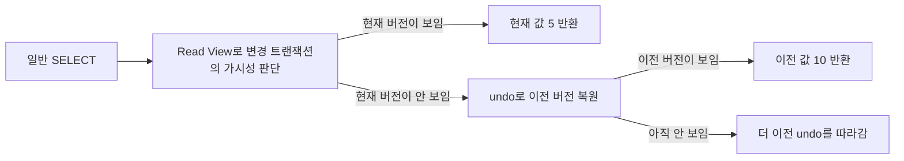

# 03. MySQL InnoDB의 MVCC와 Gap Lock

MySQL 8.4 InnoDB 기준. 먼저 **어떤 버전이 보이는가**를 이해한다. 이어서 **어떤 인덱스 범위가 잠기는가**를 살펴본다. 이 두 가지를 JPA의 관리 객체 상태와 구분하면 재고 사고의 세 층을 설명할 수 있다.

## 1. MVCC는 어떻게 이전 값을 읽는가

- **Read View**는 일관성 읽기에서 어떤 트랜잭션이 만든 행 버전을 읽을 수 있는지 판단하는 데 쓰는 가시성 정보다.
- **Undo Log**는 변경을 되돌리거나 MVCC가 이전 행 버전을 복원하는 데 필요한 정보를 저장한 로그다.

InnoDB는 클러스터드 인덱스 레코드에 마지막 변경 트랜잭션 ID(`DB_TRX_ID`)와 undo 레코드를 가리키는 포인터(`DB_ROLL_PTR`)를 둔다. 일반 SELECT의 **Read View**는 현재 읽기에 어떤 변경 트랜잭션이 보이는지 판정한다.

현재 레코드가 보이지 않으면 undo 정보를 따라 이전 상태를 복원한다. 보이는 버전을 찾을 때까지 이 과정을 반복한다.

보이는 버전이 없으면 해당 행은 결과에 나오지 않는다. [InnoDB Multi-Versioning](https://dev.mysql.com/doc/refman/8.4/en/innodb-multi-versioning.html)



### 예시로 보는 Read View의 가시성

내가 일반 `SELECT`를 실행해 Read View를 만드는 순간을 생각해 보자. 그 시점에 다른 트랜잭션 `101`과 `105`는 아직 커밋하지 않았고 `103`은 이미 커밋했다. `110`은 이 순간부터 새로 할당될 트랜잭션 ID의 시작점이다.

```text
Read View를 만드는 순간
├─ 101과 105    아직 커밋 전        → 이 뷰에서 변경이 보이지 않음
├─ 103          이미 커밋           → 이 뷰에서 변경이 보임
└─ 110 이상     아직 할당 전        → 이 뷰에서 변경이 보이지 않음
```

같은 행을 `103`이 `10`으로 바꿔 커밋했고 `105`가 그 뒤에 `5`로 바꿨다고 하자. 이 Read View는 `105`가 쓴 `5`를 건너뛰고 undo로 `103`이 쓴 **`10`**을 읽는다. `105`가 나중에 커밋해도 같은 Read View를 사용하는 동안 결과는 `10`이다.

**내가 바꾼 값은 바로 읽을 수 있다.** 내 트랜잭션이 별도 행을 `7`로 수정한 뒤 같은 트랜잭션에서 일반 `SELECT`를 실행하면 커밋 전에도 `7`이 보인다. 이 경우에는 Read View가 자기 트랜잭션의 변경을 볼 수 있게 하기 때문이다.

| 행 버전을 쓴 TX ID | 이 Read View에서 보이나? | 이유 |
| --- | --- | --- |
| 100 | 보임 | 스냅샷의 가장 오래된 활성 ID보다 작음 |
| 101과 105 | 안 보임 | 뷰를 만들 때 아직 활성 상태였음. 이후 커밋해도 이 뷰에서는 그대로 |
| 103 | 보임 | Read View가 만들어지기 전에 커밋했음 |
| 110 이상 | 안 보임 | 뷰 생성 시점에 아직 해당 ID가 할당되지 않았음 |

이 예시는 `ReadView::changes_visible()`의 가시성 판단을 풀어쓴 것이다. 트랜잭션 ID의 순서만으로 커밋 순서를 판단하면 `101`과 `103`의 차이를 설명할 수 없다. [MySQL 8.4 ReadView 소스](https://github.com/mysql/mysql-server/blob/8.4/storage/innobase/include/read0types.h)

**Purge와 긴 읽기.** 이전 상태를 복원하는 데 필요한 update undo는 해당 버전을 볼 수 있는 스냅샷이 남아 있는 동안 보존된다. 오래 열린 Read View가 있으면 purge가 뒤처지고 undo 이력이 쌓일 수 있다.

업데이트가 많은 테이블에서 오래된 스냅샷을 읽으면 더 긴 버전 체인을 따라갈 수도 있다. [InnoDB Multi-Versioning](https://dev.mysql.com/doc/refman/8.4/en/innodb-multi-versioning.html)

## 2. 스냅샷 읽기와 잠금 읽기

| SQL 또는 조건 | InnoDB 동작 |
| --- | --- |
| `REPEATABLE READ`의 일반 SELECT | 첫 일관성 읽기에서 만든 Read View를 재사용. 자신의 변경도 보임 |
| `READ COMMITTED`의 일반 SELECT | 일관성 읽기마다 새 Read View를 생성 |
| `START TRANSACTION WITH CONSISTENT SNAPSHOT` | `REPEATABLE READ`에서는 트랜잭션 시작 시 스냅샷을 설정 |
| `SELECT … FOR UPDATE` | 잠금 읽기. 충돌하는 락이 있으면 기다림. 락을 얻은 뒤 현재 레코드를 읽음 |
| `SELECT … FOR SHARE` | 공유 잠금 읽기. 다른 트랜잭션의 충돌하는 변경을 제어 |
| `UPDATE`, `DELETE` | 변경 대상 탐색에 잠금을 사용. `REPEATABLE READ`의 일반 SELECT와 같은 스냅샷을 기준으로 대상이 결정되리라 기대하면 안 됨 |

`REPEATABLE READ`에서 Tx1이 일반 SELECT로 재고 `10`을 읽었다고 하자. Tx2가 `5`를 커밋한 뒤에는 Tx1의 일반 SELECT가 계속 `10`을 반환할 수 있다. 같은 Tx1의 `FOR UPDATE`는 `5`를 읽을 수 있다.

잠금 읽기를 한 뒤에도 일반 SELECT의 Read View는 그대로다. 이 값들은 **DB에서 직접 실행한 SQL의 결과**다. [일관성 읽기](https://dev.mysql.com/doc/refman/8.4/en/innodb-consistent-read.html) · [격리 수준](https://dev.mysql.com/doc/refman/8.4/en/innodb-transaction-isolation-levels.html) · [잠금 읽기](https://dev.mysql.com/doc/refman/8.4/en/innodb-locking-reads.html)

## 3. 인덱스 락의 네 가지 유형

인덱스 키가 `10` → `20` → `30` 순서로 저장돼 있다고 가정한다.

```text
 인덱스 키       10                  20                  30
                ●──────────────────●──────────────────●

 Record Lock                         [20]        기존 인덱스 레코드
 Gap Lock        (10 ────────────── 20)         사이에 새 키 삽입을 제어
 Next-Key Lock   (10 ────────────── 20]         gap + 오른쪽 레코드
 Insert Intention         ↑ 15                   이 위치에 INSERT할 의도
```

### SQL 예시로 비교하기

아래 실습의 `mvcc_stock_lab` 테이블에 PK 값 `10`, `20`, `30`이 있다고 가정한다. 세션 A에서 `REPEATABLE READ` 트랜잭션을 시작한 뒤 아래 두 쿼리를 **각각 별도 트랜잭션에서** 실행한다.

```sql
-- Gap Lock 예시: 존재하지 않는 PK 15를 검색
SELECT * FROM mvcc_stock_lab WHERE id = 15 FOR UPDATE;

-- Next-Key Lock 예시: PK 범위 검색으로 기존 레코드 20을 읽음
SELECT * FROM mvcc_stock_lab WHERE id > 10 AND id < 30 FOR UPDATE;
```

| 세션 A가 실행한 쿼리 | 세션 B의 `INSERT` (PK 15) | 세션 B의 `UPDATE` (PK 20) |
| --- | --- | --- |
| `id = 15 FOR UPDATE` | `(10, 20)`에 삽입하므로 대기 | 이 Gap Lock만으로는 대기하지 않음 |
| `id > 10 AND id < 30 FOR UPDATE` | `(10, 20)`에 삽입하므로 대기 | 레코드 `20`도 잠겨 있으므로 대기 |

#### Gap의 경계는 어떻게 정해지나?

Gap은 **쿼리가 사용하는 인덱스에서 서로 이웃한 두 키 사이의 구간**이다. `10`과 `20`은 예제 데이터에서 `15`가 들어갈 위치의 앞뒤 키다. 존재하지 않는 `15`를 `FOR UPDATE`로 찾으면 InnoDB는 `15`가 들어갈 `(10, 20)`을 보호한다. 그동안 다른 트랜잭션의 `15`뿐 아니라 `12`나 `19` INSERT도 대기한다. `10`과 `20`은 이 구간의 경계이며 Gap Lock 자체는 두 레코드를 잠그지 않는다.

예를 들어 같은 인덱스에 `13`이 이미 있다면 `15`의 앞뒤 키는 `13`과 `20`이므로 구간은 `(13, 20)`이 된다. 범위 조건에서는 실행 계획이 스캔한 인덱스에 따라 여러 구간이 잠길 수 있다. [InnoDB 락 종류](https://dev.mysql.com/doc/refman/8.4/en/innodb-locking.html)

세션 B에서는 아래 두 문장을 한 번에 하나씩 실행한다. 대기 중이면 세션 A를 커밋하거나 롤백해 락을 푼다. 다음 비교 전에 세션 B를 롤백해 시작 데이터를 유지한다.

```sql
-- 세션 B에서 매번 START TRANSACTION 후 둘 중 하나만 실행
INSERT INTO mvcc_stock_lab (id, stock) VALUES (15, 15);
UPDATE mvcc_stock_lab SET stock = stock + 1 WHERE id = 20;
```

범위 조회는 실제 인덱스 스캔에 따라 `(10, 20]` 외의 구간도 잠글 수 있다. 표는 PK `15`의 삽입과 기존 레코드 `20`의 수정만 비교한다. [SQL 문장별 InnoDB 락](https://dev.mysql.com/doc/refman/8.4/en/innodb-locks-set.html)

- **Record Lock**은 인덱스 레코드에 걸린다. PK로 기존 행 하나를 정확히 찾는 잠금 읽기가 대표적이다.
- **Gap Lock**은 기존 키 사이의 구간에 들어오는 INSERT를 막는다. 같은 gap의 S/X Gap Lock은 공존할 수 있다. 예를 들어 두 트랜잭션이 모두 없는 키를 찾아 같은 gap을 잠근 뒤 모두 그곳에 INSERT하려고 하면 서로의 Gap Lock 때문에 데드락이 날 수 있다.
- **Next-Key Lock**은 레코드 락과 바로 앞 gap을 합친다. 인덱스의 첫 값 앞과 마지막 값 뒤도 범위에 들어갈 수 있다. 마지막 구간은 내부의 **supremum** 레코드로 표현한다.
- **Insert Intention Lock**은 INSERT 전 해당 gap에서 삽입할 의도를 나타낸다. 서로 다른 위치를 넣는 두 INSERT는 같은 gap 안에서도 진행할 수 있다. 다른 트랜잭션이 그 구간을 Gap Lock으로 막았다면 INSERT가 대기한다.

[InnoDB 락 종류](https://dev.mysql.com/doc/refman/8.4/en/innodb-locking.html)

### 쿼리 모양과 실행 계획으로 락 범위 예측하기

| 상황 | `REPEATABLE READ`에서 예상할 락 범위 |
| --- | --- |
| 유일 인덱스의 모든 키 컬럼과 일치하는 기존 행에 잠금 읽기 | 일치한 인덱스 레코드. 유일 보조 인덱스를 통한 배타 잠금은 대응하는 클러스터드 레코드에도 걸릴 수 있음 |
| PK 동등 조건이지만 해당 키가 없음 | 새 레코드가 들어갈 gap을 보호할 수 있음 |
| 비유일 인덱스 또는 범위 조건 | 실제 스캔한 인덱스 범위에 Gap/Next-Key Lock이 걸릴 수 있음 |
| `UNIQUE(warehouse_id, sku_id)`에서 `warehouse_id`만 검색 | 고유 단건 검색 예외가 적용되지 않음 |
| 적절한 인덱스가 없어 넓게 스캔 | 반환 행은 적어도 스캔한 인덱스 범위가 넓어 락 범위가 커질 수 있음 |

**`READ COMMITTED`에서는 검색·범위 스캔에 대한 gap locking을 일반적으로 사용하지 않는다.** 외래 키 제약과 중복 키 검사에는 Gap Lock이 쓰일 수 있다. 락 범위를 판단할 때는 `WHERE`에 이어 `EXPLAIN`의 실제 접근 인덱스와 `data_locks`를 확인한다. [격리 수준](https://dev.mysql.com/doc/refman/8.4/en/innodb-transaction-isolation-levels.html) · [SQL 문장별 InnoDB 락](https://dev.mysql.com/doc/refman/8.4/en/innodb-locks-set.html)

### `REPEATABLE READ`에서 팬텀을 설명하는 두 가지 방법

- **일반 SELECT 두 번.** 같은 Read View로 읽기 때문에 사이에 다른 트랜잭션이 삽입하고 커밋한 새 행이 두 번째 결과에 나타나지 않는다. 상대의 INSERT는 진행할 수 있다.
- **범위 `FOR UPDATE`로 변경 전 검증.** 해당 인덱스 구간의 Gap/Next-Key Lock이 다른 트랜잭션의 INSERT를 대기시킨다. 범위 조건을 바탕으로 후속 쓰기를 할 때 동시성 비용까지 고려한다.

## 4. 두 세션으로 검증

MySQL 8.4 매뉴얼을 기준으로 작성한 실습이다. 같은 실습 스키마에 연결 두 개를 열어 세션 A와 B로 사용한다. 준비 SQL은 한 세션에서 한 번만 실행한다. SQL 옆 주석은 공식 문서를 바탕으로 한 예상 결과다.

```sql
CREATE TABLE mvcc_stock_lab (
  id INT PRIMARY KEY,
  stock INT NOT NULL
) ENGINE=InnoDB;

INSERT INTO mvcc_stock_lab VALUES (10, 10), (20, 20), (30, 30);
```

### 실습 A. 같은 트랜잭션에서 10과 5가 보이는 순서

#### 1. 세션 A에서 재고 10을 읽기

```sql
SET TRANSACTION ISOLATION LEVEL REPEATABLE READ;
START TRANSACTION;

SELECT stock FROM mvcc_stock_lab WHERE id = 10; -- 예상: 10
```

첫 일반 `SELECT`가 Read View를 만든다. **세션 A의 연결과 트랜잭션을 열어 둔 채 세션 B로 전환한다.**

#### 2. 세션 B에서 재고를 5로 바꾸고 커밋하기

```sql
START TRANSACTION;

UPDATE mvcc_stock_lab SET stock = 5 WHERE id = 10;

COMMIT;
```

#### 3. 세션 A로 돌아가 일반 조회와 잠금 조회 비교하기

1단계에서 열어 둔 연결과 트랜잭션에서 이어서 실행한다.

```sql
SELECT stock FROM mvcc_stock_lab WHERE id = 10;            -- 예상: 10
SELECT stock FROM mvcc_stock_lab WHERE id = 10 FOR UPDATE; -- 예상: 5
SELECT stock FROM mvcc_stock_lab WHERE id = 10;            -- 예상: 10

COMMIT;
```

비교 실습에서는 먼저 `id=10`의 수량을 `10`으로 복구하고 커밋한다. 1단계 격리 수준을 `READ COMMITTED`로 바꿔 다시 실행한다. 이 경우 3단계의 세 조회 모두 **5**가 예상된다.

### 실습 B. 결과가 0건이어도 INSERT가 대기하는 이유

1. **A**에서 `SET TRANSACTION ISOLATION LEVEL REPEATABLE READ;` 후 `START TRANSACTION;`을 실행한다.
2. **A**에서 `SELECT * FROM mvcc_stock_lab WHERE id = 15 FOR UPDATE;`를 실행한다. **0건**을 반환한다.
3. **B**에서 `START TRANSACTION;` 후 `INSERT INTO mvcc_stock_lab VALUES (15, 15);`를 실행한다. **A가 보호하는 (10, 20) 구간에서 대기**할 것으로 예상한다.
4. B가 대기하는 동안 **A** 또는 별도 관찰 세션에서 아래 조회를 실행한다.
5. **A**에서 `COMMIT;`하면 B의 INSERT가 진행된다. 반복 실습을 위해 **B**는 `ROLLBACK;`한다.
6. A의 조회를 기존 키 `id = 10`으로 바꿔 반복한다. 이 경우 **B의 15 INSERT는 대기 없이 진행**할 것으로 예상한다. 다시 `ROLLBACK;`한다.
7. A를 `READ COMMITTED`로 바꿔 `id = 15` 미존재 조회를 반복한다. 이 예제는 FK나 중복 충돌이 없으므로 B의 INSERT가 대기 없이 진행할 것으로 예상한다.

```sql
SELECT ENGINE_TRANSACTION_ID, INDEX_NAME, LOCK_MODE, LOCK_STATUS, LOCK_DATA
FROM performance_schema.data_locks
WHERE OBJECT_SCHEMA = DATABASE()
  AND OBJECT_NAME = 'mvcc_stock_lab';

SELECT REQUESTING_ENGINE_LOCK_ID, BLOCKING_ENGINE_LOCK_ID
FROM performance_schema.data_lock_waits;
```

`INDEX_NAME`으로 잠긴 인덱스를 확인하고 `LOCK_MODE`와 `LOCK_DATA`로 잠금 위치를 읽는다. B가 대기하는 동안 요청 락과 차단 락의 연결이 `data_lock_waits`에 나타난다. [InnoDB 락 관찰](https://dev.mysql.com/doc/refman/8.4/en/innodb-information-schema-internal-data.html)

## 5. 패킹존 재고 사례에 연결

| 층 | 이 사례에서 확인하는 내용 |
| --- | --- |
| InnoDB Read View | 실제 운영 세션의 격리 수준과 각 SQL이 읽은 버전 |
| InnoDB 락 | PK로 기존 재고 행을 잠갔다면 먼저 Record Lock을 예상. 범위나 미존재 키가 관여했을 때 Gap Lock을 의심 |
| JPA 영속성 컨텍스트 | EntityGraph로 선조회한 관리 객체에 이전 값이 남았는지 확인 |
| Hibernate UPDATE | 다른 필드의 변경을 flush할 때 최종 재고까지 실제 `SET` 절에 포함됐는지 확인 |

1. JPA가 EntityGraph로 재고를 먼저 조회했다.
2. 별도 트랜잭션에서 MyBatis가 재고를 차감했다.
3. JPA 쪽에서는 `refresh(entity, LockModeType.PESSIMISTIC_WRITE)`로 관리 Entity를 다시 읽도록 수정했다.
4. 최종 재고를 차감 이력과 대조했다.

재조회에 사용한 운영 격리 수준과 실제 SQL은 로그로 확인한다. **`REPEATABLE READ`에서 기존 Read View가 있고 `refresh()`가 일반 SELECT를 실행하면 락을 이미 얻었어도 이전 DB 버전을 읽을 수 있다.** 이 사례에서는 재조회 자체에 `PESSIMISTIC_WRITE`를 지정했다.

## Level 1~5 문제

### Level 1 · 정의

Read View와 undo log는 각각 어떤 역할을 할까? Record Lock과 Gap Lock은 각각 무엇을 잠글까? 두 락을 합친 Next-Key Lock은 어느 구간을 잠글까?

### Level 2 · 내부 동작

세션 A가 일반 `SELECT`로 재고 `10`을 읽었다. 그다음 세션 B가 재고를 `5`로 바꾸고 커밋했다. 같은 트랜잭션에서 세션 A가 일반 `SELECT`를 다시 실행하면 `REPEATABLE READ`와 `READ COMMITTED`에서 각각 몇이 보일까? 이어서 `FOR UPDATE`를 실행하면 몇이 보이고 어떤 방식으로 읽을까?

### Level 3 · 장애와 한계

인덱스에 `10`, `20`, `30`이 있다고 하자. `REPEATABLE READ`에서 기존 PK 10과 존재하지 않는 PK 15에 각각 `FOR UPDATE`를 실행하면 다른 세션의 15 INSERT에 어떤 차이가 생길까? 같은 트랜잭션에서 일반 SELECT와 잠금 SELECT 결과가 달라지는 이유도 설명해 봐.

### Level 4 · 대안과 비용

요청 두 개가 같은 상품의 재고 행을 동시에 만들려고 한다. 둘 다 `SELECT`에서 행이 없다는 결과를 받은 뒤 `INSERT`한다. **같은 상품의 재고 행은 하나뿐이어야 한다.** 다음 세 가지에서 중복을 막는 장치와 동시 요청의 결과를 설명해 봐.

- 상품 ID에 `UNIQUE`를 걸고 중복 키 오류를 처리한다.
- `REPEATABLE READ`에서 없는 키를 `FOR UPDATE`로 조회한 뒤 삽입한다.
- 두 번째 방식의 격리 수준만 `READ COMMITTED`로 바꾼다.

### Level 5 · 실제 적용과 검증

패킹존 재고 문제에서 DB의 가시성과 행 락 및 JPA 관리 객체의 상태를 어떻게 구분했는가? 운영에서 실제로 확인한 내용과 다시 검증할 때 수집할 격리 수준·실행 SQL·락 정보·재고 이력을 각각 설명해 봐.

## 학습 기록

- 상태: 재답변 반영. Level 1~5 통과.
- 이어서 읽기: [같은 Gap Lock에서 INSERT로 넘어갈 때의 데드락](./04_단원_04_Lock.md#같은-gap-lock을-잡고도-왜-데드락이-생기나).
- 가설을 확인할 자료: 세션 격리 수준 · SQL과 바인딩 값 · 접근 인덱스 · 잠금 대기 · 재고 차감 이력.
