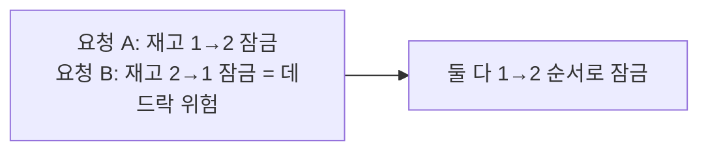

# 03. 비관적 락과 데드락·Timeout

## 기술 개념 전체 설명

### 락의 대상

SELECT FOR UPDATE는 선택한 행의 변경을 직렬화하려고 잠금을 획득한다. 인덱스와 조건, 격리 수준에 따라 잠금 범위가 달라질 수 있다. 락은 commit/rollback까지 유지된다.

### 대기와 데드락

서로 같은 행을 반대 순서로 잡으면 순환 대기가 생긴다. DB는 데드락을 감지해 한쪽을 취소할 수 있다. 락 대기 Timeout은 설정 시간 내 락을 얻지 못한 경우다. 둘의 원인과 재시도 정책을 구분한다.

### 보유 시간

락 안에서 반복 조회·개별 INSERT·외부 호출을 하면 다른 요청의 대기가 길어진다. 키 정렬, 중복 재고 통합, 일괄 쓰기, 트랜잭션 단축으로 줄인다.

## 흐름 그림

## 이력서·포트폴리오 사례 연결

사례는 재고 ID 오름차순으로 각각 한 번만 락을 획득하고 Batch Write로 보유 시간을 줄였다. 주 7건→0건 Timeout의 집계 기간·부하는 확인이 필요하다.

## Level 1~5 문제

### Level 1 · 정의

비관적 락은 무엇을 보호하는가?

### Level 2 · 내부 동작

FOR UPDATE의 락 범위와 해제 시점은?

### Level 3 · 장애·한계

데드락과 락 대기 Timeout을 어떻게 구분하는가?

### Level 4 · 대안과 Trade-off

DB 락·분산 락·낙관적 락의 선택 기준은?

### Level 5 · 실제 적용과 검증

재고 ID 정렬과 단일 획득을 어떻게 구현·검증했는가?

## 학습 기록

- 상태: 미응시
- 무자료 2분 답변:
- 틀린 개념:
- 확인한 실제 근거:
- 아직 미확인인 주장:
- 다음 복습일:
