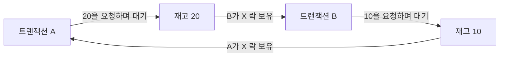
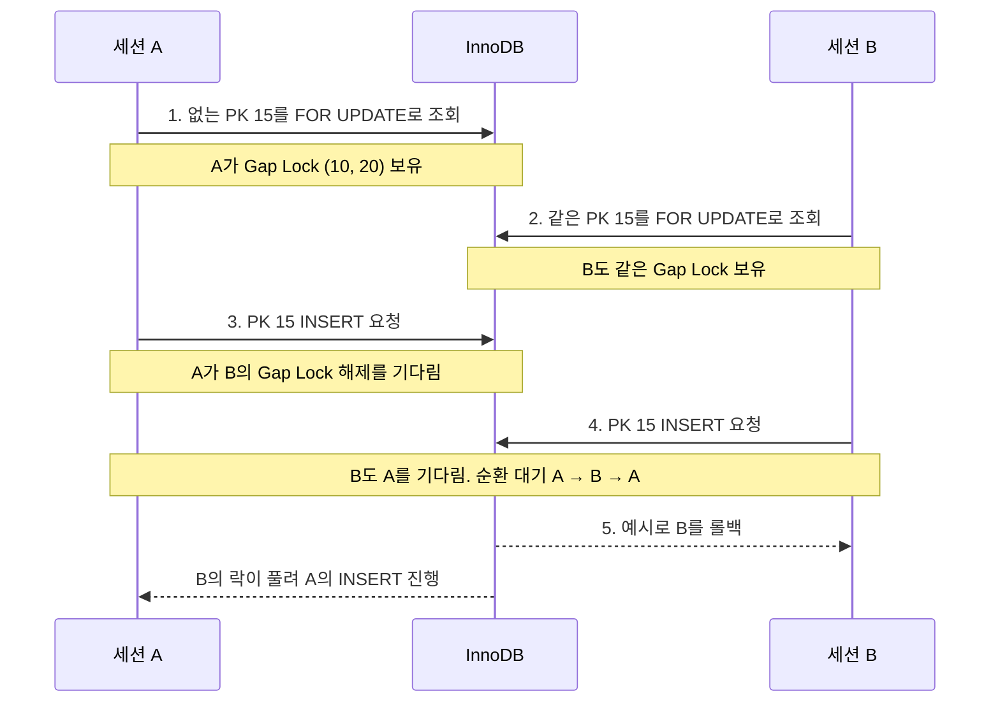
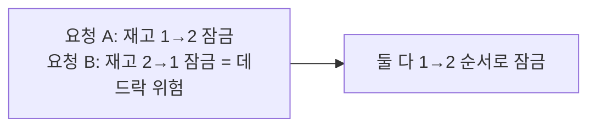

# 04. 낙관적 락과 비관적 락 · 데드락 · 락 대기

## 기술 개념 전체 설명

### 락의 대상

InnoDB는 인덱스 레코드에 락을 건다.  
조회에 사용한 인덱스와 조건 및 격리 수준에 따라 잠금 범위가 달라진다.  
잠금 읽기로 찾은 행의 락은 일반적으로 트랜잭션이 커밋하거나 롤백할 때 풀린다.  
범위가 잠기는 경우는 [MVCC와 Gap Lock 단원](./03_단원_03_MVCC.md)에서 다룬다.

### `FOR SHARE`와 `FOR UPDATE`

`SELECT ... FOR SHARE`는 S 락(공유 락)을 잡는다.  
같은 레코드에 다른 트랜잭션도 S 락을 잡을 수 있다.  
내가 확인한 행의 변경을 막은 상태로 후속 작업을 해야 할 때 쓸 수 있다.

`SELECT ... FOR UPDATE`는 X 락(배타 락)을 잡는다.  
같은 레코드에 다른 트랜잭션이 S 락이나 X 락을 요청하면 충돌한다.  
재고 수량을 읽은 뒤 수정할 때처럼 읽기와 쓰기 사이에 다른 트랜잭션의 변경을 막으려는 경우에 쓴다.

| 같은 레코드에 이미 잡힌 락 | 다른 트랜잭션의 S 락 요청 | 다른 트랜잭션의 X 락 요청 |
| --- | --- | --- |
| S 락 | 획득 가능 | 대기 |
| X 락 | 대기 | 대기 |

`READ COMMITTED`와 `REPEATABLE READ`의 일반 `SELECT`는 보통 MVCC로 자신에게 보이는 버전을 읽는다.  
위 표의 대기는 같은 레코드에서 잠금을 요청하는 경우에 해당한다. [MySQL InnoDB 잠금 읽기](https://dev.mysql.com/doc/refman/8.4/en/innodb-locking-reads.html)

### 낙관적 락과 비관적 락에서 X 락을 잡는 시점

낙관적 락은 먼저 읽고 수정할 때 버전이 바뀌었는지 검사한다.  
JPA의 `@Version`이 대표적이다.  
비관적 락의 `FOR UPDATE`는 읽는 시점부터 수정할 레코드에 X 락을 잡는다.

```text
낙관적 락  일반 SELECT → 버전 조건을 건 UPDATE에서 X 락 요청 및 충돌 확인
비관적 락  SELECT FOR UPDATE에서 X 락 요청 → 잠근 레코드를 읽고 UPDATE
```

예를 들어 두 요청이 모두 재고 10과 버전 3을 읽었다고 하자.  
첫 번째 요청이 재고 5와 버전 4를 커밋하면 두 번째 요청의 `WHERE version = 3` 업데이트는 0건이다.  
JPA는 이를 낙관적 락 충돌로 처리한다.  
첫 번째 요청이 아직 해당 행의 락을 보유 중이라면 두 번째 `UPDATE`도 락이 풀릴 때까지 대기할 수 있다.

두 방식 모두 실제 행을 수정하는 `UPDATE`에서는 DB의 X 락을 사용한다.  
낙관적·비관적 락은 동시 수정에 대처하는 전략이고 X 락은 DB가 사용하는 잠금 모드다.

### 대기와 데드락

**데드락은 서로가 가진 락을 기다리는 순환 대기다.**  
예를 들어 A가 재고 `10`을 잠그고 B가 재고 `20`을 잠근 상태에서 A는 `20`을 요청하고 B는 `10`을 요청하면 둘 다 진행할 수 없다.  
InnoDB는 데드락 감지가 켜져 있으면 보통 한 트랜잭션을 골라 전체 롤백하고 순환을 끊는다. [InnoDB 데드락 감지](https://dev.mysql.com/doc/refman/8.4/en/innodb-deadlock-detection.html)

#### 교착 상태의 네 가지 필요조건

| 필요조건 | 두 재고 행을 잠그는 예시 |
| --- | --- |
| **상호 배제** | 같은 행에 두 트랜잭션이 X 락을 동시에 보유할 수 없다. |
| **점유와 대기** | A는 `10`의 락을 보유한 채 `20`의 락을 요청한다. B도 `20`의 락을 보유한 채 `10`의 락을 요청한다. |
| **비선점** | 정상 진행 중인 트랜잭션의 락을 다른 트랜잭션이 빼앗을 수 없다. |
| **순환 대기** | A는 B를 기다리고 B는 다시 A를 기다린다. |



네 조건 중 하나를 없애면 교착 상태를 예방할 수 있다.  
예를 들어 두 트랜잭션이 모두 `10` → `20` 순서로 락을 얻으면 이 예시의 순환 대기가 사라진다.  
InnoDB가 교착 상태를 감지한 뒤 트랜잭션을 롤백하는 것은 이미 형성된 순환을 끊는 복구 동작이다.

#### 같은 Gap Lock을 잡고도 왜 데드락이 생기나?

`REPEATABLE READ`에서 PK `10`과 `20`이 있는 상태로 예를 든다.



1. A와 B가 각각 없는 PK `15`를 `SELECT ... FOR UPDATE`로 조회한다. 두 세션의 Gap Lock `(10, 20)`은 공존할 수 있다.
2. A가 `15`를 삽입하려 한다. B가 이미 가진 Gap Lock 때문에 A의 Insert Intention Lock 요청이 대기한다.
3. B도 `15`를 삽입하려 한다. A가 이미 가진 Gap Lock 때문에 B도 대기한다. 이때 **A → B → A** 순환이 생긴다.
4. InnoDB가 한 트랜잭션을 롤백하면 그 세션의 Gap Lock이 풀리고 나머지 세션의 INSERT가 진행될 수 있다.

[InnoDB Gap Lock과 Insert Intention Lock](https://dev.mysql.com/doc/refman/8.4/en/innodb-locking.html)

#### 락 대기 타임아웃과 어떻게 다른가?

| 상황 | InnoDB에서의 기본 처리 |
| --- | --- |
| 데드락 `1213` | 순환 대기를 감지하면 피해 트랜잭션 전체를 롤백 |
| 락 대기 타임아웃 `1205` | 제한 시간 동안 락을 얻지 못하면 대기하던 SQL 문만 롤백. 서버 설정에 따라 전체 롤백 가능 |

두 경로가 모두 여러 재고를 변경한다면 가능한 한 같은 ID 순서로 잠근다.  
데드락으로 롤백된 작업은 재시도할 수 있는 작업이라면 새 트랜잭션에서 처음부터 다시 실행한다.  
진행 중인 대기는 `performance_schema.data_lock_waits`에서 확인할 수 있다.  
최근 감지된 데드락은 `SHOW ENGINE INNODB STATUS`의 `LATEST DETECTED DEADLOCK`에서 확인한다. [InnoDB 오류 처리](https://dev.mysql.com/doc/refman/8.4/en/innodb-error-handling.html)

### 보유 시간

락 안에서 반복 조회·개별 INSERT·외부 호출을 하면 다른 요청의 대기가 길어진다.  
키 정렬·중복 재고 통합·일괄 쓰기·트랜잭션 단축으로 줄인다.

## 흐름 그림



## 이력서·포트폴리오 사례 연결

사례는 재고 ID 오름차순으로 각각 한 번만 락을 획득하고 Batch Write로 보유 시간을 줄였다.  
주 7건→0건 Timeout의 집계 기간·부하는 확인이 필요하다.

## Level 1~5 문제

### Level 1 · 정의

S 락과 X 락은 같은 레코드에서 어떤 조합으로 공존할 수 있을까?

### Level 2 · 내부 동작

`FOR UPDATE`의 락 범위와 해제 시점은?  
낙관적 락과 비관적 락에서 X 락은 각각 언제 필요한가?

### Level 3 · 장애·한계

데드락과 락 대기 Timeout을 어떻게 구분하는가?

### Level 4 · 대안과 Trade-off

DB 락·분산 락·낙관적 락의 선택 기준은?

### Level 5 · 실제 적용과 검증

재고 ID 정렬과 단일 획득을 어떻게 구현·검증했는가?

## 학습 기록

- 상태: 미응시
- 무자료 2분 답변:
- 틀린 개념:
- 확인한 실제 근거:
- 아직 미확인인 주장:
- 다음 복습일:
