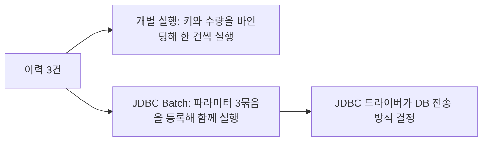
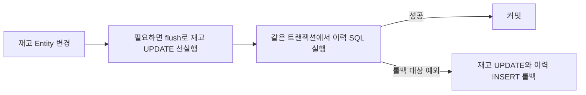

# 05. JDBC Batch와 flush·clear

재고 변경 한 건마다 이력 INSERT를 호출하면 처리 건수가 늘어날수록 DB 호출도 늘어난다. 이 단원은 그 호출을 어떻게 묶는지부터 같은 트랜잭션에서 재고 수량과 이력을 어떻게 함께 확정하는지까지 다룬다.

## 1. JDBC Batch는 무엇을 묶나?

이력 세 건을 저장한다고 해보자. 개별 실행에서는 다음 SQL에 값을 바인딩해 건마다 실행한다.

```sql
INSERT INTO inventory_history (inventory_id, delta)
VALUES (?, ?);
```

JDBC Batch에서는 같은 PreparedStatement에 파라미터 세 묶음을 차례로 등록한다. 예를 들어 `(10, -2)`와 `(20, -1)` 및 `(10, -1)`을 등록한 뒤 batch를 실행한다.

일반적으로 드라이버와 DB 사이의 왕복을 줄일 수 있다. 실제로 서버에 전달되는 문장 형태는 드라이버와 설정에 따라 달라진다. [Spring JDBC Batch Operations](https://docs.spring.io/spring-framework/reference/data-access/jdbc/advanced.html)



### JDBC Batch와 다중 행 INSERT 및 Bulk UPDATE

| 방식 | 묶는 대상 | 재고 사례 |
| --- | --- | --- |
| JDBC Batch | 같은 형태의 SQL과 여러 파라미터 묶음 | 이력마다 재고 ID와 변경량이 달라도 같은 INSERT를 반복 등록 |
| 다중 행 INSERT | 하나의 SQL 문에 여러 `VALUES` | 한 SQL 문으로 이력 여러 건 삽입 |
| Bulk UPDATE | 하나의 SQL 문으로 조건을 만족하는 여러 행 수정 | 특정 창고의 재고 행을 한꺼번에 비활성화 |

아래는 다중 행 INSERT다. 애플리케이션이 직접 만들 수도 있고 MySQL Connector/J가 `rewriteBatchedStatements` 설정을 사용해 지원되는 INSERT 배치를 이 형태로 변환할 수도 있다. [MySQL Connector/J 성능 설정](https://dev.mysql.com/doc/connector-j/en/connector-j-connp-props-performance-extensions.html)

```sql
INSERT INTO inventory_history (inventory_id, delta)
VALUES (10, -2), (20, -1), (10, -1);
```

**이력 3건과 SQL 실행 수 및 DB 왕복 수는 서로 다른 단위다.** APM에서 batch 호출 한 번이 잡혀도 DB에 SQL 문이 몇 개 전달됐는지는 별도로 확인한다. 예를 들어 이력 250건을 배치 크기 100으로 나누면 애플리케이션 기준으로는 `100 + 100 + 50`의 세 묶음이 된다.

## 2. Hibernate의 JDBC Batch와 IDENTITY

Hibernate는 처리할 INSERT나 UPDATE를 모아 두었다가 flush 시점에 JDBC로 보낼 수 있다. `hibernate.jdbc.batch_size`를 설정하면 호환되는 SQL을 배치로 묶을 수 있다. 테이블이나 SQL 형태가 다르거나 중간에 flush가 일어나면 묶음이 나뉠 수 있다. [Hibernate ORM JDBC batching](https://docs.hibernate.org/orm/7.2/userguide/html_single/#batch-jdbc-batch)

**IDENTITY는 INSERT를 실행해야 DB가 새 ID를 만들어 준다.** 일반적인 트랜잭션에서 Hibernate는 `persist()`한 관리 Entity의 ID를 얻기 위해 INSERT를 먼저 실행한다. 그래서 해당 Entity의 INSERT는 Hibernate JDBC Batch 대상에서 제외된다. 이 제약은 그 Entity의 INSERT에 해당한다. [Hibernate ORM IDENTITY](https://docs.hibernate.org/orm/7.2/userguide/html_single/#identifiers-generators-identity)

반면 이력 테이블에 `JdbcTemplate.batchUpdate()`를 사용하면 Hibernate의 Entity INSERT 경로를 거치지 않는다. DB가 이력 ID를 생성하더라도 호출 코드가 그 ID를 즉시 사용할 필요가 없다면 SQL에서 ID 컬럼을 생략하고 이력 INSERT만 묶어서 처리할 수 있다. 생성한 키가 후속 처리에 필요하다면 드라이버가 반환하는 키와 입력 행을 어떻게 대응시키는지 확인한다. [Spring JDBC Batch Operations](https://docs.spring.io/spring-framework/reference/data-access/jdbc/advanced.html)

### Kotlin 예시

다음은 이력 ID를 반환받을 필요가 없는 경우의 예시다. 입력 100건마다 하나의 배치를 구성한다.

```kotlin
data class HistoryRow(val inventoryId: Long, val delta: Int)

fun insertHistory(rows: List<HistoryRow>) {
    jdbcTemplate.batchUpdate(
        "INSERT INTO inventory_history (inventory_id, delta) VALUES (?, ?)",
        rows,
        100
    ) { statement, row ->
        statement.setLong(1, row.inventoryId)
        statement.setInt(2, row.delta)
    }
}
```

## 3. flush와 clear와 commit의 차이

| 동작 | DB | 영속성 컨텍스트 |
| --- | --- | --- |
| `flush()` | 대기 중인 변경 SQL을 실행 | 관리 Entity는 그대로 유지 |
| `clear()` | 그 자체로 커밋하지 않음 | 관리 Entity를 모두 분리 |
| `commit` | 해당 트랜잭션의 변경을 확정 | 트랜잭션 범위의 EntityManager는 종료 시 정리 |

예를 들어 재고 Entity의 수량을 바꾼 뒤 `flush()` 없이 `clear()`를 호출하면 아직 DB에 보내지 않은 변경을 잃을 수 있다. 자동 flush 등으로 이미 실행된 SQL은 `clear()` 뒤에도 같은 트랜잭션에 남는다. 이를 취소하려면 롤백해야 한다. 대량 Entity 작업에서 메모리 사용을 관리하려면 일정 단위로 `flush()`한 뒤 `clear()`할 수 있다.

`clear()` 이후 기존 Entity 참조를 수정해도 변경 감지가 적용되지 않는다. 같은 트랜잭션에서 여러 번 flush해도 DB 락은 일반적으로 그 트랜잭션이 커밋하거나 롤백할 때 풀린다. [Hibernate ORM 배치 처리](https://docs.hibernate.org/orm/7.2/userguide/html_single/#batch)

### 배치 크기와 커밋 단위

```text
하나의 트랜잭션
  ├─ 1~100번 처리 → flush → clear
  ├─ 101~200번 처리 → flush → clear
  ├─ 201~250번 처리 → flush → clear
  └─ 마지막에 한 번 commit 또는 rollback
```

위 예시는 메모리 정리 단위가 100건이고 트랜잭션은 하나다.

100건마다 트랜잭션을 커밋하는 방식도 가능하지만 이미 커밋한 묶음은 뒤 묶음의 실패로 되돌릴 수 없다.

한 요청의 재고와 이력을 함께 확정해야 하는지부터 정한 뒤 배치 크기와 커밋 경계를 결정한다.

## 4. JPA와 직접 SQL을 한 트랜잭션에서 섞을 때

다음은 재고 수량은 JPA로 변경하고 이력을 직접 SQL로 저장하는 예시다. JDBC Batch와 다중 행 INSERT 모두에 적용되는 트랜잭션 흐름이다.



- **실행 순서.** JDBC SQL이 JPA의 아직 flush되지 않은 수량을 직접 읽거나 그 변경을 전제로 동작한다면 먼저 flush한다. 이력에 넣을 값을 애플리케이션이 이미 계산했다면 선행 flush가 필요한지는 SQL 의존 관계를 보고 판단한다.
- **트랜잭션 경계.** JPA와 JDBC가 같은 DB 트랜잭션에 참여해야 두 변경을 함께 롤백할 수 있다. Spring의 트랜잭션 매니저와 DataSource 연결이 어떻게 구성됐는지 확인한다.
- **배치 실패.** 두 번째 묶음에서 제약 위반이 나도 앞 묶음의 성공은 실행 성공을 뜻한다. 앞 묶음이 같은 미커밋 트랜잭션에 있다면 전체 롤백으로 함께 취소할 수 있다.
- **실행 결과.** JDBC의 배치 반환값에는 개별 SQL의 변경 행 수 대신 `SUCCESS_NO_INFO`가 들어올 수도 있다. 반환 배열만으로 이력의 정합성을 판단하기보다 실패 여부와 커밋 뒤 데이터를 함께 확인한다. [JdbcTemplate API](https://docs.spring.io/spring-framework/docs/current/javadoc-api/org/springframework/jdbc/core/JdbcTemplate.html)

### JDBC 또는 JPQL Bulk UPDATE가 재고 행을 직접 수정한다면

직접 실행한 SQL은 이미 로딩한 JPA Entity의 필드를 자동 갱신하지 않는다.

예를 들어 DB 재고가 `5`로 바뀌었는데 영속성 컨텍스트의 객체에는 `10`이 남을 수 있다.

선행 변경을 반영해야 하면 먼저 flush하고 직접 UPDATE를 실행한다.

그다음 필요한 Entity를 refresh하거나 영속성 컨텍스트를 clear하고 다시 읽는다.

이력 테이블에 INSERT만 하고 이미 관리 중인 재고 행을 바꾸지 않는 경우에는 이 이유로 clear할 필요가 없다.

## 5. 패킹존 재고 사례와 연결

사례에서 설명한 개선은 **재고 ID 정렬 → ID별 변경량 계산 및 잠금 조회 → 재고 변경 → 이력 일괄 INSERT**다.

각 조치가 줄이는 비용을 나눠서 말한다.

| 변경 | 줄이려는 비용 |
| --- | --- |
| 재고 ID 정렬 | 반대 순서로 락을 잡아 생기는 순환 대기 |
| 같은 ID의 변경량을 애플리케이션에서 계산 | 같은 재고에 대한 반복 잠금 조회 |
| 청크별 다중 행 INSERT를 `JdbcTemplate.update()`로 실행 | 이력 건별 SQL 실행을 청크별 SQL 실행으로 줄임 |

### 실제 이력 저장 코드가 하는 일

포트폴리오에는 669개가량의 상품이 포함된 큰 요청과 평균 DB 쿼리 **2,571 → 34**가 제시된다. 같은 API의 전후 SQL 실행 횟수를 Datadog Trace에서 확인했다고 설명했다. 측정값은 Datadog에서 집계한 쿼리 수로 표현한다.

청크별 다중 행 INSERT는 SQL 실행 횟수를 줄인다. 하나의 트랜잭션 안에서 건별 INSERT 여러 번과 청크별 INSERT 여러 번은 모두 기존 커넥션을 재사용할 수 있다.

재고 조회와 잠금 조회 및 이력 INSERT의 효과를 나누어 설명하면 배치 하나의 효과로 과장하는 일을 피할 수 있다. 롤백과 정합성을 다시 검증한다면 다음 순서로 확인한다.

1. 같은 요청 데이터로 수량 변경 전후와 이력 행 수를 확인한다.
2. 테스트에서 이력 저장 도중 제약 오류를 발생시킨다.
3. 트랜잭션 종료 뒤 새 트랜잭션으로 조회한다.
4. 변경한 재고 수량과 앞서 실행된 이력 INSERT가 함께 취소됐는지 확인한다.

실제 구현은 테스트 코드와 인수 테스트로 재고 수량 및 이력을 검증했다고 설명했다. 운영에서는 재고 차감 이력과 대조했다. 위 실패 주입은 검증 예시이며 실제 테스트에 포함됐는지는 확인되지 않았다.

## Level 1~5 문제

### Level 1 · 정의

이력 250건을 JDBC Batch 크기 100으로 저장하면 애플리케이션에서 몇 묶음으로 보낼까?

JDBC Batch와 하나의 다중 행 INSERT는 무엇이 다를까?

### Level 2 · 내부 동작

Hibernate에서 IDENTITY를 쓰면 왜 Entity INSERT를 배치로 묶기 어려울까?

일반적으로 `JdbcTemplate.update()`로 여러 `VALUES`를 가진 INSERT를 실행하는 방식은 Hibernate의 `IDENTITY` Entity INSERT와 어떻게 다를까?

한 트랜잭션에 여러 SQL이 참여할 때 SQL 실행 횟수와 커넥션 사용을 구분해 설명해 봐.

### Level 3 · 장애와 한계

재고 Entity를 바꾼 뒤 `flush()` 없이 `clear()`하면 어떤 일이 생길까?

같은 트랜잭션에서 첫 번째 배치를 실행한 다음 두 번째 배치에 실패하면 첫 번째 배치는 언제 함께 롤백될까?

### Level 4 · 대안과 비용

재고 이력 저장 방식으로 Hibernate Batch와 JDBC Batch 및 다중 행 INSERT를 비교해 봐. 생성 키가 필요한지와 도메인 콜백 및 DB 호출 수를 기준으로 판단해 봐.

재고 행의 JPQL Bulk UPDATE를 추가한다면 영속성 컨텍스트는 어떻게 다룰까?

### Level 5 · 실제 적용과 검증

재고 ID별 계산과 잠금 순서 정렬 및 청크별 다중 행 INSERT가 각각 무엇을 줄였는지 설명해 봐.

평균 쿼리 2,571 → 34를 어떻게 셌는지와 재고 수량 및 이력을 어떻게 검증했는지 설명해 봐.

실제로 수행한 검증과 추가로 설계할 테스트를 구분해 답한다.

## 학습 기록

- 상태: Level 1~5 통과. 여러 INSERT가 같은 트랜잭션의 커넥션 하나를 재사용할 수 있음을 설명했다.
- 확인할 근거: JDBC Batch 설정과 실행 로그 · 트랜잭션 경계 · 쿼리 계수 단위 · 재고 차감 이력.
