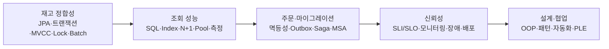
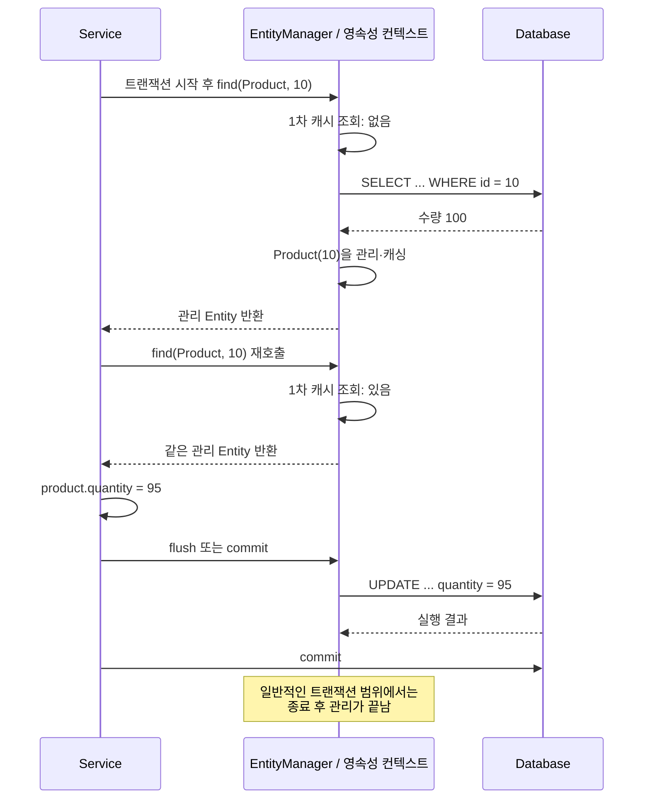
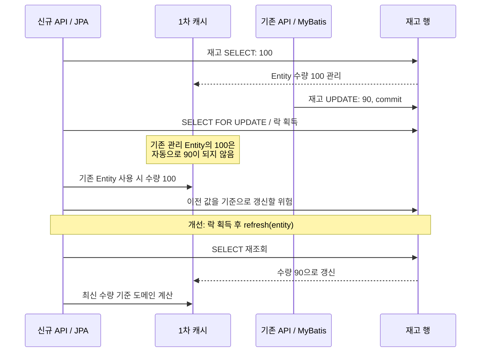
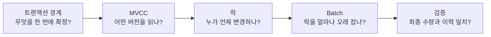
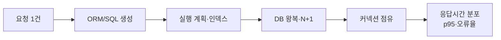
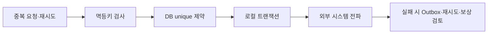
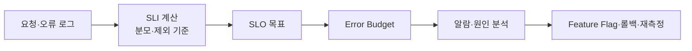

# 면접 준비 핵심개념: 그림과 요약

> 읽는 순서: 전체 지도 → 재고 정합성 → 성능 → 분산 처리 → 신뢰성 → 설계·협업. 각 개념을 이해한 뒤 실제 사례와 검증 근거를 연결한다.

## 1. 전체 지도

모든 묶음은 같은 방식으로 공부한다. **정의 → 내부 동작 → 실패 조건 → 대안 비교 → 본인 사례와 검증**. 마지막 단계에서는 자료에 적힌 숫자의 측정 기간·분모·조건을 확인한다.

## 2. JPA 영속성 컨텍스트와 1차 캐시

### 먼저 구분할 것

- **EntityManager**: Entity를 조회·저장·삭제하는 JPA API의 중심 객체.
- **영속성 컨텍스트**: EntityManager가 관리하는 Entity와 그 상태를 추적하는 공간. 변경 감지, 동일성 보장, 쓰기 지연 등에 관여한다.
- **1차 캐시**: 영속성 컨텍스트 안에서 `(Entity 타입, 식별자)`를 키로 관리 Entity를 찾는 저장소. 애플리케이션 전체가 공유하는 캐시가 아니다.
- **트랜잭션**: DB 작업을 하나의 원자적 작업으로 묶는 경계. 영속성 컨텍스트의 생성·종료 시점과 항상 같지는 않다. Spring의 일반적인 트랜잭션 범위 EntityManager에서는 대체로 트랜잭션과 함께 사용·종료되지만, Open EntityManager in View나 확장 영속성 컨텍스트에서는 더 오래 유지될 수 있다.

**정정할 점:** 트랜잭션이 시작될 때 DB의 모든 데이터가 1차 캐시에 저장되는 것은 아니다. `find()` 같은 조회로 Entity가 로딩되거나 `persist()`로 관리 대상이 될 때 해당 Entity가 들어간다.

### 생명주기 그림

### SQL은 정확히 언제 나가는가?

| 동작 | 1차 캐시/관리 상태 | 일반적인 SQL 시점 |
| --- | --- | --- |
| `find()` 첫 조회 | 없으면 DB 결과를 관리·캐싱 | 캐시 미스 때 SELECT |
| `find()` 재조회 | 같은 관리 Entity 반환 | 보통 SELECT 없음 |
| `persist()` | 새 Entity가 관리 대상이 됨 | 보통 flush 때 INSERT. `IDENTITY` 키 생성은 식별자를 얻으려고 즉시 INSERT할 수 있음 |
| 관리 Entity 필드 변경 | 변경 감지 대상 | flush 때 UPDATE. 실제 변경 여부와 SQL은 매핑·설정의 영향도 받음 |
| `remove()` | 삭제 예정 상태 | flush 때 DELETE |
| JPQL/QueryDSL 조회 | 쿼리 결과 Entity가 관리 대상이 될 수 있음 | 쿼리 실행 때 SELECT. FlushMode AUTO에서는 쿼리 전 flush가 일어날 수 있음 |
| `flush()` | 변경을 DB에 동기화, 캐시는 유지 | 대기 중인 INSERT/UPDATE/DELETE 실행. commit은 아님 |
| `refresh(entity)` | DB 값으로 관리 Entity를 덮어씀 | SELECT 재실행. 미반영 변경 유실에 주의 |
| `clear()` | 관리 Entity를 모두 분리 | 자체로 SQL 없음. 미반영 변경은 사라질 수 있어 필요 시 먼저 flush |
| `commit` | 일반적으로 선행 flush 후 DB 확정 | SQL 실행 및 COMMIT |
| `rollback` | DB 변경 취소 | ROLLBACK. 이후 같은 Entity 상태를 신뢰하지 말고 컨텍스트를 정리해야 함 |

Spring의 트랜잭션 범위에서 commit이 끝나면 해당 범위의 EntityManager가 닫히고 Entity는 더 이상 관리되지 않는다. 다만 OSIV가 켜져 있으면 웹 요청 끝까지 EntityManager가 열려 있을 수 있으므로 실제 설정을 확인해야 한다. 트랜잭션 종료와 1차 캐시 제거를 무조건 동일시하면 안 된다.

### 재고 사고에 대입한 그림

비관적 락은 **다른 트랜잭션의 동시 변경 순서**를 제어한다. 이미 메모리에 있는 JPA Entity를 최신 값으로 바꿔 주는 기능과는 별개다. 실제 프로젝트에서 `SELECT FOR UPDATE`가 어떤 Entity를 반환했고 어떤 시점에 락을 잡았는지는 SQL 로그·코드로 설명해야 한다.

### Level 4~5: 왜 `refresh()`였는가?

| 선택지 | 장점 | 비용·한계 |
| --- | --- | --- |
| 처음부터 락 조회 | 오래된 Entity 로딩을 줄임 | 모든 조회 경로와 순서를 통제해야 하고 락 보유 시간이 늘 수 있음 |
| 락 후 `refresh()` | 기존 도메인 계산과 트랜잭션 구조를 유지하며 최신 DB 값 반영 | 추가 SELECT, flush되지 않은 변경 덮어쓰기, 모든 변경 경로에 일관 적용 필요 |
| 원자적 조건부 UPDATE | DB가 조건 검사와 갱신을 한 번에 수행 | 복잡한 도메인 검증과 관리 Entity 동기화 방식 재설계 필요 |
| `@Version` 낙관적 락 | 충돌을 감지하고 락 대기를 줄일 수 있음 | MyBatis와 JPA 양쪽에서 버전 규칙·재시도 정책을 지켜야 함 |

포트폴리오상 선택은 **재고별 ID 순서 락 → `refresh()` → 도메인 계산 → 이력 Batch INSERT**다. 669개 상품 요청에서 반복 DB 작업을 줄였다고 적혀 있다. Level 5 답변에는 재현 시나리오, 동시 요청 테스트, 복구 대사, 6개월 관측 기준, p95 표본을 추가로 확인해 넣어야 한다.

## 3. 트랜잭션 → MVCC → 락 → Batch

- **트랜잭션:** 재고 수량 변경과 이력 저장이 함께 성공하거나 실패해야 하는 범위를 정의한다. Spring 프록시, 전파 옵션, 예외별 롤백 규칙을 알아야 한다. `REQUIRES_NEW`는 별도 물리 트랜잭션과 추가 커넥션을 요구할 수 있다.
- **MVCC:** DB는 트랜잭션별 읽기 시점에 따라 서로 다른 버전을 보여줄 수 있다. MySQL InnoDB의 일반 SELECT와 잠금 읽기(`FOR UPDATE`)의 차이, 격리 수준을 실제 DB 설정과 함께 설명한다.
- **락:** 비관적 락은 충돌을 대기시키지만 락 획득 전 JPA 캐시에 남은 값까지 갱신하지 않는다. 같은 순서로 락을 잡아 데드락 위험을 줄이고, 락 보유 시간을 줄여 Timeout을 완화한다.
- **Batch:** 여러 INSERT/UPDATE를 묶어 왕복 비용을 줄인다. IDENTITY 식별자는 JPA INSERT batching에 제약이 있어 사례에서는 JdbcTemplate 이력 일괄 저장을 택했다. `clear()` 전 flush 여부와 실패 시 전체 롤백을 확인한다.

## 4. SQL → Index → N+1 → 커넥션 풀 → 측정

- **SQL·Index:** `EXPLAIN`으로 스캔 범위, 조인 순서, 정렬·임시 테이블 여부를 본다. 인덱스는 읽기를 줄이지만 쓰기·저장 비용이 있다. 기간 조건과 카테시안 곱 개선 주장을 실제 실행 계획으로 방어한다.
- **N+1:** 목록 1회 조회 후 각 행 연관 데이터 N회 조회하는 현상. fetch join, 배치 조회, DTO 일괄 조회 중 페이지네이션·중복 행·메모리 비용을 보고 선택한다.
- **커넥션 풀:** DB 쿼리가 빠르더라도 풀 대기와 트랜잭션 점유가 응답을 늘릴 수 있다. 사례의 `REQUIRES_NEW` 제거는 추가 연결 점유를 줄였다는 주장으로 연결한다.
- **측정:** p95는 요청의 95%가 그 시간 이하로 끝났다는 분포 지표다. 전후 같은 API, 라우트, 기간, 요청량, 데이터 크기, 캐시 상태, 배포 환경, 표본 수를 맞춰야 개선율을 믿을 수 있다. 포트폴리오의 재고 p95 2,733→141ms와 15개 API 개선율은 이 조건을 확인해야 한다.

## 5. 멱등성 → Outbox → Saga → MSA

- **멱등성:** 같은 요청을 여러 번 받아도 업무 결과는 한 번만 반영되도록 한다. 애플리케이션 검사만으로는 동시 요청 경쟁이 남으므로 DB unique 제약과 충돌 처리도 설명한다. 키 범위, 만료, 동일 키·다른 페이로드 처리 정책이 필요하다.
- **Outbox:** DB 변경과 발행할 이벤트를 같은 로컬 트랜잭션에 기록한 뒤 별도 전달자가 발행한다. 전달은 중복될 수 있어 소비자도 멱등해야 한다.
- **Saga:** 여러 서비스의 로컬 트랜잭션을 연결하고 실패 시 보상 작업을 수행한다. 보상이 항상 원상복구와 같지는 않다. 포트폴리오에 Outbox·Saga를 적용했다고 적힌 것은 아니므로 대안 검토 수준으로 말한다.
- **MSA/이관:** CLASS101 회원 도메인 분리는 외부 token을 기준으로 Dual Write와 스크립트 전수 검증을 했다고 기재되어 있다. 양쪽 쓰기 실패 순서, 비교 대상, 컷오버와 롤백 기준을 확인해야 한다.

## 6. SLI/SLO → 모니터링 → 장애 대응 → 배포

- **SLI:** 사용자가 받은 서비스 품질의 측정값. 사례에서는 가용성(5xx), 500ms 이내 응답 비율, 2xx 안에 숨은 실패를 포함한 실질 성공률을 분리했다.
- **SLO:** 목표치. 자료에는 여섯 지표 모두 99.9%가 제시된다. 지표 정의가 바뀌면 개선 전후 값을 그대로 품질 변화로 해석하기 어렵다.
- **Error Budget:** 목표를 벗어날 수 있는 허용 실패량이다. 7일 기간, 집계 대상·제외 대상, 요청량을 말해야 한다.
- **실패 인정:** WMS·OMS 연동 모듈 실질 성공률은 99.73%→99.56%로 하락했다. 오류 그룹, 배포 버전, 지표 정의 변화, 후속 조치를 확인해 설명해야 한다. 원인을 확인하기 전에는 개선됐다고 포장하지 않는다.

## 7. OOP → 패턴 → 자동화 → 기술 의사결정

- **OOP:** 변경 이유가 다른 책임을 분리하고 인터페이스로 결합을 낮춘다. 프린터 사례에서 템플릿 선택, 이미지 렌더링, ZPL 변환, 출력 전송의 책임을 구분해 설명한다.
- **Factory Method·Strategy:** 출력 유형에 맞는 구현을 만들거나 선택하는 부분과 실제 출력 알고리즘을 분리한다. 어떤 분기가 제거됐는지, 새로운 택배사를 추가할 때 어디를 수정하는지 코드로 확인한다.
- **자동화:** Jira·GitHub 이벤트 연결은 사람이 하던 상태 변경을 줄였지만 문서 업무는 여전히 수동이었다고 자료에 적혀 있다. 자동화의 누락 조건과 실패 알림을 방어한다.
- **PLE 의사결정:** 문제 → 대안 → 판단 기준 → 적용 → 검증 → 남은 한계 순서로 설명한다. QA 대기·리뷰 시간·배포 기간의 전후 비교에서는 업무 유형이 같은지 먼저 확인한다.

## 8. 지금 바로 확인할 증빙

1. 재고 대사 쿼리·대상·주기·6개월간 실행 기록과 누락 가능성.
2. 재고 p95 2,733→141ms의 APM 대시보드 필터, 기간, 요청량, 표본 수.
3. 2,571→34 쿼리 수의 측정 단위와 재현 조건.
4. SLO 연동 모듈 실질 성공률 하락의 오류 그룹·배포 버전·후속 대응.
5. 직접 작성한 코드·RFC/ADR·테스트·장애 회고에서 본인 기여 범위.
