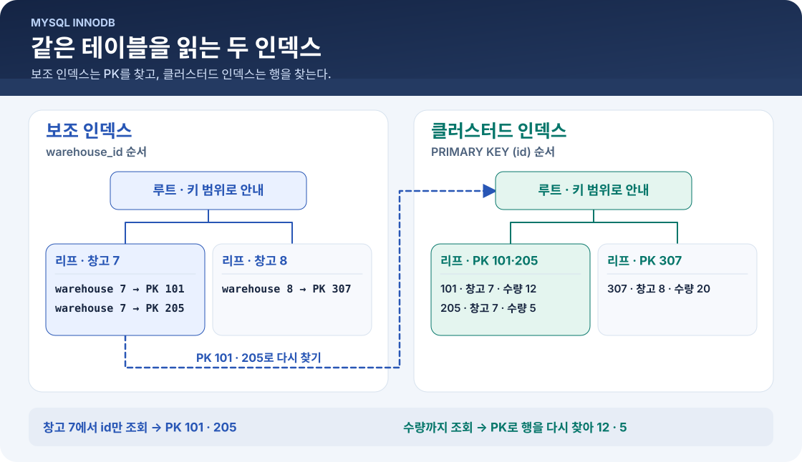
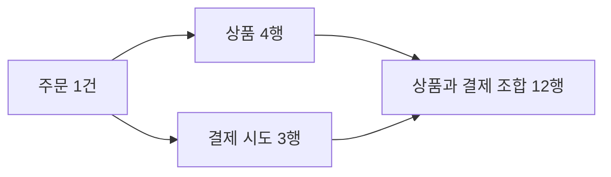

# 06. SQL 실행 계획과 인덱스

MySQL 8.4 InnoDB 기준이다. 먼저 **어떤 행을 몇 번 읽었는지**를 실행 계획에서 확인한다. 그다음 인덱스가 **검색 범위**, **원본 행 조회**, **정렬** 중 어느 비용을 줄였는지 구분한다.

## 1. 인덱스가 줄이는 비용

인덱스는 정렬된 키로 원하는 행을 찾는 자료구조다.

InnoDB에서 PK가 있으면 PK 인덱스가 클러스터드 인덱스다. 그 리프에는 행 데이터가 있다. 보조 인덱스 리프에는 보조 인덱스 키와 PK가 있다. 보조 인덱스에 필요한 컬럼이 없으면 PK로 클러스터드 인덱스를 다시 조회한다. [InnoDB 클러스터드 인덱스와 보조 인덱스](https://dev.mysql.com/doc/refman/8.4/en/innodb-index-types.html)

### 클러스터드 인덱스와 보조 인덱스의 트리 구조

예시 테이블의 PK는 `id`이고 `warehouse_id`에는 보조 인덱스가 있다. 위쪽 페이지의 키는 아래 어느 페이지로 내려갈지 안내한다. 아래는 리프가 두 페이지인 경우를 단순화한 그림이다.



예를 들어 `WHERE warehouse_id = 7`의 결과로 `id`만 필요하면 보조 인덱스에서 `101`과 `205`를 얻을 수 있다. 이를 **커버링 인덱스**라고 한다. `quantity`도 조회하면 각 PK로 클러스터드 인덱스를 탐색해 수량 `12`와 `5`를 읽는다.

키와 데이터가 트리의 어디에 놓이는지와 페이지 분할을 더 자세히 보려면 [B-Tree·B+Tree·B*Tree 자료구조](./18_심화_B_tree_자료구조.md)를 읽는다.

인덱스가 좁은 범위를 찾는 데 유리해도 결과가 테이블의 대부분이라면 원본 행을 반복해서 찾는 비용이 커진다. 작은 테이블이나 반환 비율이 높은 쿼리에서는 옵티마이저가 전체 스캔을 선택할 수 있다.

## 2. EXPLAIN과 EXPLAIN ANALYZE 읽기

`EXPLAIN`은 옵티마이저가 선택한 계획과 추정치를 보여준다. `EXPLAIN ANALYZE`는 쿼리를 실제로 실행하고 각 단계의 시간과 출력 행 수 및 반복 횟수를 보여준다. 이 단원에서는 실습용 SELECT에 사용한다. [MySQL EXPLAIN](https://dev.mysql.com/doc/refman/8.4/en/explain.html)

| 항목 | 읽는 법 |
| --- | --- |
| `type` | 접근 방식. `ALL`은 테이블 전체 스캔이고 `index`는 인덱스 전체 스캔이다. `range`는 범위 접근이고 `ref`는 비유일 키 등의 일치값 탐색이다. `eq_ref`는 조인 앞 단계의 행마다 유일 키로 해당 행을 최대 하나 찾는 방식이다. |
| `possible_keys` / `key` | 검색 후보와 실제 선택된 인덱스. 후보가 있어도 실제 계획에서 선택되지 않을 수 있다. |
| `key_len` / `ref` | 선택한 키의 사용 길이와 비교에 사용된 값. 정확히 어떤 조건까지 범위를 좁혔는지는 실행 계획과 함께 해석한다. |
| `rows` / `filtered` | 각 접근에서 검사할 것으로 추정한 행 수와 조건을 통과할 것으로 추정한 비율. `rows × filtered / 100`으로 다음 조인 단계에 전달될 추정 행 수를 가늠한다. |
| `Extra` | `Using index`는 커버링 접근의 단서다. `Using index condition`은 인덱스에서 조건 일부를 먼저 평가했다는 뜻이다. `Using filesort`는 별도 정렬 작업이 있다는 뜻이다. |

[MySQL EXPLAIN 출력 항목](https://dev.mysql.com/doc/refman/8.4/en/explain-output.html)

### 실행 비용이 커지는 지점 찾기

이해를 위한 예시 출력이다.

```text
-> Nested loop inner join  (actual time=0.1..95 rows=24000 loops=1)
    -> Index lookup on orders ...  (actual time=0.1..1.2 rows=200 loops=1)
    -> Index lookup on order_item ...  (actual time=0.02..0.40 rows=120 loops=200)
```

안쪽 조회는 바깥 주문 200건으로 인해 200회 반복됐다. 안쪽 단계의 `rows=120`을 반복당 평균으로 읽으면 약 **24,000행**을 위로 전달했다.

`actual time=a..b`는 첫 행을 반환할 때까지와 해당 단계가 끝날 때까지 걸린 시간이다. 단위는 ms이며 여러 번 실행된 단계에서는 반복당 평균이다. 상위 단계 시간에는 하위 단계 시간이 포함될 수 있으므로 각 줄의 시간을 그대로 더하지 않는다. [MySQL EXPLAIN ANALYZE](https://dev.mysql.com/doc/refman/8.4/en/explain.html)

실제 행 수가 예상보다 크게 많다면 통계가 오래됐는지와 특정 값에 데이터가 몰렸는지를 점검한다. `ANALYZE TABLE`은 인덱스 통계 갱신에 활용할 수 있다. 추정이 좋아져도 결과 자체가 많다면 쿼리 구조를 봐야 한다.

## 3. 복합 인덱스는 왜 열 순서가 중요한가

`(warehouse_id, status, created_at)` 인덱스는 먼저 창고 ID로 정렬한다. 같은 창고 안에서는 상태로 정렬하고 같은 상태 안에서는 시간으로 정렬한다.

```text
warehouse_id=7
  ├─ status=0 → 01:00 → 04:00 → 06:00
  └─ status=1 → 02:00 → 03:00 → 07:00
warehouse_id=8
  └─ status=1 → 02:00 → 05:00
```

| WHERE 조건 | 인덱스 탐색 관점 |
| --- | --- |
| `warehouse_id = 7` | 첫 열로 창고 7 구간을 찾을 수 있다. |
| `warehouse_id = 7 AND status = 1 AND created_at >= ...` | 창고와 상태를 먼저 고정한 뒤 시간 범위를 좁힐 수 있다. |
| `warehouse_id = 7 AND created_at >= ...` | 가운데 상태 조건이 없으므로 시간 데이터가 상태별 구간에 나뉜다. |
| `created_at >= ...` | 일반적인 왼쪽 접두사 범위 탐색으로 시간 구간을 바로 찾기 어렵다. 시간 선두 인덱스도 비교할 수 있다. |

인덱스가 `(warehouse_id, created_at, status)` 순이라면 시간 범위를 읽은 뒤 상태 조건을 걸러낼 수 있다. 뒤쪽 상태 컬럼이 시작과 끝의 탐색 범위를 좁히지 못해도 조건 평가나 커버링에 쓰일 수 있다. 실제 계획에서 어디에 쓰였는지 확인한다. [복합 인덱스](https://dev.mysql.com/doc/refman/8.4/en/multiple-column-indexes.html) · [범위 최적화](https://dev.mysql.com/doc/refman/8.4/en/range-optimization.html) · [Index Condition Pushdown](https://dev.mysql.com/doc/refman/8.4/en/index-condition-pushdown-optimization.html)

### 기간 조건과 정렬을 함께 보기

같은 날짜를 조회하더라도 컬럼에 함수를 적용하면 일반적인 `created_at` 인덱스의 범위 접근이 어려워질 수 있다. 원본 컬럼에 시작 시각과 다음 날 시작 시각을 비교하면 인덱스 순서를 활용하기 쉽다.

```sql
-- 날짜를 컬럼에서 계산
WHERE DATE(created_at) = '2026-01-15'

-- 시작은 포함하고 끝은 제외
WHERE created_at >= '2026-01-15 00:00:00'
  AND created_at <  '2026-01-16 00:00:00'
```

창고와 상태가 모두 고정되고 `ORDER BY created_at`을 사용하면 위 복합 인덱스에서 남은 정렬 순서를 활용할 수 있다. 창고만 고정하면 상태별 시간 순서가 각각 존재하므로 결과 전체를 시간순으로 합칠 때 별도 정렬이 필요할 수 있다.

`Using filesort`는 추가 정렬이 있다는 뜻이다. 실제로 디스크를 썼는지는 이 표시만으로 알 수 없다. [MySQL ORDER BY 최적화](https://dev.mysql.com/doc/refman/8.4/en/order-by-optimization.html)

## 4. 조인이 중간 결과를 키우는 경우

주문 1건에 상품 4행과 결제 시도 3행이 있다고 하자. 두 테이블을 각각 주문에 조인하면 주문 한 건에 대해 **4 × 3 = 12행**이 만들어진다. 주문 테이블과 연결하는 조인 조건이 있더라도 두 자식 집합이 주문 안에서 서로 곱해질 수 있다.



- 자식의 **존재 여부**만 필요하면 `EXISTS`를 검토한다.
- 주문별 **합계**가 필요하면 자식을 주문 단위로 먼저 집계한 뒤 조인할 수 있다.
- 실제로 대응하는 항목만 연결해야 한다면 주문 ID와 함께 필요한 조인 키가 빠졌는지 확인한다.

조건을 앞으로 옮겼다는 쿼리 모양만으로 조인 순서를 판단하기는 어렵다. 옵티마이저가 선택한 순서와 함께 실행 계획의 `rows` 및 `loops`를 확인한다.

`LEFT JOIN`에서 오른쪽 테이블의 필터를 `ON`에 두면 일치하는 행이 없는 왼쪽 레코드도 남는다. 같은 조건을 `WHERE`에 두면 그 레코드가 빠질 수 있다. 튜닝 전후의 결과 건수와 중복 및 누락을 확인한다.

## 5. 실습 · 인덱스 추가 전후 비교

MySQL 8.0.18 이상의 빈 실습 스키마에서 실행할 수 있다. 예상 관측을 적었고 이 문서를 작성하면서 서버에서 실행하지는 않았다.

### 준비 · 데이터 5만 건 만들기

```sql
CREATE TABLE sql_index_lab (
    id BIGINT NOT NULL AUTO_INCREMENT PRIMARY KEY,
    warehouse_id INT NOT NULL,
    status TINYINT NOT NULL,
    created_at DATETIME NOT NULL,
    payload VARCHAR(120) NOT NULL
) ENGINE = InnoDB;

INSERT INTO sql_index_lab (warehouse_id, status, created_at, payload)
WITH digit AS (
    SELECT 0 AS d UNION ALL SELECT 1 UNION ALL SELECT 2 UNION ALL
    SELECT 3 UNION ALL SELECT 4 UNION ALL SELECT 5 UNION ALL
    SELECT 6 UNION ALL SELECT 7 UNION ALL SELECT 8 UNION ALL SELECT 9
),
nums AS (
    SELECT a.d + b.d * 10 + c.d * 100 + e.d * 1000 + f.d * 10000 AS n
    FROM digit a CROSS JOIN digit b CROSS JOIN digit c
    CROSS JOIN digit e CROSS JOIN digit f
)
SELECT MOD(n, 50) + 1,
       MOD(FLOOR(n / 50), 4),
       DATE_ADD('2026-01-01 00:00:00', INTERVAL n MINUTE),
       REPEAT('x', 64)
FROM nums
WHERE n < 50000;
```

### 1단계 · 조건에 맞는 인덱스가 없는 상태

```sql
EXPLAIN FORMAT=TRADITIONAL
SELECT id, created_at
FROM sql_index_lab
WHERE warehouse_id = 7 AND status = 1
  AND created_at >= '2026-01-15' AND created_at < '2026-01-22'
ORDER BY created_at
LIMIT 30;
```

`key`와 `type` 및 `Extra`를 기록한다. 현재 PK는 창고나 날짜 조건을 좁히는 데 직접 쓰기 어렵다.

### 2단계 · 복합 인덱스를 추가하고 같은 SQL 비교

```sql
CREATE INDEX idx_lab_warehouse_status_time
ON sql_index_lab (warehouse_id, status, created_at);

ANALYZE TABLE sql_index_lab;

EXPLAIN ANALYZE
SELECT id, created_at
FROM sql_index_lab
WHERE warehouse_id = 7 AND status = 1
  AND created_at >= '2026-01-15' AND created_at < '2026-01-22'
ORDER BY created_at
LIMIT 30;
```

1단계 SQL에도 같은 `EXPLAIN ANALYZE`를 인덱스 추가 전에 실행해 두면 실제 행 수와 시간을 비교할 수 있다. 추가 후에는 `FORMAT=TRADITIONAL`도 다시 실행해 `key`와 `Extra`를 대조한다.

### 3단계 · 조건 하나씩 바꿔 보기

1. SELECT 목록에 `payload`를 추가한다. 인덱스로 검색하더라도 원본 행 조회가 필요한 이유를 설명한다.
2. `status = 1`을 제거한다. 같은 인덱스에서 기간 범위와 결과 정렬이 어떻게 달라지는지 확인한다.
3. `DATE(created_at) = '2026-01-15'`와 하루의 반열린 범위 조건을 비교한다. 같은 데이터가 나오는지 확인한 뒤 시간 조건이 계획에 어떻게 들어갔는지 본다.

## 6. 포트폴리오 사례에 연결

자료에는 **기간 조건 인덱스 개선 2건**과 **카테시안 곱 방지 조인 튜닝 1건**이 있다. 구체적인 대상 컬럼과 전후 실행 계획은 실제 자료에서 확인할 항목이다.

| 사례 | 설명할 근거 |
| --- | --- |
| 기간 조건 인덱스 | 당시 WHERE와 ORDER BY 및 추가한 인덱스의 열 순서. 실행 계획에서 스캔 범위와 정렬이 어떻게 달라졌는지 확인 |
| 조인 튜닝 | 어느 조인 단계에서 중간 결과가 커졌는지 확인. 변경 뒤에도 결과의 중복과 누락 및 집계값이 의도대로인지 검증 |
| 성능 검증 | 같은 API에서도 요청의 기간 길이와 결과량이 다르면 p95가 변할 수 있다. 바인딩 값과 표본 범위를 적고 DB 실행 계획 및 API p95를 함께 설명 |

인덱스를 늘리면 그 인덱스를 유지할 INSERT와 UPDATE 및 DELETE 비용과 저장 공간이 든다. 빠르게 만들 쿼리와 실제 쓰기 비중을 기준으로 추가 여부를 판단한다.

## Level 1~5 문제

### Level 1 · 정의

`EXPLAIN`과 `EXPLAIN ANALYZE`는 각각 어떤 정보를 보여 주나? 클러스터드 인덱스와 보조 인덱스 리프에는 무엇이 들어 있나?

### Level 2 · 내부 동작

`(warehouse_id, status, created_at)` 인덱스에서 창고와 상태가 고정된 기간 조회는 어떻게 범위를 찾나? 상태 조건을 빼면 기간 탐색과 정렬에 어떤 변화가 생길까?

### Level 3 · 장애와 한계

`possible_keys`에 후보가 있는데 `key`가 비고 `type=ALL`인 경우를 어떻게 해석할까? `Using index`와 `Using index condition`의 차이도 설명해 봐.

### Level 4 · 대안과 비용

주문에 상품과 결제 시도를 조인했더니 주문당 행 수가 크게 늘었다. 인덱스 추가로 줄일 수 있는 비용과 `EXISTS` 또는 사전 집계로 해결할 수 있는 문제를 구분해 봐.

### Level 5 · 실제 적용과 검증

기간 조건 인덱스 또는 카테시안 곱 조인 개선 중 한 건을 골라 **느린 이유 → 변경한 SQL 또는 인덱스 → 전후 계획과 행 수 → 결과 검증 → 측정 기간과 p95** 순서로 설명해 봐. 다 기억하지 못하는 항목은 어떤 자료로 확인할지 말한다.

## 학습 기록

- 상태: 개념과 실습 자료 작성 완료. Level 1~5 미응시.
- 확인할 자료: 실제 SQL과 바인딩 값 · 인덱스 DDL · 전후 실행 계획 · 결과 건수와 중복 여부 · API p95 측정 조건.
