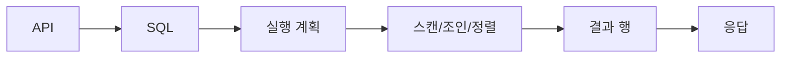

# 06. SQL 실행 계획과 인덱스

## 기술 개념 전체 설명

### 실행 계획

DB는 조건·통계·인덱스를 바탕으로 접근 경로와 조인 순서를 정한다. EXPLAIN과 실제 실행 시간·읽은 행 수를 함께 본다. 예상 행 수와 실제가 다르면 통계·데이터 분포를 점검한다.

### 인덱스

B-tree 인덱스는 조건 범위를 좁히고 정렬을 줄일 수 있다. 복합 인덱스의 열 순서, 등호·범위 조건, 커버링 여부가 중요하다. 인덱스 추가는 쓰기 비용과 공간을 늘린다.

### 조인·카디널리티

필터 전 다대다 조인은 중간 결과를 크게 만들 수 있다. 먼저 대상을 좁히고 인덱스를 이용해 조인한다. 조인 변경 시 결과 행 수와 중복·누락도 함께 검증한다.

## 흐름 그림

## 이력서·포트폴리오 사례 연결

기간 조건 인덱스 2건과 카테시안 곱 조인 1건의 전후 실행 계획·데이터량·결과 동일성을 확인한다.

## Level 1~5 문제

### Level 1 · 정의

인덱스와 실행 계획은 무엇인가?

### Level 2 · 내부 동작

복합 인덱스에서 열 순서가 중요한 이유는?

### Level 3 · 장애·한계

인덱스가 있어도 전체 스캔이 선택되는 이유는?

### Level 4 · 대안과 Trade-off

인덱스 추가와 쿼리 구조 변경을 어떻게 비교하는가?

### Level 5 · 실제 적용과 검증

개선 API의 EXPLAIN, 실제 읽은 행 수, p95 전후 조건을 제시하라.

## 학습 기록

- 상태: 미응시
- 무자료 2분 답변:
- 틀린 개념:
- 확인한 실제 근거:
- 아직 미확인인 주장:
- 다음 복습일:
