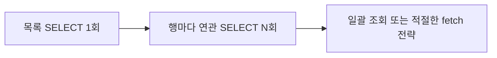

# 07. N+1, fetch 전략과 페이지네이션

## 기술 개념 전체 설명

### N+1

목록 한 번 조회 후 각 행의 연관 정보를 따로 조회하면 1+N번 SQL이 발생한다. 지연 로딩이 흔한 원인이지만 즉시 로딩에서도 쿼리 형태에 따라 생길 수 있다.

### 해결 방식

fetch join은 한 번에 읽지만 컬렉션 조인 시 행 중복과 페이지네이션 문제가 있다. IN 일괄 조회, DTO projection, batch size는 목적과 데이터량에 따라 선택한다.

### 페이지네이션

offset은 뒤 페이지에서 건너뛰는 비용이 커질 수 있다. cursor는 안정적인 정렬 키와 동률 처리, 삭제·삽입 중 페이지 경계 정책이 필요하다.

## 흐름 그림

## 이력서·포트폴리오 사례 연결

15개 API 중 N+1 6건, 과거 서비스의 cursor 4초→0.6초 주장을 실제 쿼리 수와 데이터 조건으로 방어한다.

## Level 1~5 문제

### Level 1 · 정의

N+1은 무엇인가?

### Level 2 · 내부 동작

lazy/eager와 fetch join의 실제 SQL은?

### Level 3 · 장애·한계

컬렉션 fetch join과 페이지네이션의 한계는?

### Level 4 · 대안과 Trade-off

fetch join, DTO 일괄 조회, batch size 중 선택 기준은?

### Level 5 · 실제 적용과 검증

개선 전후 SQL 수·결과 동일성·p95·페이지 경계 테스트를 보여 달라.

## 학습 기록

- 상태: 미응시
- 무자료 2분 답변:
- 틀린 개념:
- 확인한 실제 근거:
- 아직 미확인인 주장:
- 다음 복습일:
