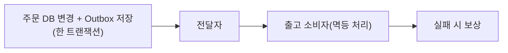

# 11. 로컬 트랜잭션·Outbox·Saga

## 기술 개념 전체 설명

### 이중 쓰기 문제

DB commit과 메시지 발행을 독립 실행하면 한쪽만 성공할 수 있다. 하나의 로컬 트랜잭션으로 둘을 원자적으로 확정할 수 없다.

### Outbox

도메인 변경과 outbox 레코드를 같은 DB 트랜잭션에 기록한다. 전달자가 발행·재시도한다. 전달 중복 가능성이 있어 소비자 멱등성과 이벤트 순서를 설계한다.

### Saga

서비스마다 로컬 트랜잭션을 실행하고 실패 시 보상 명령을 수행한다. 보상은 비즈니스적으로 되돌리는 작업이며 완전한 DB 롤백과 다를 수 있다.

## 흐름 그림

## 이력서·포트폴리오 사례 연결

포트폴리오에는 Outbox·Saga를 적용했다고 기재하지 않았다. 주문·출고 연동의 대안으로 이해하고, 실제 구현과 구분해 답한다.

## Level 1~5 문제

### Level 1 · 정의

로컬 트랜잭션이 보장하는 범위는?

### Level 2 · 내부 동작

Outbox 전달자는 어떤 실패를 재시도하는가?

### Level 3 · 장애·한계

중복 이벤트·순서 역전·보상 실패는 어떻게 다루는가?

### Level 4 · 대안과 Trade-off

동기 API, Outbox, Saga를 언제 선택하는가?

### Level 5 · 실제 적용과 검증

본인 시스템에서 실제 적용한 방식과 미적용 대안을 명확히 구분하라.

## 학습 기록

- 상태: 미응시
- 무자료 2분 답변:
- 틀린 개념:
- 확인한 실제 근거:
- 아직 미확인인 주장:
- 다음 복습일:
