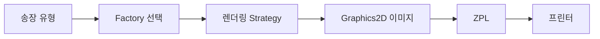

# 15. OOP·Factory Method·Strategy와 프린터

## 기술 개념 전체 설명

### 책임 분리

렌더링·템플릿 선택·ZPL 변환·전송은 변경 이유가 다르다.  
객체를 책임별로 나누고 외부 장치 의존을 경계에 둔다.

### 패턴

Factory Method는 필요한 구현 객체의 생성을 캡슐화하고 Strategy는 교체 가능한 알고리즘을 인터페이스로 다룬다.  
실제 코드가 어느 패턴에 해당하는지 생성 지점과 호출 구조로 확인한다.

### 성능

Graphics2D 이미지 렌더링 후 ZPL 변환은 폰트 설치 의존성을 줄였다고 기재되어 있다.  
1,000장 50→8초는 프린터·네트워크·템플릿·측정 구간을 맞춰 비교해야 한다.

## 흐름 그림

## 이력서·포트폴리오 사례 연결

새 택배사 템플릿 추가 때 수정 파일, 테스트 대역, 실패 처리, 처리량 측정 조건을 Level 5에서 제시한다.

## Level 1~5 문제

### Level 1 · 정의

단일 책임과 의존성 역전은 무엇인가?

### Level 2 · 내부 동작

Factory Method와 Strategy의 역할은?

### Level 3 · 장애·한계

폰트 설치 의존성이 왜 운영 문제였나?

### Level 4 · 대안과 Trade-off

템플릿 분기와 전략 객체의 복잡도·확장성을 비교하라.

### Level 5 · 실제 적용과 검증

코드 구조와 1,000장 전후 재현 조건·실패율을 제시하라.

## 학습 기록

- 상태: 미응시
- 무자료 2분 답변:
- 틀린 개념:
- 확인한 실제 근거:
- 아직 미확인인 주장:
- 다음 복습일:
