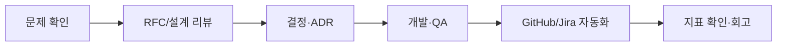

# 16. PLE 의사결정과 업무 자동화

## 기술 개념 전체 설명

### 의사결정 문서

RFC는 변경 제안과 토론을 기록한다.  
ADR은 채택한 결정과 그 배경을 남긴다.  
Design Document는 구현 경계·위험·검증 계획을 공유한다.  
문서의 이름보다 결정 근거와 책임자가 중요하다.

### 프로세스 자동화

GitHub Branch·PR·배포 이벤트로 Jira 상태를 갱신하면 수동 전환을 줄일 수 있다.  
이벤트 누락·재전송·순서 역전·문서 업무처럼 이벤트가 없는 작업을 처리해야 한다.

### 성과 비교

리뷰 시간·QA 대기·배포 기간은 업무 유형과 기간이 같아야 비교 가능하다.  
자료의 개발 완료→배포 23.6일과 2.7일은 기능 개발과 기술 개선이라는 다른 유형의 평균이므로 직접 개선율로 말하면 안 된다.

## 흐름 그림

## 이력서·포트폴리오 사례 연결

PLE로 직접 조율한 결정과 팀 합의 및 자동화 구축 범위를 구분한다.  
문서 업무 상태가 수동으로 남았다는 한계도 설명한다.

## Level 1~5 문제

### Level 1 · 정의

RFC·ADR·Design Document의 역할은?

### Level 2 · 내부 동작

GitHub 이벤트로 Jira 상태를 바꾸는 흐름은?

### Level 3 · 장애·한계

자동화가 문서 업무를 놓친 이유와 영향은?

### Level 4 · 대안과 Trade-off

사람 검토와 AI 자동화의 책임 경계를 어떻게 정하는가?

### Level 5 · 실제 적용과 검증

본인 결정 사례, 반대 의견, 결과 수치의 비교 가능성과 남은 한계를 설명하라.

## 학습 기록

- 상태: 미응시
- 무자료 2분 답변:
- 틀린 개념:
- 확인한 실제 근거:
- 아직 미확인인 주장:
- 다음 복습일:
