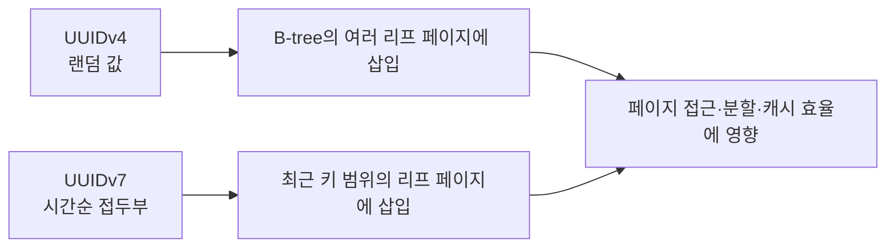

# UUIDv4와 UUIDv7: 생성 시점부터 안정적인 ID를 고르기

## 핵심 개념

UUID는 128비트 식별자다. DB에 넣기 전 애플리케이션에서 만들 수 있으므로 DB 생성형 ID의 `null → 값` 전환 문제를 피할 수 있다.

다만 UUID가 같다는 사실은 **기술적 식별자**가 같다는 뜻이다. 같은 외부 주문을 두 개의 UUID로 저장하는 업무 중복은 별도 Business Key 제약으로 막아야 한다.

| 항목 | UUIDv4 | UUIDv7 |
| --- | --- | --- |
| 주된 구성 | 무작위 비트 | 앞 48비트 밀리초 Unix 시각 + 나머지 랜덤/선택적 카운터 |
| 생성 순서와 값 순서 | 관계 없음 | 대체로 시간순. 같은 밀리초 내 완전한 단조 증가 보장은 생성기 구현에 달림 |
| B-tree 삽입 | 여러 키 범위에 흩어짐 | 최근 시각의 키 범위에 모이는 경향 |
| 외부 노출 | 생성 시각을 드러내지 않음 | 생성 시각을 읽을 수 있음 |
| 공통점 | 128비트 · 생성 후 불변 · DB unique 제약 필요 | 128비트 · 생성 후 불변 · DB unique 제약 필요 |

RFC 9562는 v4의 무작위 구성과 v7의 시간순 구성을 정의한다. 또한 동일 밀리초에서 카운터 등으로 단조성을 보강하는 방법을 정의한다. [RFC 9562](https://www.rfc-editor.org/rfc/rfc9562.html)

## 값과 인덱스의 관계

v7이 항상 빠르다는 뜻은 아니다. 테이블 크기, 삽입률, 버퍼 풀, 보조 인덱스 수, 키 저장 방식에 따라 차이가 달라진다.

v7의 생성 시각이 같거나 여러 노드의 시계가 어긋나면 완벽한 삽입 순서를 기대할 수 없다. RFC도 정렬과 인덱스 지역성의 이점을 설명하면서 단조성 보장은 구현 조건에 달린다고 구분한다. [RFC 9562 §6.2·§6.11](https://www.rfc-editor.org/rfc/rfc9562.html)

## DDD·JPA Entity 동일성과 연결

애플리케이션에서 UUID를 Entity 생성 시 할당하면 영속화 전후 ID가 안정적이다. 따라서 ID 기반 동등성 설계의 `null` 문제를 줄인다.

그래도 `equals()`와 `hashCode()`를 구현할 때는 프록시 타입, 재구성된 객체, 컬렉션에 넣은 뒤 값 변경 여부를 검토해야 한다. **UUIDv7은 Entity 동일성의 후보 키이지 업무상 중복 제거 규칙은 아니다.** 예를 들어 주문 ID는 UUIDv7 PK로 두고 `(shop_id, external_order_id)`를 UNIQUE로 둘 수 있다.

## 선택 기준과 검증

1. ID를 DB INSERT 전에 알아야 하는가? 그렇다면 애플리케이션 생성 UUID가 유용하다.
2. InnoDB PK인가? PK의 삽입 순서와 크기는 클러스터드 인덱스·보조 인덱스 비용에 영향을 준다.
3. 생성 시각이 외부에 노출돼도 되는가? v7에는 시간 정보가 포함된다.
4. 같은 밀리초 내 생성량과 다중 노드의 시계 오차는 어떤가? 생성기의 단조성·충돌 정책을 확인한다.
5. 실제 데이터량과 인덱스 구성으로 v4/v7의 INSERT 처리량, p95 지연, 인덱스 크기, 버퍼 풀 적중을 비교한다.

## Level 1~5 면접 문제

1. v4와 v7의 비트 구성과 공통점은?
2. v7이 시간순 정렬에 유리한 이유와 같은 밀리초의 한계는?
3. v4를 InnoDB PK로 썼을 때 어떤 부하가 나타날 수 있는가?
4. AUTO_INCREMENT·UUIDv4·UUIDv7을 어떤 조건에서 선택하는가?
5. 본인 서비스에서 UUIDv7을 쓴다면 생성기·저장 타입·인덱스·업무 UNIQUE를 어떻게 검증하겠는가?
