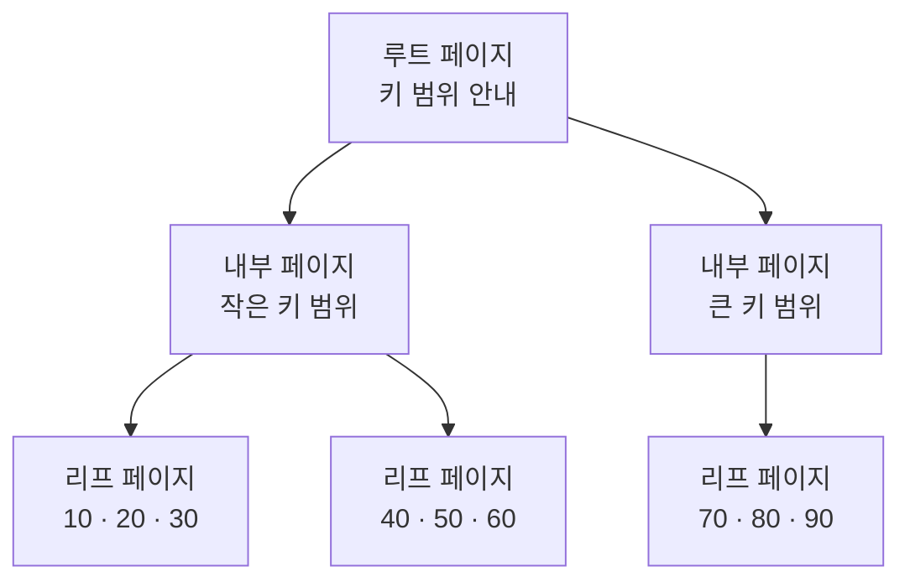

# B-tree 인덱스: UUID가 삽입 성능에 영향을 주는 이유

## B-tree 계열 인덱스란?

MySQL InnoDB 인덱스는 정렬된 키를 페이지 단위로 관리하는 B-tree 계열 구조다.  
루트에서 내부 페이지를 따라 내려가 리프 페이지에서 값을 찾는다.

키가 정렬되어 있으므로 등호 검색뿐 아니라 범위 검색과 순서 읽기에 유리하다.  
페이지에 공간이 부족한 곳에 새 키를 넣어야 하면 분할과 재배치가 필요할 수 있다.

## InnoDB에서 PK가 특히 중요한 이유

InnoDB의 **클러스터드 인덱스**는 보통 PK이며 리프에 행 데이터가 저장된다.  
보조 인덱스의 각 레코드에는 해당 행의 PK가 포함된다.

따라서 PK가 길면 보조 인덱스도 커질 수 있다. [MySQL: Clustered and Secondary Indexes](https://dev.mysql.com/doc/refman/8.4/en/innodb-index-types.html)

## 랜덤 키와 시간순 키

UUIDv4처럼 랜덤한 PK는 새 행이 여러 리프 페이지에 흩어져 들어간다.  
작업 집합이 메모리를 넘으면 여러 페이지를 읽고 수정해야 한다.

페이지 분할이 늘고 버퍼 풀의 부담이 커질 수 있다.  
UUIDv7의 시간순 접두부는 최근 키 범위에 삽입을 모아 **지역성**을 높이는 방향이다.

그렇다고 모든 부하에서 v7이 유리하다는 뜻은 아니다.  
예컨대 읽기 패턴, 병렬 쓰기 경쟁, 인덱스 크기와 캐시 조건에 따라 결과가 다르다. [RFC 9562 §6.11](https://www.rfc-editor.org/rfc/rfc9562.html)

## 인덱스의 읽기·쓰기 Trade-off

| 설계 | 이점 | 비용 |
| --- | --- | --- |
| PK를 짧게 유지 | 클러스터드·보조 인덱스 공간 절약 | 별도 Business Key UNIQUE가 필요할 수 있음 |
| 보조 인덱스 추가 | 특정 조건의 읽기 범위 축소 | INSERT/UPDATE/DELETE 때 인덱스도 갱신 |
| 복합 인덱스 | 필터·정렬을 함께 지원 가능 | 열 순서와 쿼리 조건이 맞아야 효과 |
| 시간순 UUID PK | INSERT 지역성 향상 가능 | 키 크기·생성 시각 노출·생성기 정책 검토 |

MySQL은 긴 PK가 모든 보조 인덱스에 복제되어 공간과 I/O 비용을 높인다고 설명한다. [MySQL: Optimizing InnoDB Queries](https://dev.mysql.com/doc/refman/8.4/en/optimizing-innodb-queries.html)

## 성능을 검증할 때

스키마와 보조 인덱스 구성을 고정한다.  
행 크기와 삽입 건수 및 동시성도 맞춘다.

그 조건에서 `BIGINT`와 `BINARY(16)`으로 저장한 UUIDv4 및 UUIDv7을 비교한다.  
INSERT 처리량과 p95, 인덱스 크기, 버퍼 풀 적중, 디스크 읽기·쓰기, 페이지 분할 관련 지표를 함께 본다.

SELECT도 PK 조회와 보조 인덱스 조회를 나눠 측정한다.  
**UUID 버전만 바꾸고 저장 타입까지 바꾸면 어느 요인이 효과를 냈는지 분리할 수 없다.**

## Level 1~5 면접 문제

1. B-tree의 루트·내부·리프 페이지는 무엇인가?
2. InnoDB의 클러스터드 인덱스와 보조 인덱스는 어떻게 연결되는가?
3. 랜덤 PK가 커진 테이블에서 쓰기 비용을 높일 수 있는 이유는?
4. UUIDv7·AUTO_INCREMENT·짧은 PK와 별도 공개 ID의 조합의 Trade-off는?
5. 실행 계획·인덱스 크기·부하 테스트로 선택을 어떻게 검증하겠는가?
