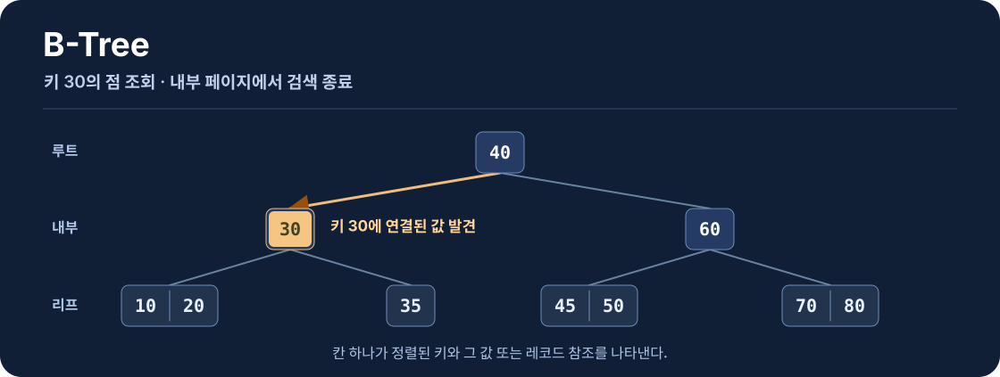
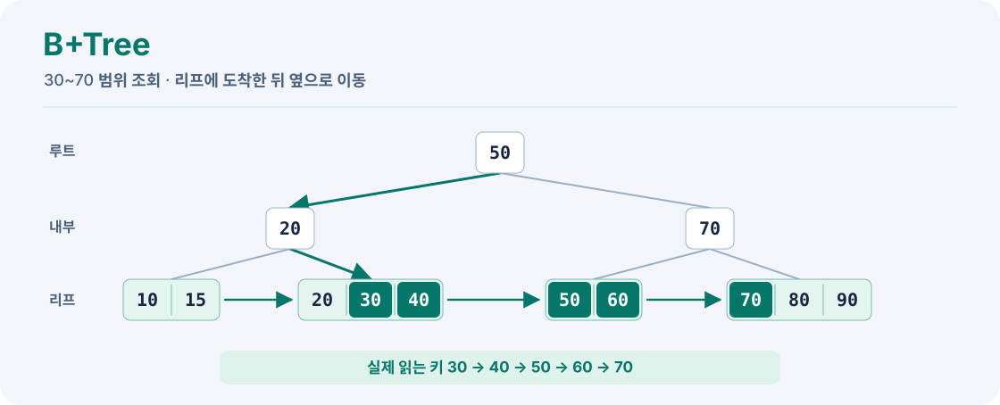
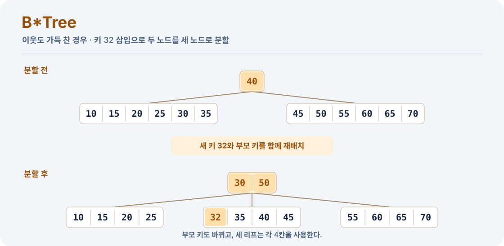

# B-Tree·B+Tree·B*Tree 자료구조

세 구조는 정렬된 키를 여러 개 담는 노드로 균형 트리를 만든다. 저장 위치를 이해할 때는 **실제 레코드가 어디에 있는지**를 보고, 삽입을 이해할 때는 **가득 찬 노드를 어떻게 처리하는지**를 본다.

## 1. 공통 구조 · 한 페이지에서 여러 갈래로 탐색

노드 안의 키는 정렬돼 있다. 예를 들어 루트의 구분 키가 `30`과 `70`이면 자식 페이지를 세 구간으로 나눌 수 있다. `55`를 찾는다면 가운데 자식만 따라간다. 모든 리프는 같은 깊이에 있다.

페이지 하나가 여러 키와 자식 포인터를 담을 수 있어서 트리 높이가 낮아진다. 디스크 기반 인덱스에서는 방문해야 하는 페이지 수가 줄어드는 것이 중요하다. [Bayer와 McCreight의 B-Tree 논문](https://rtheunissen.github.io/bst/docs/references/1972_bayer_mccreight.pdf)

## 2. B-Tree · 내부 노드에서도 검색이 끝날 수 있음

고전적인 B-Tree는 내부 노드와 리프 모두에 실제 검색 항목을 둘 수 있다. 검색 항목은 키와 값 또는 레코드를 찾는 참조로 구성된다. 루트에서 찾는 키와 일치하는 검색 항목을 만나면 거기서 값을 얻을 수 있다.

삽입할 노드에 자리가 없으면 보통 그 노드를 둘로 나누고 가운데 검색 항목을 부모로 올린다. 부모도 가득 차면 분할이 위로 이어질 수 있다. 삭제 시에는 형제 노드와 키를 재분배하거나 노드를 합쳐 균형을 유지한다. [B-Tree 원 논문의 탐색과 삽입](https://rtheunissen.github.io/bst/docs/references/1972_bayer_mccreight.pdf)

## 3. B+Tree · 내부 노드는 길을 안내하고 리프가 결과를 담음

내부 노드의 구분 키는 탐색 방향을 안내한다.
실제 검색 항목은 리프에 있으므로 내부 노드에서 `30`을 보더라도 해당 리프까지 내려간다.
구분 키 `30`이 내부와 리프에 함께 나타날 수 있다.

리프를 키 순서로 연결하면 처음 위치를 찾은 뒤 인접 리프를 따라 범위를 읽을 수 있다.
그림처럼 `30~70`을 조회하면 `30`이 있는 리프에서 시작해 오른쪽 리프를 따라 `70`까지 읽는다.
내부 노드가 주로 구분 키와 자식 포인터를 담는 구조는 한 페이지에 더 많은 경로를 담는 데 유리하다.
 [Knuth, The Art of Computer Programming §6.2.4](https://rtheunissen.github.io/bst/docs/references/1973_knuth_taocp_vol_3_section_6.pdf)

## 4. B*Tree · 이웃 노드와 나눠 쓴 뒤 분할

B*Tree는 노드가 가득 찼을 때 이웃 노드의 빈 공간부터 본다.
여유가 있다면 부모의 구분 키를 조정하면서 키를 재분배한다.
양쪽이 모두 가득 찼다면 두 노드의 키를 모아 세 노드로 나눈다.

그림에서는 리프 하나에 키가 최대 6개 들어간다. 가득 찬 두 리프에 `32`를 넣으면 부모 키도 함께 재배치된다. 분할 후 부모 키는 `30`과 `50`이고 각 리프에는 키가 4개씩 남는다.

고전적인 설명에서 B*Tree는 일반 노드의 최소 점유율을 약 3분의 2로 높이는 구조다. 루트와 정수 슬롯 수에 따른 예외가 있다. 페이지 활용도를 높일 수 있는 대신 삽입 시 이웃 노드와 부모까지 조정하는 비용이 생긴다. [Knuth의 B*Tree 분할 설명 §6.2.4](https://rtheunissen.github.io/bst/docs/references/1973_knuth_taocp_vol_3_section_6.pdf)

## 5. 비교하고 InnoDB에 연결하기

| 구조 | 설명할 때 볼 기준 | 면접에서 짚을 동작 |
| --- | --- | --- |
| B-Tree | 실제 검색 항목의 위치 | 내부 노드에 검색 항목이 있어 등호 검색이 거기서 끝날 수 있다. |
| B+Tree | 내부 노드와 리프의 역할 | 내부 노드를 탐색한 뒤 리프에서 값을 얻는다. 연결된 리프를 따라 범위를 읽을 수 있다. |
| B*Tree | 빈 공간 활용과 분할 방식 | 이웃과 재분배를 먼저 시도하고 필요하면 두 노드를 세 노드로 나눈다. |

MySQL 매뉴얼은 InnoDB의 일반 인덱스를 **B-tree**라고 부르고 인덱스 레코드를 리프에 저장한다고 설명한다. 구조를 그릴 때는 내부 페이지가 탐색을 안내하고 리프에 레코드가 있는 **B+Tree 형태**로 이해하면 된다. 클러스터드 인덱스의 리프에는 행이 있고 보조 인덱스의 리프에는 보조 인덱스 키와 PK가 있다. [InnoDB 인덱스 페이지 구조](https://dev.mysql.com/doc/refman/8.4/en/innodb-physical-structure.html) · [클러스터드 인덱스와 보조 인덱스](https://dev.mysql.com/doc/refman/8.4/en/innodb-index-types.html)

[SQL 인덱스 단원의 InnoDB 구조 그림](./06_단원_06_SQL_Index.md#클러스터드-인덱스와-보조-인덱스의-트리-구조)으로 돌아가 보조 인덱스에서 찾은 PK가 어떻게 원본 행 조회로 이어지는지 확인한다.

## 확인 문제

1. 두 그림에서 `30`을 찾을 때 검색이 끝나는 위치는 어떻게 다를까?
2. B+Tree에서 `30~70`을 읽을 때 리프 연결은 어떻게 쓰일까?
3. B*Tree에서 삽입할 노드가 가득 찼을 때 이웃에 빈 공간이 있는 경우와 없는 경우는 어떻게 다를까?
